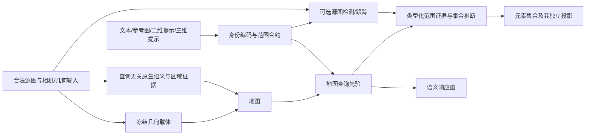

# RADIO-GS 当前成果与收敛方案

更新：2026-10-03，覆盖identity_response、有限证据与独立身份信息的完整对照。本文是当前研究状态的统一导航；保留历史实验记录，区分已完成文本运行与未完成多模态/紧凑目标。

**本轮56组完整场景评价已结束，独立身份核验没有通过默认替换条件。** [完整报告](experiments/2026-10-03-independent-referent-evidence.md)：保持几何/原生特征/SAM候选，新增源侧Qwen3身份判断；局部、上下文与三态规则分别为语义/集合70.04/67.11、69.90/67.00、70.23/66.96，原始默认70.38/66.66。能修复错误稀疏Waldo并保住正确纸巾，但整体仍有语义退化。NVOS八查询重建均86.4891%，没有增益。新增模型及视觉预算已单列，不能解释成等预算新求解器贡献。结果登记累计236份，全部任务结束；默认配方未改。

**本轮收敛的边界：区域级身份过滤不能代替像素范围和跨视角对应。** 紧裁剪丢失部件所属对象；完整源上下文能恢复部分正确部件，却不稳定改善全部查询。最后只排除综合身份矛盾、保留未知原证据的规则也未过关。停止继续提示词/上下文尺度/准入门槛搜索；下一阶段集中在身份明确后的源范围与可对应部分，独立源侧核验只作诊断，与自动成绩分开，再验证未调参场景。ScanNet本轮未重跑，UQIS仍暂停。

上一阶段24份有限证据对照均不推广：[报告](experiments/2026-10-03-finite-source-evidence.md)。错误Waldo集合0→73.23%，但原始整体语义/集合70.38/66.66→69.37/66.60；正确稀疏纸巾也被压制。因此本轮转向独立身份信息，结果如上；不重启置信度或原生先验权重搜索。

**已经得到可靠进展，但当前还没有一个同时完成全部 benchmark、四类查询、紧凑部署与新查询验证的统一版本。** 先整合有效实现，再验证方法贡献；工程修复不需要通过“新颖性”才能保留。

源尺度阶段登记156份，有限证据阶段180份，本轮236份。显式Scene/Query入口已完成四场景67文本＋1新文本的地图/源增强运行及冻结评分。复用冻结地图，未重训特征；当前identity_response文本默认语义IoU70.38%/AP87.64%，集合投影66.66%；旧identity语义50.59%为固定对照。仍不是全任务默认或独立SOTA结论。

**源尺度阶段结论（已完成）：增加视觉细节和更准确的身份测量仍不足以解决证据可信度。** [源尺度/直接身份完整报告](experiments/2026-10-03-source-scale-and-direct-identity.md)：裁块67.89/62.98、限定裁块观测域68.14/62.96，均低于默认；直接掩码身份70.91/67.07有小幅收益但有场景及定位退化，上下文70.52/66.70也未推广。一次仅0.504的错误waldo源检测足以把原集合68.08降至0：无相对身份否决不能当确认，源均值中单视角置信度会抵消，集合重复拟合也会放大弱证据。有限证据方向随后完成响应/集合联合对照，整体失败；继续停止裁块尺寸/上下文尺度/阈值搜索，不以最低视图数或query分支掩盖问题。

**范围阶段结论仍成立：范围包含关系与原生文本相似度不足以决定对象范围。** [完整对照](experiments/2026-10-02-query-scope-evidence.md)中，将父范围设unknown仅使语义+0.10–0.19pp、集合基本不变；将语义偏好父范围加入正例，语义/集合降至69.75/65.15。coffee改善却严重损伤bear nose、three cookies等，均不推广。全部67查询追踪还发现源证据遗漏与错误正身份同时存在；不再继续局部负例/面积门控搜索。下一机制必须具备与身份区分开的部件/范围证据，并经过未调参场景验证。该范围阶段未重跑NVOS/ScanNet；本轮NVOS重建状态见上方最新结论，UQIS暂停。

## 0. 本阶段已收尾：唯一入口、固定对照与明确取舍

**梳理/接口收敛完成；算法可靠性、跨benchmark整合与投稿目标仍未完成。** 当前阶段不再增加新的实验编号或逐query补丁。下一阶段从这里进入固定输入下的身份/范围验证。

|决策|固定内容|
|---|---|
|唯一可执行配方|`configs/recipes/current_research.json`；由启动器实际读取，不是仅供阅读的结果说明|
|唯一研究启动入口|`scripts/research/run_current_research.py`；从仓库根目录运行|
|当前默认|`identity_response`：语义70.38/AP87.64、集合66.66；简单源证据融合；仅LERF文本研究默认，部分query仍退化|
|固定对照|`source`，语义IoU50.59/AP86.05、集合投影64.12；作为后续改进的共同参照|
|对照/候选|`map`为直接地图对照；`regional`65.37为可选高均值候选；`calibration`55.54/AP84.69为校准对照；不组合最好列|
|输入|显式Scene/Query；已有冻结地图与声明源帧；原生地图两个全局标量的旧源词表训练来源保留|
|完整执行范围|四个LERF开发场景67个标注文本＋1个无标签新文本；重做推理不是重建几何/特征地图|
|尚未合并|全部场景小区域写入、可靠身份验证、同地图四query独立验收、ScanNet共同入口、紧凑化；UQIS暂停|

查看准确命令，不启动模型或评估：

```bash
python scripts/research/run_current_research.py --scene all --evaluate \
  --output output/current_research_new_run --plan
```

去掉 `--plan` 即从已有冻结地图重新生成源侧证据和全部查询预测，再评分；默认以`identity_response`依次运行四场景。可以用 `--scene ramen --gpu 0` 指定一个场景和显卡；`--profile map|source|identity|identity_response|regional|calibration` 明确选择已经分别评价过的配置。所有配置均不自动读取旧预测。可执行配方、结果登记和历史阶段配方各有角色，不再混称为“当前主线”。

**本阶段原定首要问题（执行结论见0.1）：源证据能否区分正确身份、错误身份与范围不完整。** 固定这条对照的几何、原生特征、源图和评价；先比较种子、轨迹及最终集合的错误，使用未参与对应决策的源视角验证。源侧模型判断只能是诊断伪证据，不能当独立真值。只有形成可对任意文本执行的规则后，才以全部67查询及未调参场景评价；不按query名称回填旧路线。可选校准和其他benchmark作为后续交付，不与这项主问题同时扩张。

## 0.1 下一研究阶段已完成：固定证据的身份与范围对照

[完整报告](experiments/2026-10-02-source-identity-and-scope-control.md)。五条件×四场景全部67文本重新评价，两个核心候选及一次身份规则修订。每五个源视角留出一个，地图仍用完整源图；不是新场景泛化。相同证据直接融合45.67、当前集合优化63.94、冲突负例弃权61.45、严格身份准入64.81、仅匹配后身份否决64.86。语义50.59/AP86.05均保持。

**上一阶段决策（本轮新规则见0.2）：source保持不变。** 身份修订只净增0.93pp，figurines63.11→68.77，但teatime72.78→70.33；toy cat19.69→69.78，bear nose79.36→20.52，不能按查询拼接。跨视角多数支持不能认证身份；区域低分也不能认证部件不属于目标。已完成该有界阶段，未通过稳定提升和新场景门槛。

下一步只集中在实例身份与部件范围不同粒度的证据可靠性：先核对实例再融合，同时避免把无匹配、教师不认识与确认不属于混为一类；补齐小区域承载。已完成的留出对照与失败案例直接复用，不重启碎片化阈值搜索。新阶段配方`configs/recipes/scope_evidence_control.json`，统一对照仍为上一节`current_research.json`。

## 0.2 条件化身份阶段已完成：新文本默认identity

[本轮报告](experiments/2026-10-02-conditioned-identity-integration.md)。12份新场景评估：同query检测实例原生分数的一/二分布证据比较，不能区分则不否决；没有区域对应则保留原检测。留出集合63.94→66.30，强制分组消融65.74。完整源图通过统一入口重算后，64.12→**66.66**，四场景69.97/58.27/74.92/63.48均提高。

新默认`identity`已在可执行配方中启用，旧`source`仍是固定对照。toy cat18.57→68.86、miffy15.01→58.47、bear nose75.02→76.98；bag12.31→0仍失败。语义IoU50.59/AP86.05不变。没有查询名分支、人工种子或父集合答案。评分与地图保持原合约，完整源实验显式复用了冻结的原生响应和SAM3输出。

**系统状态：已整合为一条可执行、完整重算且有文本收益的研究主线；不是最初四query/四benchmark/紧凑部署的完整系统。** NVOS/ScanNet共同入口、参考图与2D/3D提示在同一新地图上验收、新场景和独立三维验证仍未完成，UQIS暂停。身份分组不是身份真值，也不是本身足够支撑CVPR的贡献结论。

## 0.3 参考实例阶段已完成：NVOS接入同一入口与双读出

[阶段报告](experiments/2026-10-02-reference-instance-integration.md)。`run_current_research.py --benchmark nvos`现在读取显式参考实例Query，重新跟踪合法源图、拟合响应和实际集合，分别保存两种输出。八查询重放、fresh、typed评分均为86.4891%，逐查询IoU复现原高分。仍使用冻结的正提示SAM参考掩码，未重跑原始scribble→SAM，不是正负提示或纯图像query完成。

共享集合求解器的成员值若错作归一化响应，NVOS仅6.82%；实际取出的集合轮廓诊断85.08%。因此保留独立响应86.49与元素集合，固定读出语义，不能换阈值混称官方增益。32份完整队列评价已登记，文本默认identity未变。现在是同一CLI覆盖文本和正参考实例，不是同一地图四query完成；ScanNet接口、原生图像检索、3D提示、紧凑化仍待验证。

## 0.4 同地图图像和点提示阶段完成：能力边界已显式化

[阶段报告](experiments/2026-10-02-same-map-image-and-point-queries.md)。在现有ramen地图完成两个源侧探针×RGB图像、图像+掩码、3D点、等价2D点，共八次完整运行；统一入口新增`--scene-input`和`--query-input`。图像原生余弦仅作排序，源区域检索后跟踪；3D点通过可见Gaussian锚点转成SAM3点提示，之后共享响应/集合求解。

等价2D/3D集合一致性100%/99.99365%。但是纯RGB可能被背景中的碗主导，点可能只指向部件；增加显式前景输入改变目标识别，仍有范围扩张。这是源伪区域诊断，不是独立准确率，不计入112份benchmark报告。文本66.66和NVOS86.49为先前结果，未在本轮提升。四类入口不等于四query任务完整验收，ScanNet整合、独立3D、新场景和紧凑化仍待完成。下一问题是明确查询的身份和范围信息，再逐级验证种子、跟踪与最终集合；不能用扩大集合代替意图解析。

## 0.5 范围逐级定位阶段完成：跨视角证据有效，剩余错误类型不同

[阶段报告](experiments/2026-10-02-reference-scope-stage-localization.md)。八查询仅参考帧重建77.996%，全源跟踪86.489%，全部改善；这是当前机制消融，不是新增涨分。八查询源侧响应/实际集合对跟踪证据拟合94.27/93.07%，这些源掩码不是独立真值。orchids主要漏检（精确率99.91、召回68.00），trex同时有误检和漏检且源拟合较差，不能统一扩大范围。没有逐帧源真值，种子错误与跟踪错误仍无法严格分责。下一步分解独立目标上的几何支持/源正证据覆盖；默认方法与已有成绩保持不变。

## 0.6 漏检证据分解及有界修复完成

[阶段报告](experiments/2026-10-02-reference-evidence-coverage.md)。八查询诊断显示几何投影基本覆盖目标，但不代表边界准确。orchids漏检中24.22%无原始正证据、29.55%正证据因腐蚀消失；多数其他查询已有正证据却未形成足够输出。两组×八查询重建：中心线86.6568%、全部正例86.9899%，原方法86.4891%；全部正例提高召回但降低精确率，horns_center/trex退化，默认不变。这是连续响应的开发对照，不是完整双头更新或稳定新场景收益。下一步只集中区分跨视角正负冲突与Gaussian跨边界混合，不继续放宽腐蚀/阈值。

## 0.7 冲突分解与固定机制控制完成

[完整报告](experiments/2026-10-02-reference-conflict-decomposition.md)。八查询方差分解必须区分标签域：腐蚀后视角间冲突占多数，完整原始掩码则单视角Gaussian覆盖混合占58.58%–85.73%。这些是漏检位置的标签方差份额，不是因果错误比例。其他视角正支持降低负例权重的八查询控制86.4240%，低于原86.4891%，不晋级、不再搜索权重。下一步优先固定几何、按相同图像尺度比较光栅分辨率，以区分混叠和载体覆盖问题；当前未证明Gaussian拆分有效。

## 0.8 分辨率×求解步数完整控制结束

[阶段报告](experiments/2026-10-02-reference-resolution-control.md)。固定几何/教师/源图，边界半径随源分辨率同比例变化，24次新重建全部完成。原192×256/120步86.4891%，384×512/120步85.5732%，原分辨率480步86.4160%，高分辨率480步85.5395%。提高分辨率八查询均退化，延长求解未恢复；默认保持不变。完整掩码中的单视角混合仍存在，不继续预算和权重搜索。下一步检验单视角可表示性与多视角联合约束是否冲突，尚不能宣称拆分Gaussian已被证明有效。

## 0.9 单视角可表示性与共同拟合阶段完成

[完整报告](experiments/2026-10-02-reference-representability.md)。八查询302源视图、两标签域，604个单视角和16个共同拟合轨迹完成。完整掩码单视角99.239%、共同96.638%；已知域共同99.867%。trex完整域单视角99.139%、共同91.132%，优先指向共同证据/对应兼容性，不能仅因单Gaussian混合就认定必须拆分。完整域共同字段目标IoU86.581%，原86.489%，没有实质突破，默认不变。下一步集中查源范围正确性、完整性与几何对应，不再增加求解预算或全面放开边界监督。

## 0.10 响应融合整合完成：当前默认identity_response

[完整报告](experiments/2026-10-02-consolidated-response-integration.md)。本轮扩回四场景全部67文本＋1无标注输入，16份完整场景评价及两次ramen入口验证完成。此前源范围用于集合，却没有进入语义响应；简单可见贡献融合补齐这条链后，语义IoU50.59→70.38、AP86.05→87.64、集合投影66.66保持。四场景IoU/AP均改善。新默认identity_response，旧identity仍作固定对照。

逆渲染拟合70.75/AP86.58，主要收益已被简单融合解释；原生概率下界68.57/AP89.11体现精度取舍，均不默认替换。50查询改善、7退化、10不变，duckbuoy与coffee仍明显失败；没有逐query回填。不能将系统修复包装成新优化器或紧凑学生贡献。NVOS旧86.49保持、ScanNet无本轮结果、UQIS暂停。下一步围绕不完整范围的负证据可靠性和未调参场景验证，保留同一完整基线；停止只在NVOS局部权重上打转。

## 1. 当前结果：同一张表，明确不同来源

| 结果族 | 队列 | 当前记录 | 定位与限制 |
|---|---|---|---|
| next75 LERF语义图 |4场景|IoU66.9301%，AP84.1459%|原生写入＋源范围推断＋旧查询分布校准；不是地图直接读出或新紧凑学生结果|
| next80选中集合投影 |4场景|56.9226%|历史回退参考，同样是增量配方；不是统一稳定模型|
| next104选中集合投影 |4场景|62.5986%|保留参考；4查询更新、63查询继承|
| next107选中集合投影 |4场景|63.1135%|可选高均值候选；13查询更新、54查询继承，铲子明显退化|
| next74 NVOS |8查询|IoU86.4891%，AP98.0139%|独立的参考实例路线/地图；正参考提示、无目标RGB|
| next44 ScanNet |8场景|19/15/10类IoU59.2471/59.4852/73.2194%|体积加权Gaussian伪真值开发协议，不是公开点云/网格同口径成绩|
|新完整文本地图基线|4场景全部67查询|语义IoU50.59%，AP86.05%，直接选取44.80%|不读历史查询答案；全局标量仍用旧源侧监督拟合|
|新完整文本源增强基线|相同4场景全部67查询|语义同上，集合投影64.12%|统一重算，非继承；比next104高1.52pp，figurines退化|
|可选区域检索＋跟踪|4场景全部67查询|集合投影65.37%；语义50.59/AP86.05不变|四场景均值提升，sake/pour-over严重退化，不默认替换|
|可选源侧偏置校准|4场景全部67查询|语义IoU55.54/AP84.69；集合64.12不变|未与区域候选联合评价，不拼接最好列|
|新identity_response默认|4场景67标注文本|语义70.3775%，AP87.6429%，集合66.6617%|同证据简单融合；7查询退化，非独立SOTA|
| UQIS |暂停|无当前结果|按用户要求保持暂停|

这些结果不能拼成“同一模型的统一成绩”。LERF selected 指实际选中元素后的**二维轮廓投影**，不是独立三维真值IoU。ScanNet八场景与公开十场景及不同标签转移规则必须分别说明。四类query没有在同一张新地图上完成验收。

可复算结果索引：[research_consolidation.json](../configs/recipes/research_consolidation.json)。该文件是结果与依赖登记，不是训练/推理配方。

```bash
python scripts/research/summarize_consolidated_results.py \
  --output output/research_consolidation/results.json
```

此命令仅重新汇总112份已存在报告，不做新推理或预测重评分；其中16份来自完整文本基线及两项提供器/校准对照，20份来自身份/范围阶段，12份来自条件化身份整合，32份来自参考实例整合。结果为 `output/research_consolidation/results.json`。各报告的准确路径、统计字段与队列都在索引内。

## 2. 方法骨架与实际实现

共同研究方向：**查询无关地图保留几何和语义能力；按查询身份与范围类型接入证据；输出可真正选取的三维元素集合。** 基础地图应支持查询，可选源图增强补充证据。



这是收敛骨架，不代表所有箭头已经统一实现。当前新增在线路线具体实现 text_union 与 reference_instance；完整whole/part解析、同地图四query仍未闭合。`radio_gs/querying/typed_evidence.py`是可复用数值核心之一；LERF选取路径另由研究解码器实现，不能把所有benchmark包装成同一个已验收求解器。

- **几何**：LERF研究候选使用next66的RGB/MoGe相关冻结载体；NVOS有单独next72载体；ScanNet参考结果保留自己的输入与载体协议。不同benchmark几何来源不可隐去。
- **语义**：较强LERF路线使用原生高容量SigLIP特征及分辨率改进。保护原生能力有效，但当前文本实现具体依赖SigLIP；“任意VFM功能替换”尚不是完成的验证结果。
- **教师**：SAM3提供分割/跟踪证据；crop语义特征用于身份可靠性，不等同于每个元素的范围标签。当前在线成绩不能证明四教师紧凑蒸馏成功，也不能证明RADIO是必须的。
- **证据**：身份、已观测范围、可否排除和几何对应应分开表达。模型置信度、跨视角一致、面积多数都不是独立真值。当前三态支持仍不完整，部分教师补集会成为伪负例。
- **输出**：语义响应与独立选中子集必须分别生成和评价；未知范围不能因未检出就自动成为负例。

## 3. 哪些保留，哪些不合并

| 类别 | 收敛决定 | 实现/证据位置 |
|---|---|---|
| 输入覆盖 |消除历史阶段性源图上限，按每阶段合法源图表运行；不以“更多”替代权限核验|next72、75、79；`source_coverage_next72/*/cohorts.json`|
| 几何与写入 |保留已验证坐标/载体修复、冻结几何后重建、足够精细的写入；分辨率不是越高越好|ADR0008、next66/67/74/75|
| 更新域 |优化实际选中子集时，不因全场景遮挡而禁止已观察元素更新|ADR0011、next67、`decode_expanded_extent_next72.py`|
| 原生语义 |保留原生查询空间和能力；结构/范围更新不能无证据破坏语义排序|ADR0009、next54/75|
| 小区域 |取消不合理的固定整图面积剔除思想；保留原始掩码。next106的64像素补集只是有界控制，未全面部署|`encode_source_regions_next72.py`、`encode_small_regions_next106.py`|
| 候选保留 |不能让弱配对把单视角有价值候选直接抹去；解耦候选发现与对应认证|next86/88/106，尚需统一实现|
| 范围类型 |实例、类别集合、部件不能用相同并集规则；保留证据身份直到推断|ADR0010；完整实现未完成|
| 自动视觉示例 |next107仅保留为可选实验；不是稳定默认，不按查询成绩拼接|`discover_typed_sets_next107.py`|
| 不稳定变体 |不整合生成查询别名、最大连通块强替换、无条件范围并集、多个部件框、提示服从度门控、无证据增加教师/步数|next84–107相应受控结果|
| 历史紧凑场 |保留对照和代码；不能把其功能或参数量移接到在线高容量结果上|原HGCF/哈希branch/96D路线，历史文档保留|

next107完整24场景控制：相同核心基线62.2365→文本发现62.6333→单框视觉示例63.1135；多部件框63.0701，提示服从度62.6114，保留未知扩展62.6148。相同Box证据直接投影57.5694，比包含渲染优化与正则的完整路径低5.5441个百分点。它支持集合优化的实践价值，尚不单独证明新颖性。

收益与失败一起保留：塑料勺0→48.87（纯文本已47.02），清酒杯77.03→87.09；铲子相同核心基线40.17→16.49，旧洋葱身份仍错。不得把next106洋葱单例与next107其他查询事后拼接，宣称完整新模型。

## 4. 查询访问方式：共享架构，明确不同承诺

| 模式 | 查询阶段访问 | 当前收敛要求 |
|---|---|---|
| 地图＋声明的query输入 |地图、query编码器、本次参考图/提示|不扫描额外场景RGB；提供参考图本身不违反此模式|
| 地图＋源侧缓存 |额外逐视图特征/掩码/区域字典|明确缓存是部署组成，不藏进“仅地图”说法|
| 源图增强 |协议允许的源RGB、检测/跟踪/临时优化|合法研究路线，完整记录额外调用与冷/热查询成本|
| 目标图辅助二维读出 |当前评价视角RGB|仅在相应协议允许时单列；不能并入三维选取成绩|

先完整比较前述地图与源图增强两条路径，再讨论按需自动切换。不得按目标IoU或查询名称选择路径。官方允许输入的系统比较与相同证据/预算的机制比较是两类问题，不能互相替代。

NVOS参考提示不等于必须使用SAM；LUDVIG的NVOS SAM路径在线访问多视图，而LERF SAM配置直接访问被评估图像RGB；ScanNet uplifting阶段用源图不等于查询阶段再次扫描源图。源码依据：[NVOS](https://jason718.github.io/nvos/)、[LUDVIG SAM](https://github.com/naver/ludvig/blob/main/predictors/sam.py)、[LERF评估](https://github.com/naver/ludvig/blob/main/ludvig_clip.py)、[ScanNet流程](https://github.com/naver/ludvig#open-vocabulary-semantic-segmentation)。这里只说明访问差异，不作新的同协议排名。

## 5. 真实依赖：为什么还不能称为统一入口

`decode_expanded_extent_next72.py`现在读取：

| 输入 | 是否与query有关 | 去历史答案依赖时如何处理 |
|---|---|---|
| next66geometry、next72RGB/相机/通用掩码 |查询无关|可合法复用，显式成为Scene输入|
| next75语义产物 |包含查询无关特征，也包含固定查询读出|拆开字段，不能整个payload都当查询无关地图|
| next53 `typed_readout.pt`分数分布 |查询相关|next75最终语义校准也依赖它；不能视为新query通用校准|
| next38 `scores.pt`排除参考 |查询相关|由当前query在线计算替代，不能换个路径名继续隐藏|
| `initial['texts']`、已有query encodings |固定查询列表|由本次Query输入建立，不按历史下标查找答案|
| next44 `identity_<frame>.pt` |查询相关检测|按当前query及权限生成，历史缓存仅作可重放结果|
| next63回退轨迹 |查询相关|不相关查询不加载；缺证据显式弃权，不偷偷继承旧答案|
| next98/104 retained selection |历史预测|保留作对照；完整新构建必须全query统一生成|
| next103判定/next104种子及轨迹 |查询相关伪证据|明确提供器与生成规则，不视为独立人类真值|

因此，旧默认入口仍是有历史依赖的实验链。新增显式输入分支和统一文本入口绕开这些依赖，见第6节。`evaluate_scope_dictionary.py`也从旧evaluation目录读取已编码query。统一入口不能只是一层包装器。

### 5.1 本次补充定位：语义成绩也有查询历史依赖

`rebuild_expanded_semantic_next72.py` 写入的 `native_field.pt` 保存查询无关的1536维区域融合特征，同时保存两个在旧源侧查询检测上拟合的全局校准标量。特征写入不消费查询语义；标量训练却使用旧词表，不能称整个文件的训练完全查询无关。

随后 `refine_joint_semantic_next66.py` 使用 next44 每查询检测修正分数；`align_joint_semantic_next66.py` 又把各查询分数按源视图可见质量映射到 next53 同查询的旧分布。**因此66.9301%属于这条完整旧链，不能转贴给原生地图直接读出。** 这不是发现了测试真值泄漏，而是发现了新查询无法直接复用的运行依赖。替换这层校准必须重新评价。

### 5.2 已拆出的最小可执行入口

- 数值核心：`radio_gs/querying/native_map_response.py`。
- 命令入口：`scripts/research/query_consolidated_map.py`。
- 显式场景与文本：`configs/consolidated/*.scene.json`、`*.queries.json`。
- 输入仅为声明的原生地图、SigLIP编码器、本次文本；不读取旧预测、固定查询encoding、轨迹、源RGB或标签。
- 输出 `response.pt` 保存余弦和语义概率、几何绑定、观测支持；**不伪造已经完成的集合解码**，不导出 `selection_scores`。
- 仍复用两个已拟合全局标量，并在配置明确其源侧旧词表训练来源。没有按新query拟合参数。

```bash
PYTHONPATH=. /root/miniconda3/envs/cybersim_agent/bin/python scripts/research/query_consolidated_map.py \
  --scene configs/consolidated/ramen.scene.json \
  --queries configs/consolidated/ramen.new-query.json \
  --output output/research_consolidation/native_map/new_query
```

使用已有 cybersim_agent 原生编码器环境；此入口不调用SAM。场景描述保留源图权限文件路径供后续增强提供器使用，当前入口不打开它。`intent` 记录任务要求，当前语义响应不执行类别集合/实例/部件的范围推断。

### 5.3 实际运行结果

四场景全部67文本查询（21/14/14/18）已使用同一入口重新编码并产生完整原生地图响应；另完成1个没有历史预测输入的新文本查询。输出位于 `output/research_consolidation/native_map/`，汇总为该目录的 `execution_summary.json`。所有响应有限；运行未读取历史查询预测。单场景批处理耗时约25–88秒，包含模型/地图加载和输出，在并行任务下测得，不是受控延迟比较。

独立的数值比较在推理结束后读取历史原生响应：验证旧文本的编码兼容性与地图数值，没有把旧预测用于生成新结果。对应编码余弦接近1，原生分数差异约浮点存储精度量级；这不是与next75最终66.93%后处理输出等价。

新查询 `a small piece of food resting on a plate` 最高概率0.4742，按旧0.5阈值没有正响应元素。其余弦和连续概率已正常产生，该项是仅地图对照；后续源模式已完成集合求解、输出946个元素。因为没有真值，**仅证明新输入可贯穿两种模式，不证明召回成功**。旧词表拟合的全局标量是否适用于开放文本，仍需与排名/范围分别验证。保留这个结果，不换容易的新查询制造成功。

## 6. 统一文本入口与下一步落实边界

`run_consolidated_query.py` 现在提供 `map` / `source` 两个模式。源侧模式从相同原生地图出发，按本次文本逐一读取全部声明源图，直接生成SAM3区域，再调用实际子集渲染求解器。没有父版本选取列、隐式旧轨迹或历史查询分布传递。明确传入 `--response` / `--evidence` 可以重放本次中间产物；不自动查找历史答案。

```bash
PYTHONPATH=. /root/miniconda3/envs/cybersim_agent/bin/python scripts/research/run_consolidated_query.py \
  --scene configs/consolidated/ramen.scene.json \
  --queries configs/consolidated/ramen.integration-queries.json \
  --mode source --output output/research_consolidation/rebuild_ramen --gpu 0
```

源模式输出 `sets/lerf_ramen/typed_readout.pt`，保留语义概率并另外输出集合成员概率。地图模式只输出语义响应；评价时可显式指定 `--direct-map`，用相同0.5阈值形成直接地图子集对照，不冒充经过范围优化的结果。

评价通过 `evaluate_consolidated_query.py` 调用共享的 `radio_gs/evaluation/lerf_readouts.py`。函数从已有评价器提取，保留相机、归一化、阈值和GT路径；旧评价器也调用它。用next104 ramen结果重放，语义IoU/AP/定位和集合投影IoU全部精确复现。评分与生成独立运行。

**这是统一的文本整合基线，不是宣称历史所有有效改进已合并。** 当前源提供器只使用直接文本检测；缺检测时保留本次地图先验，而不是旧答案。区域检索和参考跟踪现已接为可选通用提供器，但top1身份未独立确认；小区域补集仍没有全量进入地图构建。

接下来依次完成：

1. 通用区域检索/跟踪已接通并完成四场景对照；接下来分离种子身份错误、跟踪漂移和整体/部件范围错误。不能把原生top1或跟踪一致当作确认身份。
2. 源侧留出视角偏置校准已运行，但AP下降，仍不默认使用。分开处理标签正确性与校准对渲染排序的影响；不恢复next53旧查询分布。
3. 固定相同源证据和预算，分离简单聚合与集合优化的贡献，再做未调参场景验证；全源图收益不能冒充新机制贡献。
4. 将NVOS/ScanNet各自输入和评分合约接入共同接口，再完成同地图多模态、紧凑化与公开同口径对比；UQIS仍暂停。

本次收敛不改变输入权限、GT协议，也不承诺四query或SOTA已经成立。

### 本次完整收敛结果

已完成全部四场景的统一规则重建与评价。直接地图选取44.80%→源增强64.12%；next104历史参考62.60%，next107可选参考63.11%。新结果逐场景为figurines63.35%、ramen57.09%、teatime73.16%、kitchen62.89%；相对next104三升一降。所有新结果的语义分数与几何绑定保持一致，没有填入父版本选取列。

新地图语义IoU50.59%、AP86.05%，与旧最终链66.93%/84.15%必须分别报告。这里是一个完整自动文本基线，但不是同时保住旧语义定位与全部细粒度身份能力的最终方案。新查询也完成源侧推断、输出946个元素；无真值，不计入指标。

详见[完整运行报告](experiments/2026-10-02-consolidated-text-runtime.md)和`output/research_consolidation/full_execution.json`。小区域写入、身份/跟踪的可靠性、无损开放文本校准及其他benchmark的统一接入仍待落实。保留旧路线作回退，不按查询赢家拼接。

### 提供器与校准接口的后续收敛

`--regional-fallback`已完成四场景、9个零检测查询的自动区域检索/全源跟踪，并全量重新求解全部query；宏平均selected64.12→65.37，四场景均值都升，但sake46.37→11.16、pour-over34.32→0。`--source-calibration`另行完成四场景：语义IoU50.59→55.54，AP86.05→84.69；集合精确不变。两个候选独立评价，不默认组合，不按query拼赢家。

源侧图库显示清酒杯种子落在瓶状物上，这是至少一例在几何求解之前的身份错误。不同视角对同一伪标签的拟合一致，仍不能证明目标正确。接口梳理与两候选完整验证已收尾；后续问题集中为身份和范围证据可靠性。完整证据见[提供器对照报告](experiments/2026-10-02-consolidated-provider-controls.md)。

## 7. 当前导航

- 本文：当前统一事实、收敛边界与下一个交付。
- [结果登记](../configs/recipes/research_consolidation.json)：各族准确路径与协议。
- [研究计划](../paper/CVPR_RESEARCH_PLAN.md)：贡献问题与论文证据缺口。
- [ADR0007–0011](adr/)：语义地图、冻结几何、原生语义保护、类型化证据、独立集合输出。
- [提供器完整对照](experiments/2026-10-02-consolidated-provider-controls.md)：最新两候选的收益与失败。
- [next107历史报告](experiments/2026-10-02-set-discovery-transfer-next107.md)：此前的迁移和同证据对照，不是当前统一入口。
- `CONTEXT.md`：保留完整实验时间线，不把每条历史候选都当默认方法。
- 旧README章节、`PROJECT_MAINLINE.md`、旧论文稿：历史路线资料，不再作为当前实现完成状态。

## 8. 收敛结论与落实边界

当前只保留一条研究骨架：**冻结几何＋原生语义地图＋显式查询＋可选源侧证据＋独立集合求解**。高容量路线先承担机制验证，紧凑多教师学生保留为后续必须验证的目标。方法定位不再随单例结果变化。

| 内容 | 本次收敛后的状态 | 下一步处理 |
|---|---|---|
| 结果与协议 |已统一登记、可复算；四benchmark结果仍属不同谱系|不再跨谱系拼成绩|
| 全源视图、冻结载体、原生写入 |可复用产物与实现已找到；不同阶段实际源数仍需显式传入|统一构建入口沿用，不重新引入默认20帧|
| 原生文本地图读取 |已独立成Scene/Query入口|作为统一运行的原生对照，不继承66.93%|
| 源侧身份、跟踪、集合优化 |直接文本、区域top1、参考跟踪、集合优化均已通过显式接口运行|仍需可靠身份与完整范围机制；不继承旧query答案|
| 小区域与候选发现 |已证明历史筛选会丢信息；只在局部补集实验中实现|并入通用源区域构建后再报告完整收益|
| Box、多框、VLM与各门控 |保留实验记录；没有证据支持全部串联|不纳入默认路径，不按查询拼接赢家|
| NVOS、ScanNet |保留独立有效实现及其输入/评分约定|随后接同一接口；当前不声称共享新地图|
| 四query、紧凑化、公开排名、新场景 |尚未完成|与当前成绩严格分开；UQIS继续暂停|

成果梳理、取舍与实施顺序已收敛，源侧证据与集合求解已接入显式输入。**统一文本整合基线和历史高分路线仍需分开；接口层区域检索/跟踪及源侧校准已完成对照；可靠身份、完整范围、无损校准及跨benchmark多模态整合仍未完成。**
