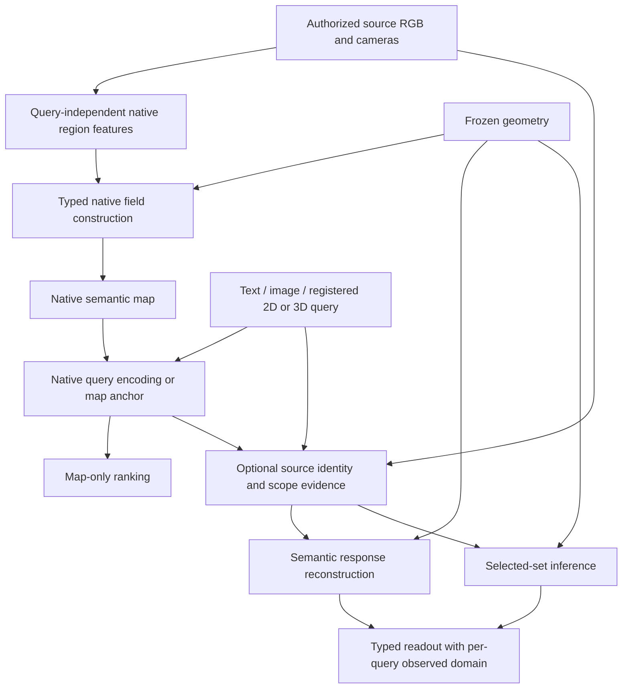

# Current executable system

The public entry is `python -m radio_gs.pipeline`. It consumes explicit Scene
and Query JSON, rather than discovering a historical experiment from its name.
The capability description is `configs/pipeline/current.json`; the executable
inputs are Scene/Query JSON and `PipelineConfig`. The current complete recipe is
`configs/pipeline/system_v8.json`, whose31 executable jobs completed in
`output/system_v8/summary.json`. Earlier recipes remain executable comparators.
The complete post-scope-study replay is
`output/system_v8_all_benchmarks_replay_20261005/summary.json`; all31 predictions
and evaluators finished without changing the recipe. The companion
`common_comparison.json` reports final-output purity/coverage separately by task.

## Shared mainline and strict four-query evaluation

[ADR0012](adr/0012-common-observation-architecture-and-query-contracts.md) defines
the common architecture: frozen geometry, native identity, regional membership
and visibility, and task-specific set inference. The actual numerical core
`radio_gs.querying.observation_readout` is called from dense native fields,
compiled ScanNet region priors and registered UQIS mesh queries. Source-assisted
LERF/NVOS retain their typed rendered-evidence and actual-set solver. A class
partition, category union and particular instance have different output contracts.

The cohort runner now completes all31 predictions before evaluation: LERF4 with
two outputs, NVOS8, ScanNet10 and UQIS9. `--benchmarks uqis` runs only the complete
UQIS cohort when appropriate. Access is declared per job, not inferred from a
benchmark name to grant additional photos. UQIS is strictly map-only.

The [evidence convergence study](experiments/2026-10-05-evidence-domain-and-instance-reliability.md)
adds an explicit public instance-reliability reducer. Its positive weights retain
the owning observation; complement confidence remains a separately declared,
uncalibrated policy. The tested source variants are not promoted over v8.
`SurfaceConsistency.readout` now returns unary ranks and a separate boolean MAP
set by default. Historical `map_conditional` scores require explicit configuration;
they are not posterior marginals. Point membership calibration evaluates all
deployment candidates while training still excludes unlabelled vertices.
The point-only learned head still does not constitute shared four-query training.

The optional `pipeline.regional_context_map` compiles unmasked tight-crop and
expanded-context SigLIP descriptors alongside the unchanged object features.
`text_context_identity` selects an explicit research identity rule; it does not
rewrite semantic coordinates, memberships or the other three query rules.
Both full context candidates failed to improve text set IoU and remain disabled.
`save_identity_evidence` exports query/region scores for separate post-prediction
diagnosis. Oracle seed/category scripts are evaluators, never query providers.
See the [identity study](experiments/2026-10-05-native-context-and-identity-bottleneck.md).

`radio_gs.pipeline.registered_observation_map` builds UQIS maps using only legal
mapping observations. These store native SigLIP descriptors, sparse regional
membership, visibility and element transfer. `registered_observation_query`
encodes text/image or obtains a camera-ray/3D anchor on that same map. It reads
no source RGB, depth, teacher masks or target labels at query time. The image
query's own reference crop is its explicit input.

With `PipelineConfig.instance_scope` / `--instance-scope`, the query-independent
`InstanceObservationScope` operator selects the native-identity seed and uses
one-hop co-visible correspondence to recover scope. It adds positive support
without clearing native responses outside partial regions. Independent bool
element sets use the seed or confidence-weighted visible majority; point queries
retain anchor co-membership. Full native, anchor and seed-only controls are also
emitted. No fitting or target-specific routing occurs. Spatial-language relation
reasoning and mixed-region membership correction remain incomplete.

Two optional scope providers now share the same registered query entry:
`witnessed_observation_scope` uses independent third-view containment, and
`entity_observation_scope` binds unchanged native identity to an offline entity
prior. The latter can be compiled by SAM3's generic concept path or the cached
FC-CLIP/Mask-Adapter full panoptic model. Four complete UQIS comparisons are
finished; none is enabled in v8. Larger scope increased false membership.
See [scope results and limits](experiments/2026-10-05-uqis-entity-range.md).

`radio_gs.benchmarks.uqis.evaluate` preserves the original four AP metrics and
optionally scores `--selections` as actual element sets. It reports per-modality
IoU and same-target four-query success. Cross-modal target pairing is evaluator
information only. Rank scores are not calibrated probabilities, and their old
fixed-cutoff diagnostic is not the new explicit-set result.

UQIS v7 AP text/image/2D/3D is26.596/39.433/52.745/52.359%; actual IoU is
16.387/28.599/42.090/41.524%. Same-target all-four IoU>=.5 is only8.995% under
scene-macro averaging. All9 scenes are opened development, not final test.
UQIS uses official-mesh/RGB-D-assisted geometry; no compact student or identical
input-track claim across all tasks. See the [complete experiment](experiments/2026-10-04-common-system-and-uqis-instance-scope.md).

The v8 default adds bidirectional native local appearance **identity** for image
queries, while retaining that original semantic field and scope decoder. Image
AP/actual IoU are44.034/34.876%; the other three modalities remain unchanged.
All-four IoU>=.5 rises to10.384%, still far from unified high accuracy. All31 jobs
have been freshly rerun; public tasks retain their accuracy. Four UQIS readouts
exactly reproduce the isolated candidate, including every actual set. This is a
development promotion with2852.81MiB of map arrays, not independent final accuracy
or a compact student. See the [fixed comparison](experiments/2026-10-05-uqis-local-correspondence.md).

## Retained and optional category mechanisms

The [completed local membership/member identity study](experiments/2026-10-04-local-observation-membership.md)
adds two opt-in, query-independent builders: `pipeline.local_membership_map`
and `pipeline.member_identity`. They operate on registered mesh and compiled
Gaussian observation maps, with each teacher retaining its native coordinates.
The first reweights overlapping region membership using emitting-view-excluded
features; the second preserves the original transfer/masks and corroborates
identity with descriptors of actual members from other views.
`querying.observation_readout.corroborate_identity` is shared by the instance
and category readers. All71 automatic jobs are complete; both mechanisms fail
the full comparison and are disabled by both v7 and v8 assets. In particular,
semantic competition weights must not be interpreted as foreground probabilities.
These are explicit research controls, not a second promoted mainline.

The bounded instance study additionally compiles query-independent physical
hypotheses (`pipeline.observation_hypotheses`) and view-exclusive mutual tracks.
They keep all original supported regions; no semantic edge or candidate cap is
introduced. A separate `pipeline.region_appearance` builder adds native DINOv2
patch-pooled region descriptors to the same geometry/membership map. Its image
query reads only its own reference crop. Teacher dimensions remain independent;
`mean_native_identity_ranks` can combine ordinal identity evidence without
projecting teacher coordinates or using it as foreground probability. These
options require explicit map declarations and do not alter the frozen v7 maps.
The exact fixed comparisons are in `configs/recipes/uqis_observation_hypotheses.json`
and `configs/recipes/uqis_native_appearance.json`. New teacher weights, descriptors
and compilation cost count toward deployment; none establishes a compact student.

`pipeline.local_appearance_map` additionally retains every native DINO patch and
sparse region-to-patch area weights from the same legal source frames. It neither
changes geometry/membership nor adds source views. `querying.local_appearance_match`
compares an image query's own patches with each regional observation, using either
bidirectional nearest-patch similarity or mutual-nearest-pair mass and similarity.
All patches and regions participate; the 16-region chunk is only a memory batch.
These scores replace pooled appearance **identity** evidence in the existing
equal-native-rank reader, never regional membership probabilities. Text, point
queries, the original SigLIP field, and the scope decoder remain unchanged.
The map declaration `image_local_match` selects the operator. The bidirectional
(`chamfer`) mode is enabled uniformly for image queries by v8; reciprocal matching
remains a research control. The complete pooled/patch comparison is
`configs/recipes/uqis_local_appearance.json`.
This is a high-capacity correspondence representation: retained patch arrays and
shared teacher weights are deployment cost, even though no source RGB is read
at query time. Mutual patch similarity alone does not certify instance identity
or consistent 3D correspondence.

`models.referent_language` provides an optional query-only role encoder using the
existing local Qwen3 runtime. It separates a target phrase from landmark phrases
and explicitly records unresolved language. These plans are generated from the
current query, never from scene images, evaluator labels or cross-modal pairings;
precomputed plans count as query preprocessing, not query-independent map data.
The registered provider also generates a plan for a fresh unparsed query.
`querying.referent_identity` compares target/landmark phrases in the original
SigLIP space. The optional relation energy marginalizes every supported landmark
candidate using the checkpoint's native logit scale, physical distinctness and
extent-normalized distance/vertical order. World-z is the registered up axis.
It has no top-k cap and is not a calibrated probability. The original full-query
semantic field, native controls, geometry and scope decoder remain unchanged.
These `text_identity` modes are research alternatives, absent from v7. Their
fixed comparison is `configs/recipes/uqis_referent_identity.json`; additional
language-model weights and parsing time must be counted. Language parsing and
partial-region geometry can both be wrong; executing a plan does not certify
that all instance relationships in the original sentence were understood.
The [complete role/relationship study](experiments/2026-10-05-uqis-referent-identity.md)
finished four cohorts and rejected all replacements. The final control retained
the full expression and used `positive_support_rank(s,p)=s+s*(1-s)*p` instead of
a log relation penalty. This shared primitive also factors the identical existing
scope formula; retaining a score floor does not guarantee correct identity or
better ranking. No role/relationship option is enabled in the default recipe.

The completed [individual-region study](experiments/2026-10-04-region-observation-identity-transport.md)
adds `radio_gs.pipeline.region_observation_identity` and an opt-in categorical
reader `radio_gs.querying.region_observation_vote`. `source_region_observations`
declares source-derived descriptors/masks/graph; `source_region_mode` selects
matched emitter, native, verified-instance, verified-union or linked-verified
controls. Links use reciprocal co-visible geometry, then transport identity once;
no masks grow or merge across views. The main native field remains unchanged.
Exact-mask coalescing may retain multiple emitting labels, but almost all nodes
have one. Multiplicative name verification therefore cannot relabel most nodes.
All78 evaluations complete; neither candidate beats v6, so no default enables it.
This is not a four-query instance reader or a calibrated identity estimator.

The optional local category reader is implemented in
`radio_gs.querying.local_element_fusion`. It aggregates positive, negative,
unknown and visibility statistics at each element/query pair before a shared
16/20-input,32-hidden residual head. `local_element_checkpoint` selects the
supervised single/dual-native reader or its scene-level pooled control;
`local_auxiliary_scene` declares the second query-independent native dictionary.
Both teachers use the same declared entropy-weighted region readout, each with
its own native text encoder. Features are formed over the complete mutually
exclusive category menu before batching. No category or scene ID is a feature.
No-source-evidence positions retain the original logits; native descriptor and
query coordinates remain frozen, but the learned residual can change rankings.
This is an extra label-supervised categorical reader, not a compact student,
general single-query scorer, instance selector or calibrated quality estimator.
`local_element_control=average_prior` instead equally averages the two native
probability priors inside the unchanged visibility vote, without fitting labels.
It retains the SigLIP fallback where source evidence is absent. The second
dictionary, pretrained encoder and source caches all count toward deployment.
The equal-native-prior path is enabled by v6 for ScanNet after original10,
development6, reserved3 and full22-job evaluation. The learned residual heads
remain research controls and are not selected by any default scene.
See [methods, complete results and remaining limits](experiments/2026-10-04-local-element-and-dual-native-fusion.md).

The optional [consumed-element reliability study](experiments/2026-10-03-consumed-element-reliability.md)
adds frozen category-union semantic statistics to the quality head and compiles
all view-to-element numerator/denominator contributions for differentiable fitting.
Its loss uses the actual point-to-element evaluation mapping, not just per-mask
quality. Scene `source_region_identity` supplies full-menu native compatibility;
`source_reliability_checkpoint` selects a linear or32-hidden shared head. After
retrieval training, its outputs are evidence weights, not calibrated mask quality.
All geometry/teachers remain frozen and v5 is unchanged. This is a separately
label-supervised category-partition branch, not a general free-query/compact field.


The optional research reader `source_region_grounding` is **not enabled in v5**.
Region and direct-pixel positive-only identity updates completed all10 ScanNet
scenes, but provided no substantial final gain. They read declared source masks;
their intermediate output is source-assisted and never replaces `native_logits`.
See [complete comparison](experiments/2026-10-03-positive-region-grounding.md).

The completed [scope/identity study](experiments/2026-10-03-scope-granularity-and-source-identity.md)
adds opt-in complete-category readers and `radio_gs.pipeline.category_union_identity`.
It encodes each declared category union rather than an isolated detected part,
preserving native descriptors in a separate source-assisted cache. It is not a
map asset or an instance-query operator. Full-menu ambiguity, union identity and
emitting-label/native-label controls precede query batching. None is enabled in
v5: the best complete candidate gains only0.47pp19, and direct native relabelling
substantially regresses. These readers are not applied to LERF whole/part queries.

The opt-in [task-trained region readout](experiments/2026-10-03-task-trained-region-readout.md)
adds an external frozen Mask-Adapter / same-backbone plain-pooling pair, without
changing v5. `adapter_observation_field` rebuilds query-independent descriptors
for every existing region, retaining the identical sparse W. Its scene specifies
`category_query_encoder` so query text uses the correct ConvNeXt CLIP space;
SigLIP's default text path remains numerically unchanged. These research maps
are category dictionaries, not an annotated four-query/compact-student result.
The research `source_negative_policy=unknown` removes only outside-mask negative
votes after the original positive confidence assignment. Full old/new-map controls
both fail to improve final accuracy, so this policy remains inactive.

The subsequent [70-scene source study](experiments/2026-10-03-source-likelihood-and-resolution.md)
adds opt-in `source_observation_model=diagonal|full` (whole-view-excluded native
anchors and detector error rates) and `union_verified_categories` (scope/identity
agreement). They do not pass full19-class promotion. A complete paired-resolution
candidate shares SAM outputs and identities between96x128 and192x256 source
rasters, keeping the same frozen learned map. The latter gives60.653474%19,
only+0.379926pp over its matched low control; v5 stays unchanged.

`source_streaming=true` implements the matched-budget visibility vote one view
at a time, commuting the per-query scalar normalization after linear accumulation.
It is used by the paired-resolution configurations with `detector_matched_mass`,
full positive/negative evidence and no spatial/ambiguity gates. It is not the
implementation for other fusion policies. This removes simultaneous view-operator
storage without dropping any view. The complete low-resolution replay has zero
point-prediction differences. Source records may declare `boundary_radius`;
the paired high-resolution records use2 versus the default1. Map and geometry
are unchanged; this improves source sampling, not teacher identity or compactness.

The [independent-room scope-quality study](experiments/2026-10-03-supervised-scope-quality-independent-rooms.md)
adds an explicitly supervised opt-in `source_reliability_checkpoint` to the
streamed category reader. Ten statistics feed22 learned parameters predicting
scope precision and visible category recall. `source_reliability_mode=typed`
weights positive/negative evidence separately; `shared` uses their geometric mean;
`shared_matched_mass` uses a common weight with the identical known-pixel evidence
mass. All use the same frozen checkpoint. None changes native encoder coordinates,
field descriptors, geometry, or the default v5 configurations.
Nine official training rooms provide labels; the new3-room,554-view comparison
does not establish a useful typed-over-shared gain. Retain research status.
Label-using quality diagnosis is isolated under `label_using_diagnosis/`, with
no deployment scene configuration reading it. It is not a reported method score.

## What is shared

1. A frozen geometric carrier, cameras and an explicitly permitted source set.
2. A query-independent native semantic field on the carrier. Source-region
   descriptors retain the pretrained encoder's coordinates. Queries do not train
   an unconstrained adapter that can destroy unseen semantic relations.
3. Typed queries: text category/union, image reference, registered 2D prompt and
   registered 3D prompt. These share elements, but do not imply identical targets.
4. Optional authorized source observations for identity and extent. Query-time
   photographs/models/caches are part of this mode's inputs and cost.
5. For set/reference tasks, separate semantic response and actual selected-set inference. A high rendered
   semantic score is not proof that removing the selected elements extracts the
   right object.

This is a coherent implementation of the semantic-field and typed-readout
direction. It is **not yet the original compact, learned multi-teacher universal
field**: the current native semantic provider is SigLIP, SAM contributes source
scope/structure, and the successful online path still uses photographs and
tracking. RADIO/DINO capability retention is not established by these results. The NVOS
reference adapter uses geometry and source tracks without a native feature asset;
its accuracy is not evidence that the semantic field helps that benchmark.



## Building the map

`radio_gs.pipeline.region_teacher` encodes every nonempty generated SAM region
from every declared source frame. It has no additional area or frame-count cap.
This removes a historical mismatch in which small regions could support source
identity decisions without ever entering the base semantic field. Coverage is
still limited by the source images, SAM proposal generator and raster resolution;
“no area filter” does not imply complete object proposals.

`radio_gs.pipeline.native_reconstruction.NativeFieldAccumulator` is the retained
LERF and v2 ScanNet writer. It normalizes the mean of overlapping region descriptors at
each pixel, applies the frozen Gaussian contribution operator's adjoint, then
normalizes per-element features. `build_map` provides the explicit LERF camera
adapter; `scripts/research/build_scannet_native_map.py` uses the same writer for
the frozen ScanNet comparator. Neither reads evaluation labels or stored query predictions.

This retained simple writer can mix whole-object, part and background semantics.
It is a reference mechanism, **not a claimed solution to semantic bleeding**.
More proposals must be evaluated, not assumed to improve it.

```bash
PYTHONPATH=. /root/miniconda3/envs/cybersim_agent/bin/python \
  -m radio_gs.pipeline.region_teacher \
  --scene configs/pipeline/reconstruction/ramen.json --output output/my_map/regions
PYTHONPATH=. /root/miniconda3/envs/cybersim_agent/bin/python \
  -m radio_gs.pipeline.build_map \
  --scene configs/pipeline/reconstruction/ramen.json \
  --regions output/my_map/regions --output output/my_map/map
```

Geometry is explicitly supplied, not reoptimized by these commands. LERF uses
the retained MoGe/RGB carrier; ScanNet's new track uses the supplied unlabelled
mesh. These are different permitted-input tracks. The LERF binary response uses
two frozen, source-trained calibration scalars declared in the reconstruction
configuration; feature construction is query-independent, their original
training was not. This distinction also applies to claims of rebuilding from
scratch.

The current ScanNet category field instead uses `radio_gs.pipeline.observation_field`:
it stores original native region atoms and a sparse alpha-based transfer. Runtime
uses `p=softmax(100 * F @ Q.T)`, `r=1-H(p)/log(C)`, then `W(r*p)/W(r)`
(with the original distribution retained if weight is zero). Original element features/masks/cameras are not
read for this prior. Construct from a declared v2 source scene with:

```bash
PYTHONPATH=. /root/miniconda3/envs/cybersim_agent/bin/python -m radio_gs.pipeline.observation_field \
  --scene configs/pipeline/scannet_native_complete/scene0062_00.scene.json \
  --output output/my_observation_map
```

This categorical representation is not a validated replacement for overlapping
whole/part or reference-instance readouts. Teacher `--crop-policy natural` exists
for the completed input control, but is not active: it degraded native priors.

## Reading one map with four query types

```bash
PYTHONPATH=. /root/miniconda3/envs/cybersim_agent/bin/python \
  -m radio_gs.pipeline --scene output/same_map_queries/probes/scene.json \
  --queries configs/pipeline/ramen.four-query.json \
  --access map-only --output output/my_map_queries --gpu 0
```

Map-only text/image queries use the native text/vision encoder. A 3D prompt reads
the nearest supported element; a 2D prompt reads a contribution-weighted feature
along the registered ray. Signed prompts form a positive-minus-negative feature
direction. **Image/point outputs are similarity rankings, not calibrated object
masks or hard prompt constraints.** Text only has a probability output when the
scene explicitly supplies calibration. No source RGB is read in this mode; a
user-supplied image query is itself an allowed input.

Changing `--access source-assisted` executes native text identity admission and
source detection, or reference retrieval/anchoring and source tracking. It then
reconstructs both readout heads. Without replay flags it executes providers
fresh; `--source-evidence`, `--native-response`, `--reference-tracks` explicitly
reuse observations, not fitted historical answers. Sources are restricted to the
declared authority. Text means a category union; image/point currently mean a
reference instance. Source-assisted 3D prompts currently use one positive anchor;
they do not implement the complete signed 3D prompt task.

`radio_gs.querying.reference_response` shares reference reconstruction between
the deployed runtime and correspondence experiments. Unknown observations are
kept separate from negatives. Neither repeated views nor native semantic
agreement establishes independent physical identity truth.

Read one query with:

```python
from radio_gs.pipeline.readout import load_query_readout
query = load_query_readout("output/my_queries/typed_readout.pt", "bowl")
```

The accessor returns the query's score units, observed domain and independently
selected element IDs when available. Different queries can have different
observed domains; taking their union changes rendering normalization. The fresh
four-query run actually encounters this case. `selected_element_ids=None` means
no set head was executed; native cosine is not silently thresholded as membership.

## Storage and task adapters

`native_field compress` stores each native vector with int8 coordinates and one
scale. It changes numerical precision, not the encoder basis or dimensionality.
LERF map-only matching and online image resolution consume it. Feature payload
is about half the float16 payload; geometry, encoders, photographs and online
region caches remain additional costs. This is deployment compression, not a
validated low-dimensional student or a new recognition mechanism.

ScanNet category evaluation requires competing class logits on original points,
rather than an independent binary mask per query. The active native category
adapter uses all10 maps and1158 declared source frames on the supplied-unlabelled-
mesh track. Its source path is:

1. Encode the complete mutually exclusive category menu in the native space.
2. Compute temperature100 category probabilities on native region atoms, apply
   the precompiled sparse transfer with information weights1-H(p)/log(C), normalize
   by transferred weight, then convert probabilities to one-vs-rest logits.
   No old element field is required. Category competition precedes evidence mixing.
3. Read literal-text SAM3 probability masks and same-window native
   foreground/context identity confidence from every declared source frame.
4. Use detector confidence for relative view weights, rescaled per query to
   preserve the original native-confidence known-pixel evidence budget. This
   retains native total-budget calibration, not its per-view ordering.
   Accumulate confidence-weighted source probabilities through the frozen
   visibility-normalized projection adjoints. Blend the native prior at fixed0.1
   relative visibility weight. Entries without evidence keep exact native logits.
5. Compare category scores on elements, then use the frozen point evaluator.

The installed SAM3 processor already returns probabilities under its historical
`masks_logits` key. No second sigmoid is applied. Sources use96x128 scope rasters.
Query-independent region proposals are not substituted for category detections.
Identity margins and resulting source scores are not calibrated truth.

`source_category_fusion=visibility_weighted_vote` selects this category rule;
`source_query_batch_size=4` controls memory without dropping views or classes.
The prior is computed on the full vocabulary before batching. Native map-only
scores remain available; source inference does not update the map or geometry.
This cold path does not load an old scene threshold/competition head or answer.

The alternative `native_category_head` adapter and `legacy_category_memory`
provider remain frozen comparators. The original iterative source solver remains
available when the fusion option is absent. It is no longer the active ScanNet
rule: identical-evidence comparisons show lower scores and higher cost. This is
not a reason to replace LERF whole/part or reference-instance set inference.
ScanNet exposes category logits, not an independent extraction head.

## Building complete category evidence

```bash
PYTHONPATH=. /root/miniconda3/envs/cybersim_agent/bin/python \
  scripts/research/run_scannet_cold_completion.py
PYTHONPATH=.:scripts/research /root/miniconda3/envs/cybersim_agent/bin/python \
  scripts/research/complete_scannet_all_source_cohort.py
PYTHONPATH=. /root/miniconda3/envs/cybersim_agent/bin/python \
  scripts/research/export_complete_system.py
```

These commands build fresh category observations for the two previously missing
scenes, then the remaining eight, and export the declaredv2 recipe. They use
existing complete native maps/frozen geometry. Shards partition all frames;
there is no additional source-count cap. `build_category_source_evidence.py`
accepts explicit Scene/Query files and produces identity cues and geometry
contributions without labels or historical scene calibration. The declared
source-frame set is not a claim that every raw frame of the dataset is used.

## One complete deployment/evaluation recipe

```bash
PYTHONPATH=. /root/miniconda3/envs/cybersim_agent/bin/python -m radio_gs.pipeline.cohort \
  --recipe configs/pipeline/system_v5.json --output output/my_system --gpus 0,1,2,3,4,5
```

The22 jobs are LERF4, NVOS8 and ScanNet10. This recomputes query/readout results
and runs unchanged evaluators after predictions are saved. Declared detector and
track caches are reused, not historical final answers. It is a deployment recipe,
not one command that trains a compact four-teacher field from raw photographs.

Fresh v5: LERF semantic70.400676%/selected projection66.960933%, NVOS reference
86.513417%, ScanNet10 point19/15/10 mIoU59.592965/60.869057/71.430577%.
The ScanNet semantic representation totals1.210025GiB versus4.493211GiB in v2.
[Latest complete results and costs](experiments/2026-10-03-compiled-observation-system.md).
LERF/NVOS retain prior performance. The ScanNet gain is separated in
[the complete report](experiments/2026-10-03-complete-source-cold-system.md):
source coverage contributes1.59/1.60/1.86pp on matched8; simpler fusion contributes
1.01/0.90/1.31pp on full10 with identical evidence. Do not conflate the cohorts or
attribute extra-image gains to a new algorithm.

The frozen v2 ScanNet scores exactly match the independent fusion implementation on
all scene/split metrics. Observed large-scene cached-evidence query times fall
228.62/292.03→43.48/46.28 seconds, excluding teacher generation and under concurrent
execution. All maps, photographs, models and source caches remain deployment cost.

## Native-prior contribution and conflict evidence

A full10-scene uniform-prior control preserves geometry, observed support, source
identity teacher and0.1 regularization, but removes native map semantic information
from the prior.19/15/10 drops2.090728/2.784880/2.182746pp. This establishes a useful
component contribution for category fusion, not a compact-student or four-query
claim. The native prior still harms19class in3/10 scenes. Spatial proposal-owner
confidence and partial categorical observation candidates both regress and are
absent from active scenes. See [the complete30-run study](experiments/2026-10-03-native-prior-and-evidence-conflicts.md).

## Compiled native observation readout

`native_category_prior.kind=compiled_region_response_mixture` is active in
`configs/pipeline/scannet_identity_observations`. It reads `native_observation_field`,
not a historical element field or raw observation assets. The sparse field is
query-independent and retains native descriptor coordinates. The v3 baseline public
readouts match the uncompiled region-response metrics exactly; v5 adds the
validated information/reliability rules on the same field. Source-assisted
queries still consume declared grounding caches; field-only means only the prior.

The uncompiled `region_response_mixture` remains a diagnostic comparator. Its
11.03GiB region/mask dependency and repeated projection are not needed by v3.
The earlier v3 improves mean accuracy/storage but loses5 scenes versus v2.
v5 improves9/10 scenes versus v3 while preserving all assets; scene0070 regresses.
These are development results, not proof of new-scene generalization or novelty.

## Reliability controls and label-using diagnosis

`native_observation_reliability=entropy_information` is active; whole-view-excluded
support weights remain an unsuccessful research option. Information is not
correctness. The category rule assumes a complete competing menu with C>1.
`source_identity_control=detector_matched_mass` selects the active source weighting;
no per-class/per-scene parameter was selected. No teacher/input/crop changed.

Fixed geometry/W with GT-assigned regional classes gives80.29%19class, showing a
large semantic assignment gap. This is LABEL-USING IN-SAMPLE DIAGNOSIS, never
an automatic method result, geometric quality score or proven upper bound.
No fitted parameters are saved or consumed by the runtime. See [full controls](experiments/2026-10-03-observation-identity-and-reliability.md).

## Scientific limits and inactive candidates

The optional2026-10-05 whole-instance set reader compiles frozen surface geometry,
source colour and native DINO into one `surface_affinity.npz` relation graph.
`surface_consistency` in an experimental map manifest selects a global binary
Potts solver, shared by text/image scope unaries and exact-point membership
unaries. It does not change native identity or allow source RGB at query time.
Fixed relations and disjoint-instance-trained relations are matched controls.
Actual sets and MAP conditional scores are reported separately; MAP scores are
not calibrated marginals. This condition improves point IoU but remains disabled
in v8 because of scene regressions and text/image ranking losses. Zero-unary
completion outside the evidence domain was rejected in development rooms.
Full contracts, costs and results are in the [surface-set report](experiments/2026-10-05-surface-consistent-instance-selection.md).

The UQIS candidate now uses the same public runtime entry with
`--access map-only`. A scene's `map.json` has schema
`registered_native_observation_map_v1`; `--queries` accepts its public query
package or a staged query JSON. The provider reads one frozen native dictionary,
region membership, visibility and mesh coordinate domain for all four modalities.
Text/image use paired native encoders; spatial queries derive a geometric anchor
from map geometry. The point control uses native semantic similarity, while the
candidate reads conditional region co-membership. Raw source RGB/depth and source
mask decoding are absent from query execution. The same first-scene24 queries
were freshly replayed through the public entry with zero output difference;
the complete nine-scene replay then reproduced all268 queries for both controls.
This is an official-mesh/RGB-D research track, not a compact learned student,
source-assisted NVOS, or a replacement of the validated v6 readers. Full9-scene
results and limitations are tracked in the
[UQIS method record](experiments/2026-10-04-uqis-map-only-four-query.md).
On v0.3 the native text/image AP is19.642/25.868%; anchor co-membership improves
2D/3D point AP from46.581/46.901 to51.989/52.359%. Optional `--scope-transfer`
adds one physical-overlap hop, reaching53.026/53.121%, but fixed-threshold IoU
regresses and incremental CIs cross0. It is not the default readout.
The versioned v0.3.1 same-camera click correction changes one2D input only;
all267 other inputs and mapping evidence are identical. No query-answer reuse.

- LERF selected projection measures actual selected Gaussians through2D output;
  it is not independent3D ground truth. Public benchmark equivalence is pending.
- Four-query execution on a newly rebuilt ramen map is complete, with122 sources
  and no detector/track replay; this is not annotated four-query accuracy.
- Native int8 roughly halves field payload but changes retrieval rankings.
  Low-dimensional multi-teacher capability retention remains unproved.
- Finest-region ownership and early/late dual-scope fusion regressed complete
  comparisons; these optional experimental fields are absent from active scenes.
- Sparse RGB conflict rules, exclusive calibration refits and extra scope
  transfer did not establish useful gains. Do not restore them by historical name.
- Simple weighted fusion is a baseline, not a novel contribution. A future
  mechanism must exceed it with identical evidence and on untuned scenes.
- Region-mean semantic mixing, wrong/partial source masks, full signed3D queries,
  complete3D extraction and a validated compact universal field remain open.
  UQIS assets and historical evaluation code were rediscovered on2026-10-04.
  The user reaffirmed strict map-only inference. Historical predictions were
  rescored. A repaired9-scene/67-target/268-query v0.3 candidate now exists at
  `output/scannet_uqis_9_v0_3_candidate/release_final`, maintained through
  `radio_gs.benchmarks.uqis`. It fixes point registration, image-border/FOV errors
  and reference-vs-mapping visibility; replaces false Core claims with language
  tags; separates four query workspaces and mesh scoring. All nine maps were
  rebuilt because old maps contained62 newly excluded observations; current
  four-query evaluation is complete. A geometric ray correction is exported as
  `output/scannet_uqis_9_v0_3_1_candidate` with67/67 front-target ray hits.
  Independent identity review, calibration and fresh final scenes remain open;
  current official-mesh/RGB-D geometry is a separate declared track. See
  [the phase report](experiments/2026-10-04-uqis-v03-query-reconstruction.md).
