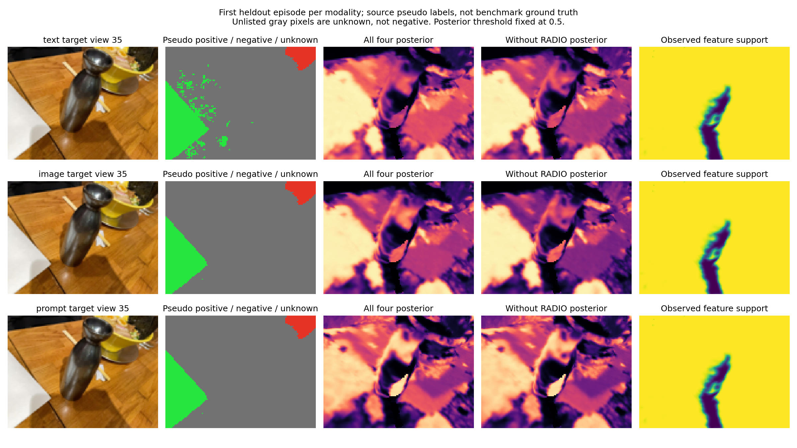

# 连续迭代：修复语义有效性与稠密教师监督遗漏

本轮完成两个场景共 17 组训练、顺序种子复核、去 RADIO 对照、共同标签域评估、实际原生 query 冷启动和可视化。保留的是可验证的训练完整性修复；没有把偶然高分的配置提升为性能主线。

## 两处明确的实现错误及修复

**几何可见被错误地当作语义已重建。** 原 figurines 的 92249 个可见元素中，15879 个 latent 与随机初始化逐值完全相同，却被 `observed` 标为有效。扩充 ramen 原固定顺序 660 步也有 2986 个。事后初始化比较与重新训练的实际梯度覆盖计数一致。

现在训练逐步记录每个元素是否收到非零特征梯度，拒绝非有限梯度和几何未观测区域的梯度。导出有效性为“几何可见且至少受到过特征监督”，不是收敛或语义正确的证明。导出前后评估分别记录，避免有效范围变化造成隐性指标提升。`feature_update_counts.pt` 是带哈希的训练审计产物，不是冷启动依赖。直接 query 与条件 query 的接口均将无效元素分数置零，同时保留 `valid=false`；未知元素仍不是评估负标签。

**稠密教师监督错误地依附于区域召回任务。** 无跨视角区域匹配的训练帧没有目标任务，就收不到 RADIO/DINO 稠密教师监督。figurines 的训练帧 31 有 10858 个有效像素，旧路径全部漏掉。只改变像素抽样无法修复整个视角缺席。

现在稠密教师独立轮转合法训练视角，每个视角内先遍历有效像素再重复采样；SAM 轮廓和 SigLIP 区域监督仍保持原任务语义，不随此改动重排。新增的覆盖调度和像素遍历成为默认实现；实验对照可用 `--matched-dense-teacher-views --random-teacher-pixels` 恢复旧采样策略。几何、相机、验证帧隔离不变，教师仍各自可选。

还修复了空区域 mean 产生 NaN 的路径，以及某一步教师无有效样本时对空梯度求 norm 的问题。可视化改为从 authority 读取分辨率、校验几何与编码器绑定，并使用每个模型自身的渲染分母。

## 覆盖修复的实际验证

| 场景与配置 | 几何可见元素 | 实际受监督元素 | 未训练但可见 |
|---|---:|---:|---:|
| figurines 原采样，180 步 | 92249 | 76370 | 15879 |
| figurines 新覆盖，四教师 | 92249 | 92249 | 0 |
| figurines 新覆盖，去 RADIO | 92249 | 92249 | 0 |
| 扩充 ramen 原采样，660 步 | 255984 | 252998 | 2986 |
| 扩充 ramen 新覆盖，四教师 | 255984 | 255984 | 0 |
| 扩充 ramen 新覆盖，去 RADIO | 255984 | 255984 | 0 |

四个最终字段逐元素验证 `observed == (feature_update_counts > 0)`。所有训练视角的有效像素都已遍历；所有验证视角的教师采样次数为零。覆盖率 100% 的分母是所选训练视角的几何可见元素，**不是整张地图，也不是全部元素语义正确率**。

## 语义结果：有改善，但没有全面恢复

下表是相同场景范围、全部任务分母的源伪标签 IoU，未使用提示条件优化。完整遍历教师后，ramen 的标签有效比例仍约为文本 10.64%、图像/提示 9.42%；不是全图 GT。

| 场景/配置 | 文本 | 图像 | 原始提示 |
|---|---:|---:|---:|
| 扩充 ramen 原固定顺序 660 | 0.530997 | 0.713965 | 0.699406 |
| 扩充 ramen 新覆盖，四教师 660 | 0.640089 | 0.887976 | 0.795591 |
| 扩充 ramen 新覆盖，去 RADIO 660 | 0.597322 | 0.731266 | 0.632707 |
| figurines 原四教师 180 | 0.429126 | 0.342784 | 0.337224 |
| figurines 新覆盖，四教师 180 | 0.437035 | 0.342699 | 0.300811 |
| figurines 新覆盖，去 RADIO 180 | 0.435403 | 0.305273 | 0.291239 |

在原六帧训练版本的共同标签范围内，ramen 新覆盖四教师为 0.954327/0.548978/0.574558；扩充数据原采样为 0.686671/0.484877/0.556529。原六帧版本 660 步则为 0.932675/0.620387/0.507165。因此旧区域图像召回仍未完全恢复，不能只引用扩大范围的 0.888 宣称全面超过原版。

提示条件推理：ramen 四个任务全部具备语义 seed 支撑，无不可用任务；已有响应满足二值约束，条件优化没有额外提升。figurines 八个任务均可用，条件后四教师/去 RADIO 的 IoU 为 0.790797/0.720082，仍低于先前 0.841616/0.732666。覆盖完整性与语义精度是两个不同结论。

## 排除过的方向

- 同一模型去掉新增元素的渲染贡献后，共同区域的图像 IoU 完全不变，排除了该诊断范围内“新增元素混合直接造成退化”的解释。这是诊断消融，不能作为部署裁剪方案。
- 随机任务顺序的种子 1000 在 ramen 很好，但种子 2000 和 figurines 未复现同等改善。保留实验选项，默认仍固定顺序。
- 原生 query 邻域约束、余弦学习率衰减未表现出跨场景一致收益，保持关闭。没有为追求这几个伪标签任务调阈值或挑中间 checkpoint。
- 调度分组审计显示旧顺序并非长串连续同目标视角（同模态最大连续数为 1）；因此不能把改善解释成消除了长视角块。任务顺序敏感性确实存在，但它不是已经完整定位的唯一因果机制。

17 组全部结果见 `paper/artifacts/feature_training_integrity_iteration_20260915.json`，包含报告路径与哈希，避免只保留最优种子。

## 冷启动与可视化

最终去 RADIO 字段在禁止读取四教师训练缓存、episodes、queries 和 RADIO 特征文件的环境下，实际编码文本、图像、提示并召回成功，几何未改变；原生编码与训练编码的余弦分别约为 0.9999996/0.9998043/1.0。这里测试的是执行一致性，不是语义质量。证据为 `paper/artifacts/ramen_dense_teacher_without_radio_cold_20260915.json`。

图中大量灰色区域没有标签，后验仍有扩散响应。不能把这些位置直接算作假阳性，也不能因为少量已知正负区域拟合良好就说边界已重建正确。下一阶段应扩大独立语义标注和区域身份核验，优先处理真实跨视角边界/身份监督，而非继续在少数伪标签任务上挑调度种子。

## 验证与实现范围

相关专项测试 44 项通过；17 次训练均完成梯度及保存/冷加载检查。四个最终字段的训练梯度计数、有效性、训练/验证采样隔离均通过独立逐项验证。`git diff --check` 通过。默认修复的目标是合法、完整的特征训练与有效性接口；历史性能基线继续保留，未将本候选宣称为已恢复的性能主线。
