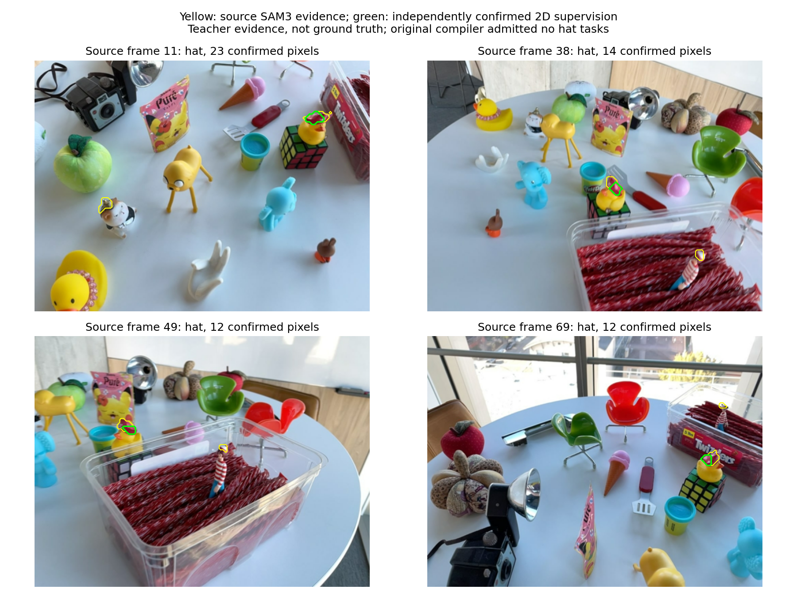

# 以另一视图确认当前正像素，修复局部监督收缩

本轮将源2D像素证据与硬3D元素标签的准入条件分开，完成两场景同预算训练及三类真实查询评估。结论：恢复了部分可靠来源的局部监督并改善相关查询，但figurines整体文本退化，不推广为联合默认方案。

## 具体收缩机制及实现

旧编译器只有当元素获得两视角硬正票、投影到当前像素的正元素贡献超过一半时，才采用当前SAM3强正像素。跨越当前视图掩码边界的载体，可能无法在当前视图获得>.7的硬正票，即使当前像素本身明确为正、另一视图又支持该载体，仍会失去2D监督。

新增默认关闭的`--independent-pixel-corroboration`：当前像素SAM3概率>.8、几何语义支持>.5，并且来自至少一个**其他**源视图强正票的载体贡献>.5，才补回该像素。当前视图的票从计数中扣除，不能自我确认；任何负视图票否决补回载体。保留原像素正例与负例，3D正负标签不变，不降低原投票置信门槛。

这是2D监督粒度的保守改进，不把新增像素直接升级为硬3D正元素。支持来自两次源观察，但不是独立真值证明。原先弃权也不能一概称为错误标签。

代码：`radio_gs/training/grounded_text_supervision.py`的`independent_positive_carriers`，以及`scripts/audits/compile_grounded_text_supervision.py`。编译产物记录逐query/view的原始、原保留及可补回像素数。

## 证据变化

| 场景 | 原任务/词数 | 新任务/词数 | 现有任务新增正像素 |
|---|---:|---:|---:|
| figurines | 63 /14 | 67 /15 | 1,302（原45,967） |
| ramen | 99 /14 | 99 /14 | 900（原59,554） |

figurines新增4个hat任务，分别位于源帧11、38、49、69，正像素数23、14、12、12。目视检查主要对应鸭子帽子的局部支持，没有恢复所有教师检测范围。监督栅格为96×128；这些计数是该栅格的像素，不能误解成高分辨率完整帽子掩码。

黄色为源SAM3强正范围，绿色为新确认的2D监督。图像是源训练图，未读取目标评估图来构造标签。可补回量只有原正像素的约2.83% /1.51%，说明本机制不能解释全部监督收缩；不能通过这一个局部修复宣称整体范围已经完整。

## 同预算训练与结果

比较对象为`fusion_init_trainable_2106/3240`：源融合初始化、可训练decoder及元素、四教师与原query任务。新训练仅更换上述grounded监督；保留2,106 /3,240步、种子及其余选项。这里特意使用可训练初始化对照来隔离标签变化，**不是**与之前固定decoder且2%更新约束的模型比较；其原生能力遗忘问题仍然存在。

全文本真实开发任务IoU /AP：

| 场景 | 原监督 | 独立像素确认 |
|---|---:|---:|
| figurines | 27.87% /45.29% | 26.02% /42.68% |
| ramen | 15.57% /22.26% | 15.99% /23.24% |

同一参考任务集图像/直接提示IoU：

| 场景 | 原监督 | 独立像素确认 |
|---|---:|---:|
| figurines | 35.22% /29.13% | 35.99% /29.91% |
| ramen | 19.73% /22.92% | 20.23% /23.23% |

局部文本：figurines pirate hat从10.26%到26.07%，rubber duck with hat从32.87%到26.19%，miffy从6.37%到4.40%；ramen egg仍为0。源已知域文本训练IoU仍达99.76% /99.89%，与真实任务存在明显差距。

这说明局部监督恢复有作用，但没有保住所有查询。当前结果不能独立判定退化来自新增hat任务频率、学习特征的语义干扰还是校准变化；不能把几条相关指标写成唯一因果链，也不能按开发GT删掉不利任务来制造提升。

## 决策及验证

保留可选编译改进，默认关闭，不替换联合默认模型。接下来必须在保留原生能力的前提下解决局部监督对其他query的干扰，而不是继续增加自由训练的粗类标签。源词表缺失与低分辨率小部件监督仍是明确限制，但本轮未证明提高分辨率必然提升最终召回。

25项相关测试通过，检查当前视图不能自我确认、单个负视图否决、非法计数拒绝及原监督合约。额外重新编译关闭选项的两场景：任务和四组2D/3D正负证据张量与旧版本逐项完全一致。新数据3D正负标签、旧任务负像素及既有正像素均核验保持。

证据：

- `paper/artifacts/independent_pixel_supervision_difference_20260916.json`
- `paper/artifacts/independent_pixel_training_protocol_20260916.json`
- `paper/artifacts/{figurines,ramen}_independent_pixel_{text,reference}_20260916.json`
- 源目录新监督：`grounded_text_independent_pixels.pt/json`
- 新训练：`fusion_init_pixel_corroboration_2106/3240`

所有成绩仍为LERF开发评估、单种子；不是独立最终test，未新增ScanNet/NVOS联合成绩。
