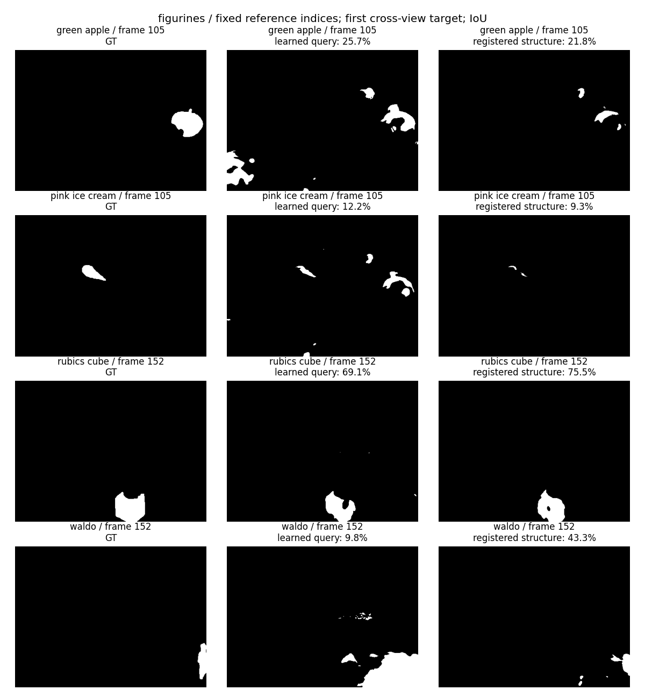
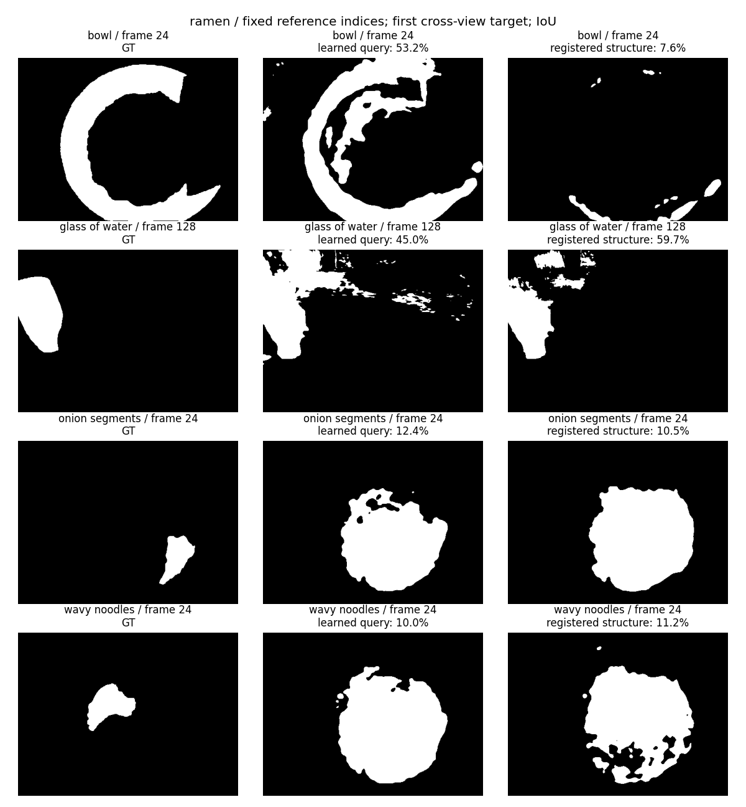

# 注册点查询直接读取结构场：系统瓶颈对照与修复

本轮保留的改动是**注册正负点直接读取现有地图的结构坐标**。两场景 prompt AP 都提高约 18–19 个百分点，figurines IoU 提高 19.11 个百分点；ramen IoU 只提高 2.90 个百分点。文本、图像的原路径和结果严格保持不变。不能将这个结果描述成三类查询、所有对象或全部 benchmark 已经解决。

## 从完整系统看，问题在哪里

当前链路为：多视角几何先验及尺度修复 → 冻结 Gaussian 几何 → 可见性约束下的源教师特征/区域监督 → 每元素一个 96 维向量 → 查询读取 → 相同几何渲染与评估。

其中 64 维语义前缀来自源侧原生语义融合，训练时写保护；32 维结构后缀由结构教师与区域监督学习。文本、图像通过固定原生解码器匹配语义前缀。保护前缀解决的是训练继续破坏已有语义锚点，不证明原教师全部能力已在压缩、融合之前和之后无损保留。

旧注册点查询已经带有正负世界坐标，却仍将 DINO 特征和坐标经场景学习的线性适配器映射到元素空间。这个步骤没有保证查询能读出所指元素的结构关系。本轮固定几何、整个元素场、支持域、参考点、目标帧和渲染器，仅改变读取方式，取得显著提升。这定位出一个可直接修复的系统瓶颈：**已注册的查询没有可靠地读出现有结构信息**。

## 实现及授权信息边界

新增 `radio_gs/models/scale_affinity_readout.py`，通过 `ElementRetrievalField` 的可选 `scale_affinity` 配置加载。旧模型未设置该配置时行为不变。

1. 按原查询协议反归一化正负世界坐标，在冻结几何中找对应元素。全部 18/13 个参考查询均恢复原来提供的两个元素 ID；没有挪到其他受监督元素。未支持或重合的正负种子直接弃权。
2. 对结构后缀做固定通道门控及归一化。令与正、负种子的余弦相似度分别为 `cp, cn`，响应为 `sigmoid(12*(cp-.5))*sigmoid(12*(cp-cn))`。
3. 门控尺度候选来自源训练区域三维范围的五个分位数，只按源验证视角的已知元素 IoU 选择一个全局尺度。两场景均选择索引 4。没有按目标、类别或 benchmark GT 选择尺度、阈值或参数。
4. 候选保存的每个父模型 tensor 都逐位不变，仅增加全局读取参数。仍是一个元素向量，没有第二份语义地图、目标 RGB 编码或测试时优化。

这是经验性的结构相似度读取，不是已经学成的物理层级分解。门控的通道顺序来自固定初始化，结构坐标本身没有“按物理尺度排序”的保证；源几何尺度也不等同于已标定的米。改善不能归因于已经解决了对象尺度学习。当前评估器为兼容旧查询仍会计算源 DINO，不能宣称已获得编码计算加速。

## 同一协议下的实测

下表单位为百分数；IoU 使用固定 0.5 后验阈值，AP 同时检查排序，未用 target 最优阈值。

| prompt 读取方法 | figurines IoU | figurines AP | ramen IoU | ramen AP |
|---|---:|---:|---:|---:|
| 父模型：学习适配器 | 21.60 | 40.28 | 21.88 | 32.92 |
| **保留：直接读取冻结结构 32D** | **40.71** | **57.83** | **24.77** | **51.94** |
| 额外训练结构与尺度门控 | 28.86 | 52.31 | 17.08 | 38.11 |
| 直接读取完整 96D，不门控 | 16.54 | 54.09 | 17.32 | 49.94 |

完整 96D 对照的门控也不同，因此并非仅一个维度变量的纯消融。但它明确说明“任何直接读取都能恢复同样 IoU”不成立，不能忽略结构与语义坐标的不同用途。

额外训练使用源区域正负样本的 pair BCE，共 12 轮，没有 benchmark GT。其最佳源验证 IoU 从 figurines 42.85% 降到 37.02%，ramen 从 44.23% 降到 43.23%；真实查询也不如固定结构读取。因此保留无需新增结构训练的候选。源训练损失下降不能当作泛化提高的证据。

同一参考查询子集的文本、图像结果如下，保留候选逐观测指标与父模型完全相等：

| 场景 | 文本 IoU / AP | 图像 IoU / AP |
|---|---:|---:|
| figurines | 32.40 / 55.98 | 33.12 / 54.52 |
| ramen | 3.77 / 31.02 | 13.81 / 34.21 |

另一个对照让原生语义最大/最小响应选择种子，再读取结构。其文本/图像 AP 为 figurines 40.49/37.79、ramen 23.37/32.62，均低于父模型。虽然 ramen 部分 IoU 上升，仍拒绝该替换，不能只挑有利指标。此读取只选单个组，且总会选种子，没有可靠的目标不存在判断或同类多实例并集能力。

## 可视化与剩余核心问题

固定参考索引 `[0, n//3, 2*n//3, n-1]`，取各自第一个跨视角目标，不按性能挑样例。图像生成时重新冷加载模型，重算 IoU 并与原评估逐项核对，误差小于 `1e-6`。

具体退化不能隐藏：ramen 的该 bowl 视角从 53.2% 降至 7.6%，面条与周围食物仍混合；figurines 的该 green apple 和 pink ice cream 样例也退化。平均提高不等于每个对象改善。

后续只聚焦两个缺口，按因果顺序推进：

1. **文本/图像的目标身份与种子可靠性。** 保留原生分数，但最高分点不保证落到正确完整对象上。应先分别测源原生锚点的定位错误、跨视角融合错误及误选对象，包含缺席类别和同类多实例；不能用更多训练或直接平滑掩盖身份错误。
2. **身份正确之后的范围与层级。** 注册点已经给出目标位置，ramen 的完整碗、食物部件仍出错。固定全局结构尺度和源局部区域监督不能保证完整对象范围。应在相同已知种子下检查结构可分性与完整范围上限，再决定修改监督或读取，避免先堆模块。原始 SAM 缓存已经使用多尺度裁剪，不能未经验证归咎于“没有多尺度 SAM”。

## 评估合约及验证

本轮是 LERF 标注上的**派生参考查询开发评估**：figurines 18 个参考查询、35 个目标观测；ramen 13 个参考查询、57 个目标观测。参考 GT 提供一正一负点；目标 GT 仅用于评估。真值是 2D 类别 polygon 并集，不是 3D 真值，也没有独立验证物理实例对应。无目标 RGB 编码，源训练缓存不能在查询阶段打开。这不是官方 LERF 点提示成绩或独立最终 test，也不能代表 ScanNet OVS/NVOS 已经提高。

- 22 项相关测试通过：直接注册读取、原生响应保护、正负点弃权、批次/子集一致性、尺度梯度、完整向量对照、原字段/解码器兼容。
- 真实评估与可视化均从磁盘冷加载执行。
- 封存脚本逐 tensor 验证候选与父模型相等，核对所有模型哈希、训练时源码快照、源侧尺度选择、文本/图像逐观测指标相等及种子 ID 完全一致。
- 训练时版本与后续增加诊断开关的代码分别按 SHA256 归档，避免把当前文件误当成当时训练源码。

保留候选路径为 `/mnt/pool/sqy/results/RADIO-GS/output/preserved_source_inventory_20260916/{scene}/scale_affinity_v1_direct_control/field.pt`。名字保留原对照名称以维持 provenance；封存清单明确该候选适用于注册 prompt 开发评估，不做联合 benchmark 升级。

主要产物：

- [封存清单](../../paper/artifacts/registered_structural_query_repair_20260916.json)
- [figurines 三查询明细](../../paper/artifacts/figurines_scale_affinity_reference_20260916.json)
- [ramen 三查询明细](../../paper/artifacts/ramen_scale_affinity_reference_20260916.json)
- `scripts/audits/train_scale_affinity.py`：源侧训练与固定结构对照导出。
- `scripts/audits/export_native_seed_affinity.py`：原生种子/完整向量失败对照导出。
- `scripts/audits/plot_registered_structure_queries.py`：固定样例重算与绘图。
- `scripts/audits/seal_registered_structure_repair.py`：结果和状态完整性复核。
