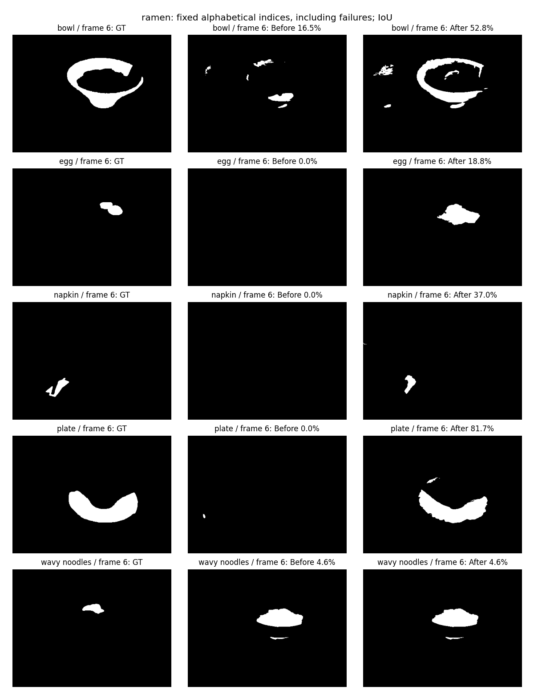
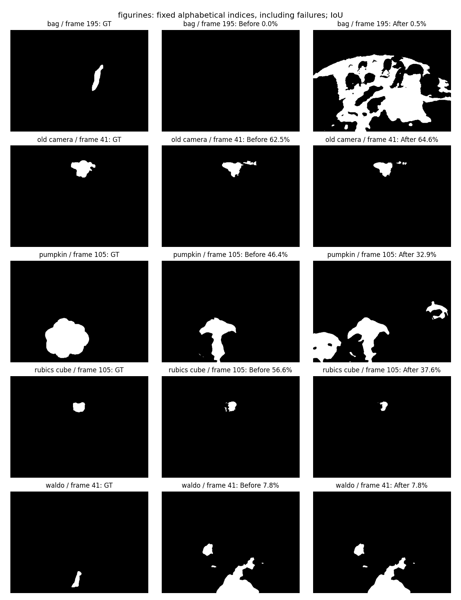

# 源侧概念与对象范围直接传递：系统定位、修复及开发评估

2026-09-16；分支 `codex/surface-object-memory-v4`。本轮保留候选为
`grounded_semantic_transfer96`，不是全 benchmark 晋升。

## 结论

原生语义参数保留之后，仍存在一个独立的能力传递缺口：SAM 的“这个概念对应这些像素”关系，在只做区域裁剪、SigLIP 重编码与特征融合时，没有可靠转成最终元素召回范围。

直接使用训练视角上的概念—范围伪监督，在**完全不更新已有 96 维场及其他父模型参数**的条件下学习小型全局范围读出，ramen 完整文本开发评估 IoU 从 **8.59% 到 23.09%**（+14.49 个百分点，2.69 倍），AP 从 **30.97% 到 37.24%**。figurines IoU 从 **33.63% 到 35.37%**，AP 从 **58.49% 到 57.34%**。图像与点提示的逐项结果完全不变。

这证明存在可恢复的定位信息，不能把当前低分全部归因于几何或教师不认识目标。也不能宣称解决了所有开放词汇问题：当前改善主要来自已有源概念的范围恢复，概念路由仍有明显语义错误，fig 的部分对象也退步。

## 当前完整路径与改动

1. 继续使用冻结的 MoGE 几何及同一可见性/投影责任矩阵。语义训练不移动几何。
2. 父场仍为每元素一个 96 维向量：保护的原生语义前 64 维 + 已学习的结构后 32 维。原生保护针对该压缩融合锚点，不等价于完整高维教师能力无损。
3. 仅从训练 RGB 的全图及原始 query-free 区域 bbox 裁剪生成 BLIP 描述，再用固定规则提取候选短语。没有输入评估类别、评估图像或标注。描述模型只用于离线候选发现，不进入部署；不是新增必需的场特征教师。
4. 用 SAM3 在训练图像定位这些短语；保留置信度至少 0.7 的区域。至少两个训练视角有检测、且有至少 20 个正元素的概念才进入范围监督。**这些仍是伪标签**，重复检测和模型置信度都不能证明实例对应或标签正确。
5. 掩码按既有几何可见性协议提升到元素。相同概念在一个视角取区域并集，跨有检测视角按元素可见性平均；未获得该概念证据的视角不直接作为负标签。已检测视角的掩码外可见区域作为伪负例。
6. 分别归一化原场两个分区，用固定正则系数 0.001、正负平衡的岭回归学习每个源概念的全局仿射范围读出。输出为截断到有效区间的 membership 概率。所有父场参数严格不变。
7. 文本 query 保持原生 SigLIP 编码，用原生空间匹配源概念原型；只有超过该原型“裸短语 / a photo of a 短语”源侧相似度门槛时，才使用对应范围读出。否则精确返回旧文本读出。图像和点提示仍走原路径。
8. 部署仍只有一个每元素特征场，加全局读出参数、概念原型与门槛；不携带源图、SAM 掩码、源元素 membership 表。这个读出是**源概念条件化的范围分类器**，不是已证明普适的开放词汇相似度空间。

实现：[范围读出](../../radio_gs/models/grounded_semantic_transfer.py)、[源侧拟合](../../scripts/audits/fit_grounded_semantic_transfer.py)、[查询接入](../../radio_gs/models/element_retrieval_field.py)。新能力显式 opt-in；已有 checkpoint 默认行为不变。

## 同协议完整对照

以下是所有有标注对象观察的文本 IoU / AP，单位 %；figurines 56 个、ramen 71 个观察。每个场景采用相同几何、query 编码、480 宽渲染、0.5 membership 判定、分母及有效支持规则。

| 方案 | figurines IoU / AP | ramen IoU / AP |
|---|---:|---:|
| 父场：完整源掩码条件阈值 | 33.63 / 58.49 | 8.59 / 30.97 |
| 新概念区域，仅融合原生掩码裁剪特征 | 37.04 / 60.63 | 6.99 / 28.02 |
| 同区域，仅融合粗掩码裁剪特征 | 35.90 / 60.33 | 5.99 / 29.08 |
| 概念范围 PCA 替换 structure32 | 17.54 / 35.60 | 11.09 / 33.86 |
| 概念平衡后 PCA 替换 structure32 | 17.43 / 35.84 | 16.89 / 37.73 |
| 原固定词表 + 保留全场 + 线性范围读出 | 27.96 / 48.03 | 18.47 / 28.94 |
| **源发现概念 + 保留全场 + 线性范围读出** | **35.37 / 57.34** | **23.09 / 37.24** |
| 源发现概念 + 保留全场 + MLP 范围读出 | 35.06 / 56.90 | 20.73 / 29.89 |

诊断含义：

- 单纯加入更多区域裁剪语义，不能解释/解决 ramen 的范围缺口。原生掩码优于粗掩码的局部结果也不足以解释全系统低分。
- 只用旧词表改范围监督，ramen IoU 就达到 18.47%，但 AP 下降、figurines 也下降。因此这项控制支持范围读出的作用，**并不单独证明开放语义排序恢复**。
- 新源概念与直接范围读出结合，才同时改善 ramen IoU 和 AP。两套源标签来自不同 grounding 路径；固定词表控制不是“只改词表、所有伪标签完全相同”的纯单变量实验，不能做精确贡献百分比分解。
- 强行覆盖结构后 32 维会毁掉点提示能力。原方案 fig/ramen prompt IoU 为 40.71/24.77%，原始 membership32 变为 12.19/9.13%，平衡版也只有 9.41/12.74%。两种替换均拒绝。
- 高 PCA 能量保留并不意味着细小对象范围保留：原始码保留约 99.97/99.43% 能量，但源组范围重建 IoU 约 89.82/73.41%。按组归一化后 ramen 源重建到 83.83%，最终跨视角召回仍不足。
- MLP 未获益。它用最后一个源训练视角的教师标签做验证、2000 步内选 checkpoint；该源图已参与基础场，不能称为独立未见视角测试。MLP 与线性也存在拟合划分和损失差异，不把结果全归因于非线性。

线性方案是本轮在开发集对照后保留的共同候选；**没有按场景选不同赢家**。不把其表现写成独立 test 结果。

## 三类查询与逐类变化

参考查询协议（fig 35 / ramen 57 个跨视角目标观察）的保留候选：

| 场景 | 文本 IoU / AP | 图像 IoU / AP | 点提示 IoU / AP |
|---|---:|---:|---:|
| figurines | 34.55 / 56.80 | 33.12 / 54.52 | 40.71 / 57.83 |
| ramen | 22.29 / 36.56 | 13.81 / 34.21 | 24.77 / 51.94 |

图像、点提示的每个 observation 字段与父场相同，而不只是四舍五入后的均值相同。本轮没有改善这两种 query，也没有实现新的 2D SAM 交互 prompt 协议。

完整文本的类别平均 IoU：

| 场景 / 类别 | 原场 | 保留候选 |
|---|---:|---:|
| ramen / bowl | 21.97 | 57.71 |
| ramen / egg | 0.00 | 32.58 |
| ramen / plate | 0.00 | 63.77 |
| ramen / spoon | 0.03 | 37.41 |
| ramen / napkin | 0.00 | 25.22 |
| ramen / chopsticks | 0.00 | 0.00 |
| ramen / kamaboko | 0.00 | 0.00 |
| ramen / wavy noodles | 10.82 | 10.82 |
| figurines / green apple | 33.41 | 61.34 |
| figurines / red apple | 43.35 | 55.03 |
| figurines / pumpkin | 46.37 | 32.86 |
| figurines / rubics cube | 53.18 | 42.01 |

## 剩下最重要的问题：概念路由可靠性

实际 query 门控审计显示 fig 只接纳 7/21 类，ramen 接纳 9/14 类。其他 query 逐元素精确回退父模型。

但是源侧 photo-template 门槛**不是语义等价保证**：

- `chopsticks` 错接到 `noodles`（0.856 > 0.826）；`wavy noodles` 反而因 0.803 < 0.826 回退。
- `bag` 错接到 `table`，产生大片桌面误检。
- `pumpkin` 接到更粗的 `fruit`，范围扩大并退步。
- `pink ice cream`、部分专有名词被拒绝，保留旧能力但未解决失败。

因此“保留原生字段”不能写成“最终所有 query 都不退步”。当前保护的是父模型状态、原生余弦、图像/提示和被拒绝文本的旧响应；被接纳文本的替代范围仍可能错。

**下一项只聚焦 query 到概念的语义等价/修饰词可靠性**：以源侧同义改写、相邻概念与属性对作为正负对，验证是否真的指向相同源区域，再决定使用范围读出还是回退。不能按本次评估词手写别名或例外，也不能继续单纯放宽门槛。先检验源侧可靠性是否转移到隔离开发类别，再扩展图像区域读出。之后才处理源掩码的对象/部件范围与边界误差。

## 正确性、复现与边界

- 33 项相关模型测试通过，包括查询回退、原生保留、行/批不变性、冷加载、无观测元素置零和原结构/阈值读出。
- 两场景独立冷加载审计：全部父 tensor 相等、原生 cosine 相等、图像响应相等、回退文本响应相等；真实参考协议图像/提示逐项相等。图中的重渲染 IoU 与结果 JSON 一致到 1e-6。
- 源 RGB、教师/几何绑定、caption 模型文件、生成物、field、评估协议和实现均以 SHA256 绑定；迭代前代码保留内容寻址快照，不用修改后的脚本冒充历史生成版本。
- 所有训练/拟合仅用源侧数据；标注视角与语义训练视角不交叉。评估 query/GT 仅用于开发评估和报告。几何仍沿用既有冻结构建协议，本轮不是独立几何质量改进证据。
- LERF 是 category-union 开发协议，图像/提示使用既定参考图及其派生提示；不是已验证物理实例任务、官方 3D 点 benchmark 或独立最终 test。
- 未做新的 ScanNet OVS、NVOS、目标缺失、无 RADIO 消融；不能外推。图像 query 与真实 SAM 2D 交互仍是后续工作。

离线顺序：`discover_source_caption_phrases.py` → `ground_source_caption_phrases.py`（SAM3 环境）→ `encode_caption_region_evidence.py` → `export_source_membership_code.py --balance-groups`（产生组定义，替换场仅作拒绝的控制）→ `fit_grounded_semantic_transfer.py`。各脚本使用 `--scene figurines|ramen --device cuda:N`；Python 路径为 `/root/miniconda3/envs/cybersim_agent/bin/python`，SAM3 使用 `/root/miniconda3/envs/sam3/bin/python`。已存在的输出禁止覆盖。当前脚本是本仓库两场景审计入口，尚非通用 benchmark 训练 CLI。

数据与 checkpoint 根目录：`/mnt/pool/sqy/results/RADIO-GS/output/preserved_source_inventory_20260916/{scene}`。实现快照：`/mnt/pool/sqy/results/RADIO-GS/output/caption_transfer_sources_20260916`。

证据索引：[封存清单](../../paper/artifacts/source_grounded_transfer_seal_20260916.json)、[fig 文本](../../paper/artifacts/figurines_grounded_transfer_text_20260916.json)、[ramen 文本](../../paper/artifacts/ramen_grounded_transfer_text_20260916.json)、[fig 门控审计](../../paper/artifacts/figurines_grounded_transfer_audit_20260916.json)、[ramen 门控审计](../../paper/artifacts/ramen_grounded_transfer_audit_20260916.json)。完整负面对照为同目录 `*_caption_transfer_*`、`*_fixed_vocab_transfer_text_*`。

固定字母顺序四分位类别、各自第一个有标注视角，包含失败/退步；未按效果选图。目标 RGB 不参与这些预测。

