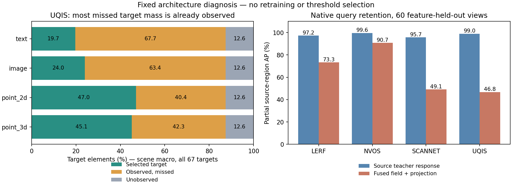
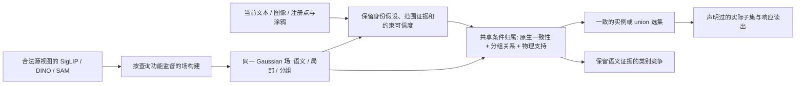

# 五项基线之后：系统架构归因与方法设计判断

本轮结论：**当前实现完成了载体和成员算子的统一，但查询证据保留、条件成员学习、任务读出之间还没有形成完整闭环。** 已经有充分证据定位多个独立瓶颈；还没有依据把全部 v10 差距归到某一个组件，也没有依据否定场景特定、三教师、单 Gaussian 场的方向。

基准版本为 `c6a7730`。本轮完成 30 个场的盘点、ScanNet 全部 10 房间、NVOS 全部 8 案例、UQIS 全部 67 目标／268 查询、LERF 全部 208 个查询视图对，以及 60 个特征留出源视图、2,910 个部分区域的查询保留诊断。没有训练新模型、修改阈值或替换正式预测。

[机器可读证据](2026-10-08-architecture-attribution-results.json) · [诊断协议](2026-10-08-architecture-attribution-protocol.md) · [尺度约束补充协议](2026-10-08-scope-bound-protocol.md) · [原五项成绩](2026-10-08-five-benchmark-results.md)

左图是完整 UQIS 队列的目标元素召回分解，不是 IoU，也不包含误选背景的惩罚。右图使用源教师部分区域作为伪查询，诊断融合与投影后的排序保留；它不是四项公开 benchmark 的 AP。

## 1. 当前系统实际实现了什么

设每个 Gaussian 的原生语义、局部外观、可学习分组特征分别为 `S_i, L_i, G_i`。

1. 源视图中重叠 SAM 区域的 SigLIP 描述子先求和归一化，得到像素语义；DINO 提供局部像素特征。通过可见贡献反投影并跨视图平均，生成 `S_i, L_i`。
2. 文本用语义相似度定位；图像用语义与局部 patch 最大相似度的等权组合定位。空间 NMS 最多保留 8 个锚点；实例任务选择首选，union 任务对接近最高匹配分数的锚点取成员并集。
3. 在默认配置下，最终成员分数由下式给出，原生语义／局部证据不再逐元素参与范围判断：

   `m_i = sigmoid(tau * (z_i(s)^T z_support(s) - bias) - ||x_i-centre||² / (2*s²))`。

   `z` 是经过尺度门控并归一化的分组特征；多像素支持被合并成一个归一化原型和一个空间中心。signed 输出再乘以 `1-m_negative`。
4. 所有未提供尺度的查询使用该场源 SAM 区域尺度的中位数。现有公开输入均没有独立的对象尺度推断。
5. 训练主要是：源 mask 内部单锚点、该 mask 的已知尺度、单视图 partial SAM 监督、soft subset alpha 损失。部署包含估计锚点、整幅参考图的 patch 证据、多射线涂鸦、未知对象尺度、完整类别竞争。

这说明目前的高容量主要是**存储容量**。高维原生特征仍在场里，但部署把大量信息压缩成了少量锚点，最终范围由分组核决定。不能据此宣称已经验证了高容量、查询能力保真的完整方法，也不能把失败直接解释为 32 维分组容量不足。

## 2. 观测缺失有损失，但解释不了大部分当前错误

UQIS 的目标特定观测覆盖率为 **87.43%**（九房间场景宏平均，67 个目标）。假设所有已观测目标元素都能选对且不产生误选，才得到这个理想选集 IoU 上限。它是诊断上限，不是可实现模型结果。

完整队列中的目标元素分解如下，各行相加为 100%：

| 输入 | 已选中的目标 | 已观测但漏选 | 未观测 |
|---|---:|---:|---:|
| 文本 | 19.70% | 67.73% | 12.57% |
| 图像 | 24.01% | 63.42% | 12.57% |
| 二维点 | 47.03% | 40.40% | 12.57% |
| 三维点 | 45.09% | 42.34% | 12.57% |

ScanNet 19 类的理想“已观测点全部分类正确、未观测点仍为 void”上限为 **87.89% mIoU**，实际原生对照与成员读出分别只有 36.95% 和 22.29%。缺少观测是事实，已观测部分的识别与读出也有大量损失。

原有坐标传递检查显示 ScanNet 的 Gaussian 中心与评分顶点无位移；UQIS 每房间 99% 分位也为零。它排除了大规模网格坐标错位作为现有证据中的主要解释，**不排除**可见性、投影混合、相机误差或场构建质量问题。

预算仍是必须控制的混杂因素：UQIS v10 地图实际记录 1,107 个源帧，新场用于特征拟合的合计仅 162 帧；ScanNet 十房间源配置声明 1,158 帧，新场合计 180 帧。后一个数字是声明可用帧数，尚不是逐缓存核实的实际采用数。增加源帧可能同时改善覆盖和已观测特征质量，不能用上表否定它的价值；但也不能把覆盖以外的全部错误都归给帧数。

## 3. 原生特征“保持不动”没有保证查询能力保留

对每个场的两个特征留出视图，用其原有 SAM 区域描述子进行部分区域检索；在相同已知正／负像素上比较源教师响应与 Gaussian 场投影响应。使用原有教师缓存，无新增编码器、公开查询或目标标签训练。

| 场族 | 源教师部分区域 AP | 场融合与投影后 AP | 语义方向余弦 | DINO 方向余弦 |
|---|---:|---:|---:|---:|
| LERF | 97.23% | 73.32% | 0.945 | 0.696 |
| NVOS | 99.58% | 90.73% | 0.969 | 0.895 |
| ScanNet | 95.67% | 49.14% | 0.918 | 0.564 |
| UQIS | 98.99% | 46.78% | 0.897 | 0.465 |

该表按独立场等权；NVOS 的 horns 两个提示共用一个场，源视图诊断只计一次。公开 NVOS 结果仍按完整八案例计分。

这里源描述子与区域标签有构造上的关联，源教师 AP 高并非独立泛化证明。对照的意义是：**同一源查询经过场构建和读出后，区分能力明显下降；高余弦不足以保证排序保持。** 该实验包含融合、观测覆盖和投影，尚未把三者的贡献隔离。

代码对应的不足是确定的：当前跨视图融合是固定归一化平均；重叠不同尺度区域先在像素层混合；后续只冻结已经融合好的 `S_i/L_i`，没有以查询排序、局部匹配或跨视图功能一致性来约束这个过程。因此，“protected native subspaces”是避免后续覆写的正确约束，却尚未实现附件所要求的查询能力保真。

## 4. 目标身份和成员范围确实是两个问题

UQIS 文本／图像的高斯锚点可用精确网格对应检查其真实实例归属，不再用“输出中谁占多数”代替锚点身份。

| 输入 | 首选锚点属于目标 | 8 个候选中有目标锚点 | 正式选集 IoU | 用 GT 选现有候选的最好选集 IoU |
|---|---:|---:|---:|---:|
| 文本 | 20/67 | 27/67 | 12.08% | 16.45% |
| 图像 | 21/67 | 32/67 | 15.99% | 22.13% |

最后一列评估了 1,072 个固定候选掩码，只改变现有候选的选择；尺度、特征、成员核都不变。它说明当前候选集合中的排序改进空间有限。它不是所有可能身份方法的上界，不能据此放弃改进候选生成。

更关键的是，全部 **59 个可用三维点的锚点都属于正确目标**，但在这 59 个查询、九房间上，条件选集 IoU 仍只有 **31.73%**，精确率 57.77%、召回 51.44%。原完整 67 查询结果仍为 27.69%，没有删除另外 8 个失败查询。

二维点要多拆一层：61 个可用查询的原始最大射线贡献都来自目标，但经过 `observed` 过滤后，只有 59 个仍保留至少一半目标支持质量；另外 2 个有效支持的目标质量为零。这是“有渲染对应”与“有可用于成员推理的观测”之间的差别，不能把所有可用二维点都视作身份已正确。

方法层面的判断：当前实例路径过早把原生证据收缩成单个锚点；首选错误时无法恢复查询身份，而首选正确时还会遭遇独立的范围错误。只修身份、只扩大 top-k、只换负提示公式，都覆盖不了完整问题。

## 5. 范围错误不能笼统归给尺度，也不能统一收缩或扩张

LERF 实际选集投影的四场景宏平均精确率只有 **33.81%**，召回达 **87.60%**，有明显多选。NVOS 正好表现出另一种错误：响应精确率 **95.94%**、召回 **60.53%**；flower/orchids 的响应精确率均接近 100%，召回仅 **7.75%/9.25%**。

### 负提示并非此次 NVOS 崩溃的主因

固定全部八个场、支持、尺度和读出，移除负提示后，NVOS 宏 IoU 仅从 **57.6865%** 变成 **57.6980%**，差 **0.0115pp**。flower/orchids 几乎不变。已验证完整 signed 成员张量逐元素精确重放，故这个干预排除了“当前负分支严重误删目标”作为这两个案例的主要原因。

在授权正涂鸦上，flower/orchids 的正分支投影平均响应仅 **0.2614/0.3013**，负分支贡献接近零。即使给定正确正提示，当前成员核也未充分响应。这不是靠更复杂的负约束聚合即可补足的。

### 固定尺度产生硬约束，但硬半径解释不了主要剩余漏选

因为分组余弦不超过 1，当前固定温度、偏置与尺度下有解析上界：

`logit_i <= tau*(1-bias) - ||x_i-centre||²/(2*s²)`。

超过 `s*sqrt(max(0,2*tau*(1-bias)))` 的元素不可能超过 0.5；显式三维正锚点的 clamp 单独处理。这条上界已对保存的预测逐元素验证。

在 59 个正确三维锚点条件下，按相同场景宏平均，目标元素分为：

| 状态 | 比例 |
|---|---:|
| 未观测 | 5.90% |
| 已观测，但超过解析可选半径 | 1.16% |
| 已观测、在可选半径内，仍漏选 | 41.50% |
| 已选中 | 51.44% |

因此，**把主要问题解释成硬几何半径太小，不符合这个队列的证据。** 大量损失发生在可见、身份正确、几何允许的元素上，定位到学习到的亲和关系与条件读出这一段。软距离惩罚、尺度门控、分组表示、偏置和训练目标仍然耦合，尚不能分别给出因果占比。

对 NVOS 将解析成员上界通过原有响应渲染器投影，flower/orchids 的乐观目标召回可达 **99.03%/98.61%**。这是固定场参数下的乐观召回界，不是 IoU 界，更不是可实现结果；它说明现有几何与硬可选范围没有强制要求出现 90% 以上漏选。

方法缺陷是：SAM 区域亲和关系尚未学成稳定的完整对象归属；单支持训练与多支持部署不匹配；未知对象范围目前由场景中位尺度替代。尺度问题需要与分组和监督共同解决，但不能先验认定它独自解释所有失败。

## 6. ScanNet 的类别读出存在清晰的概念失配

相同场、原生查询、评分顶点和类别菜单下，19 类原生 mIoU **36.95%**，成员竞争为 **22.29%**，十房间均下降。已观测有效顶点上，原生正确而成员错误有 **409,925** 个，成员修复原生错误只有 **79,124** 个。这里是顶点计数，不与场景宏 mIoU 混为一个指标。

在已观测有效点中，平均 **57.77%** 的点对所有类别的成员响应都不超过 0.5，完整菜单 argmax 仍被迫分配一个类别。现有分数表示“属于某个锚点所定义范围的程度”，并不表示可跨类比较的语义置信度；锚点选定之后，原始类别匹配的强弱没有保留到逐点决策。

这不要求恢复 v10 的独立分类系统。统一成员核可以继续提供结构关系，但类别读出需要保留原生类别证据，并在同一明确的证据／归属模型下竞争。直接对若干独立实例亲和分数 argmax，是当前原型的不足，不是统一架构的必要形式。

## 7. 训练和验证还有哪些不到位

所有场固定 2,000 次更新，实际对应的训练区域不同：每个区域平均仅 **1.37–10.93** 次更新。figurines 仅 75.1% 的可训练区域被抽中过一次，ramen 为 78.2%；“同样 2,000 步”不代表各场有相当的训练覆盖。

这证明预算没有按监督规模匹配，**不证明**只增加步数就能解决问题。随机点、partial SAM 范围、给定尺度和单视图 alpha 损失，与部署的图像身份、未知尺度、完整对象和类别竞争之间，本来就存在任务差别。历史上单纯混合 signed 训练、期望能量和负分支竞争的失败也不能通过更多重复掩盖。

当前仍未隔离的因素包括：同帧预算下移除 MaskAdapter 的影响；去掉 v10 额外 22-room 3D 标签的影响；相同 native 表示与 Gaussian 投影下的融合误差；预算与收敛不足；参考图像 patch 证据与视图平均局部特征的失配。它们必须保留为待验证项，不能在论文或汇报中虚构解释百分比。

## 8. 方法架构如何收敛

保留三个已成立的边界：**一个场景 Gaussian 载体、三个职责明确的子空间、一个共享的条件成员算子**。下一版应补足的是查询证据到对象归属的链条，而不是继续叠加 benchmark 专用求解器。

这是待验证的设计方向，不是本轮已训练出的新方法。三个核心修正分别是：

1. **用查询结果约束场构建。** 让合法源视图生成的区域、局部 patch、点查询在融合后保留相对排序与对应关系，而不只追求向量余弦或冻结均值。原生子空间的构建可以学习；后续分组优化仍不得任意覆写其语义，查询与原生解码规则继续配对。先做同预算、高容量保真对照，避免把观测不足误认为表示容量不足。
2. **身份与范围联合保留、分别诊断。** 原生证据不能在锚点选择后消失；未知身份保留多个互斥假设，未知范围保留可验证的尺度／层级证据。共享成员函数要同时看当前证据与场中关系；既不无条件混合不同实例，也不把估计锚点当作必然正确的标签。具体融合形式应由源伪查询训练和留出验证确定，不能再手工叠加一个目标分数驱动的权重。
3. **训练共享归属的部署能力。** 在合法源视图上构造图像、点、涂鸦等伪查询，区分射线关联不确定性、同目标多支持、真正负约束；利用可见性和几何支持建立可信的跨视图一致性。nested masks 和未观测区域继续保持 unknown。类别语义竞争和实际子集渲染可以有明确的 typed 输出，但不能绕过共享归属核心另开隐藏实例求解器。

SAM 提供的是部分、分层分组证据，不是现成的完整对象真值；跨视图关联也必须有可信度和冲突处理，不能把新生成的关联全部当硬标签。上述设计保留三教师边界，不引入额外 3D 标注、运行时源缓存或 v10 成员头。

## 9. 下一轮实验顺序及判断标准

| 顺序 | 要隔离的因素 | 最小有意义的对照 | 判断依据 |
|---|---|---|---|
| 1 | 源观测质量／融合 | 原高容量 B0，保持几何／teacher／输入，单独改变覆盖或查询功能保持；源预算变化另列 | 源留出查询排序、局部对应、目标覆盖，不能只看向量余弦 |
| 2 | 已知身份下的成员学习 | 固定支持、源数据和输出，改进源监督与范围条件；记录训练区域暴露与重复性 | 正确三维支持的精确率／召回和实际 IoU；同时检查 NVOS 漏选与 LERF 多选 |
| 3 | 推断身份与最终读出 | 在已验证成员基础上改候选证据；单独验证类别竞争 | 候选召回、选对后的范围、完整类别 mIoU；全部五项同时报告 |

先完成第 1 项与已知身份成员对照的设计和验证，再确定具体可学习参数；不立即把所有建议合成一次大改。每一步保留全量基线、固定主指标与回归报告。压缩、速度优化和独立最终评测在方法能力足够稳定后处理。

当前最合适的课题表述是：**在场景特定 Gaussian 表征中保留多模态查询证据，并学习身份与范围相容的条件归属。** 研究贡献应落在可验证的查询信息保留、条件归属学习和跨输入一致性上。模块统一和现有 affinity 公式本身还不足以构成创新性证明。

## 10. 证据与执行完整性

所有原生／成员类别指标、208 个 LERF 实际选集 IoU、268 个 UQIS 选集及 Gaussian-to-mesh 对应均复算一致。134 个 UQIS 推断首选和 8 个 NVOS signed 成员张量逐元素精确重放，候选与解析范围诊断未改变模型文件。所有解析上界及目标分区等式通过断言。

诊断过程中保留了两次失败日志：大场特征投影显存不足，改为相同独立列的分块计算；三维点解析界检查最初漏计显式正锚点 clamp，按原部署规则补齐。它们是诊断执行修正，不是基线模型或分数的修正。原五项正式成绩保持不变。

完整输出：`output/query_field_20261008/architecture_attribution_v1`。数值及源文件哈希见本报告的 JSON；诊断、正式成绩和尚未验证的设计建议分开保存。上述各阶段差值存在相互作用，不能加总成一个“已解释的 v10 差距”。
