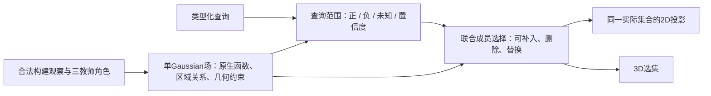

# 稀疏覆盖损失的独立对照：57.5700%→47.6829%，四场全降

在完整v10成员函数参照之后，本轮只改变轮廓监督采样，完成四场68查询的全部
预测后统一评分，并完成独立实际mask审计。**保持范围输入和正式求解链，采用
16×16稀疏监督使实际选集IoU下降9.8871pp。**这为场内几何约束保真不足提供了
直接对照证据；不是新无源模型成绩，也不证明此前全部差距都由采样引起。

## 隔离了什么

两组几何、当前原生先验、检测及身份筛选、18源帧/场、384×512渲染、交错相位、
240步求解完全相同。初始化、归一足迹成本、每视图置信度、active views及其顺序
通过原版optimization-state固定，并在输出状态逐张量验证相同。

仅将原192×256相位上的监督限制到均匀16×16点，仍执行原balanced BCE/overlap；
没有重写求解器。许可文件没有跟踪预测，present=False；不添加任何新正/负证据。
376个原active query-view全部保留，即使稀疏后该视图可能没有正采样点。
原12个无正来源查询沿用相同原生初值。完整场景四次预测后才打开评测标签。

这是采样方案的干预，包含采样引起的类内归一化样本变化和overlap中固定+1平滑
项的相对尺度变化。**没有独立隔离漏采样与积分测度/平滑尺度两者的作用**。
它也不是当前96×128上旧16×16场因子的逐元素复现；仅隔离该稀疏密度及原损失
处理方式，在相同完整输入和求解器中的影响。不得以此声称已经解释旧能量全部失败。

## 完整结果

| 方法 | figurines | ramen | teatime | waldo | 宏IoU % | P % | R % |
|---|---:|---:|---:|---:|---:|---:|---:|
| seed（无源开发候选） |56.3150|33.8481|54.6946|41.7562|46.6535|48.7356|85.4985|
| dense有源正式函数 |60.8140|55.3980|66.1586|47.9096|57.5700|64.4516|82.2279|
| sparse有源同函数 |53.9678|45.8676|53.0064|37.8899|47.6829|63.1321|67.7437|

sparse相对dense -9.8871pp，四场全降，场景配对bootstrap区间[-12.2467,-7.6396]pp。
sparse相对seed +1.0295pp，但仅ramen提高，另外三场下降，区间跨零；不提升默认。
四场为反复使用的开发场，区间不代表独立最终测试。

## 损失主要表现为错误收缩

稀疏后P只下降1.3195pp，R下降14.4842pp，且四场R都明显下降。相对dense输出，
实际渲染删除901476个正确像素、446584个误选像素；新增142329个正确像素及
309446个误选像素。18个对象获益、151个受损。像素跨查询/视图重复计数，不是
Gaussian身份真值或独立3D GT。

负约束样本从17436813次降到90777次；它们严格为原负约束与采样位置相交，
没有增加负标签。即便如此，实际召回仍明显下降。因此不能简单按负样本数量
解释删除行为：固定足迹代价下，稀疏轮廓不足以约束未采到的正确范围。该解释
与结果一致，但没有单独证明某一个求解步骤或平滑项就是全部原因。

此前失败能量方案P39.3296%/R71.6720%；本稀疏完整范围参照P仍63.1321%。
旧方案的低精度没有被本对照充分解释，范围语义、目标形式和求解近似仍需分开
验收。不能看到9.89pp下降后，只增加采样点就宣称整个方法已经修复。

## 对下一版方法的约束

1. 取消“16×16点上alpha/梯度一致即可代表完整选集函数”的验收标准。场内
   几何算子要对对象完整范围、面积测度和增删决策保真；不能在编译时丢掉大部
   分约束，然后要求优化器或更多监督自行补回。
2. 查询范围判定仍需输出正、负、未知与置信度，并区分类别并集和单实例。
   不能用完整实例森林、单个高相似种子、任意SAM部分并集冒充它。
3. 初始成员是可修订的先验；联合成员选择允许补入、删除和替换。未知不是可靠
   背景，也不意味着初始成员必须永久保留；任何收缩需通过完整范围功能验收。
4. 下一项核心实现应是同一场内的高保真几何约束与联合选集解码，先固定范围输入
   对照正式参照，再验证范围预测。来源视图数/原子数属于可调整构建预算，
   18帧与固定稀疏网格均不是理想架构的核心原则。

目标职责图（尚未全部实现，非当前已验收部署架构）：

标准推理依然禁止重新读取源RGB/mask/camera/tracks、自由成员参数拟合及答案库。
场内高保真函数可在构建期编译；是否能以共享/有界解码器保留正式函数效果，仍须
实际验证。暂不再追加外观/阈值变体，不把两个有源研究提升为五任务统一新版本。

## 复现

冻结be99ba8；根`output/query_field_20261011/canonical_sampling_v1`。
完整预测屏障、原两控制精确复现、初始化/成本/置信度/视图顺序精确相同、负标签
只做相交、全部实际mask独立评分均通过。7项相关测试分次通过。两项研究均已
结束，原始checkout未改动，当前无源开发最佳仍46.6535%。完整结果及逐对象
变更见`2026-10-11-canonical-sampling-audit.json`。
