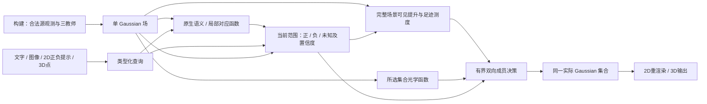

# 从能力迁移到统一集合推理：机制与闭环条件

2026-10-12。本文收敛当前方法方向；实验状态以各结果报告为准。候选课题表述：
**保留原生查询能力的 Gaussian 场：类型化范围组合与实际集合决策。**
核心问题是：如何在构建时吸收多教师的不同能力，使一份场表示在无源查询时，
既识别当前提示的对象，又输出符合任务语义、可投影的完整实际集合？

保留单 Gaussian 载体、SigLIP/DINO/SAM 三教师角色、当前合法类型化输入与同一
2D/3D实际集合。不要求三教师特征混成一个向量，也不要求所有任务argmax同一
标量。允许增大构建表示、改变范围和成员架构，但不把测试查询答案、源检测、
逐查询连续参数拟合藏入部署包。当前大场是功能参考，压缩仍是后续要求。

其中当前范围的正确性仍未闭环；图中箭头是目标职责，不代表整条标准链已验收。
`extent_preparation`已[完整四场验收](../experiments/2026-10-11-extent-preparation-results.md)，
移除了初始化和成本的特权来源。固定原生准入控制四场均退化；随后三态原子
拒识将实际选集投影46.6535%提高到50.8519%，四场全升。进一步排除自身的
其他视图补全得到52.0773%，相对原子基线三升一降、区间跨零，两轮独立审计
均通过。这是目前最好的无源研究候选，公共全局默认尚未替换。函数可运行、
数值保持和实际能力恢复仍分别验收，完整范围与五任务不能由局部提升代替。

[公共文字链](../experiments/2026-10-12-text-extent-public-results.md)已实际重算
原子基线全部68查询，选集逐位一致；重新编码原始文本也逐值一致。连续成员值
严格检查在一个回退查询失败，最大差5.96e-8、选中位差0；门槛未放宽，不能
称所有浮点值完全保持。52.0773%补全候选尚未做同样的全量公共入口复算。
[五任务清单](../experiments/2026-10-12-common-extent-readiness.md)进一步核实
其余26份场包缺新算子，类别互斥、明确负提示及3D点约束也仍需类型化接入。

## v10功能借鉴的具体边界

不能只比较同名特征或模块。代码复核显示，v10的native density admission先
由查询条件检测器提出范围，再对这些检测匹配的原生分数判断是否有排除依据。
`native_identity_posterior`在样本不足或单峰情形不做相对否决，其输出不宣称
语义正确性概率。把这段公式直接用在所有query-free候选上，会改变被条件化
的候选分布，仍不是原功能迁移，也不会补回前面的查询条件空间定位。
同契约连续参照中，密度准入只比raw联合提高0.4367pp；没有证据把它当主要
性能来源。历史同窗口前景/背景分支也不能未经对照就当作当前v10主链。

| v10中的功能责任 | 当前迁移状态与边界 |
|---|---|
| 原生语义与局部匹配 | 保留多个原生查询/汇聚函数；不等于完整范围判定已恢复 |
| 查询条件空间范围生成 | 主要缺口：原子拒识改善误选，但尚未完整恢复定位/范围召回 |
| 检测条件下的身份否决 | 特权参照中保留；不能脱离前置检测，套到全部候选就称等价 |
| 正/负/未知及置信度 | 三态拒识有实际增益；原始负掩码必须保留来源激活许可，不能只搬张量 |
| 完整场景观察提升与成本 | 场内A_obs/足迹函数已验收，68最终集合保持 |
| 实际成员集合的渲染约束 | 完整R_set与有限双向决策已支撑50.8519%无源候选；完整性能尚未恢复 |

因此下一项可学习空间读出若有必要，应迁移的是当前查询到范围/排除/未知的
函数，用独立源伪查询检验输出功能和后续真实集合，而不是只追加描述子监督。
如输入缺少所需定位信息，应扩展查询无关构建表示；训练损失降低不能充当输入
充分性或能力迁移的证据。标准运行仍不调用源图像检测器或拟合连续查询参数。

## 机制一：保留查询函数的证据测度

科学问题：多个原生观测混成均值后，语义竞争、非线性准入与局部双向对应会
失去区分信息。特征误差下降或坐标保持不代表这些查询功能保持。

已有实现是Gaussian支撑上的语义测度和多模态局部对应：先在原生证据上执行
当前类别竞争/前景判定，再按空间支撑整合；局部图像匹配保留双向patch对应，
而不是把所有外观平均后只比较一次cosine。数学上一般有
`sum_r w_ir f_q(z_r) != f_q(sum_r w_ir z_r)`；非交换性本身不是新定理。

可能的贡献是明确哪些原生查询函数必须保留，并以同源、同几何的功能对照
证明其对跨输入能力的作用。不能只把一个码本或更大的特征存储称为创新。
验收需同时包括原生排序/局部对应、真实身份正确率及共同成员读出的最终表现。
当前证据支持部分原生函数迁移，尚不支持全任务身份与完整范围已恢复。

## 机制二：类型化范围的组合与排除许可

科学问题：相关区域、完整实例、类别并集、局部属性/部件并非同一集合。
一个可靠局部正样本不能自动证明整对象范围；没有观测到也不能当背景。

目标表示为绑定Gaussian支撑的查询无关区域关系，运行时保留身份候选及其
层级/可见性，产生三态证据：正、获准的负、未知。类别并集允许多个对象；
reference instance使用当前参考约束身份；part/attribute不自动扩张成整实例；
partition保留完整类别竞争。这些类型共同提供范围证据，最终成员决策共享。

组合顺序必须明确：同一视图先形成当前集合的范围，再判定其内部、边界与
排除许可，最后提升到Gaussian。一般 `erode(union(M)) != union(erode(M))`，
简单合并已有部分正标签不能声称复现完整并集。已有`ScopeConstraints`的
P-any/N-all处理部分标签具有明确语义，但不等于查询条件检测器的完整范围。

其中完整范围组合已新增[ScopeTopology功能参考](../experiments/2026-10-11-scope-topology-results.md)：
query-free候选的成员模式合并为atom，保留其与观察射线邻域的关系。查询先组合
候选，再对邻域生成内部/边界/负许可，最后经已验收的观察算子提升。它保留分割
关系信息，不是通过改名消除源信息；没有源mask文件回读、新源SAM检测或查询
答案存储。在有限候选与固定离散化下，35389440个射线条件独立逐位验证；
四场68查询及独立审计完成。既有标准46.6535%，特权完整参考56.9282%，特权候选匹配55.0409%，
原生完整无源控制35.0014%。后两者同时改变P/N/c，不能把差距全算作身份的
单项因果效应；匹配组Ramen仍退9.2468pp，说明范围精度也没有解决。

关键修订是：**原生相关性只产生身份假设，不能直接授权整个候选为正。**
原生控制P36.0690%、R91.3804%，四场均表现为较标准更多误选；完整并集的
计算正确不等于它包含且仅包含查询所需对象，也不证明并集补集可获准为负。
将全局confidence尺度消除的[完整四场对照](../experiments/2026-10-12-relative-evidence-results.md)
只有34.9523%（−0.0490pp，区间跨零）。这个标量不是主要补救方向；相对视图
可靠性、拒识及负许可不能由该对照判断，后续分项证据见下文，不据此否定所有
confidence建模。

源伪范围诊断中，完整候选贪心并集84.7519%，任意原子并集的精确最优87.8886%，
原生准入并集47.7222%；均为四场等权、376个非空query-view的结果。原子最优
同时放宽组合域并采用精确求解，不把与贪心的差距纯归为表示损失；它不是
Gaussian性能上界。所有贪心均未用满16步，也没有继续增预算的直接依据。

类型化身份准入、可信负证据及完整公共多输入链仍是待验证的主要机制，不能用
whole-instance森林、阈值、硬种子保持或追加损失代替。最小归因顺序是：

1. 在固定训练观测上检查query-free候选是否包含所需范围；匹配诊断使用源
   伪范围，必须标为特权诊断，不能把评测查询及其答案加入训练/场状态。
2. 固定候选和几何，分别替换原生准入与范围组合，区分检索错误和候选缺失。
3. 固定正范围，单独替换负证据/未知与置信度生成，统计有效删除和范围损失。
4. 在同一已验收成员引擎上比较完整集合，确认源范围拟合改善是否转成实际收益。

候选不足时调整构建信息与范围表达；身份错误时改查询函数；完整范围已有而
成员仍错时才改决策。不再把三种缺陷合成“模型未收敛”。

另一个必须明确的逻辑区别是：裁剪语义兼容性通常只支持区域“可能包含”目标，
不直接支持区域内每个位置“都属于”目标。把存在性兼容当作完整范围标签，
即使候选边界准确也可能错误。多尺度候选全部语义同意，也不自动证明空间
定位正确。因此原子拒识只是一项可证伪的矛盾处理候选，不能代替查询条件的
定位函数；不能再把一个裁剪分数经过阈值变换视作v10条件检测功能已经迁移。

[完整源侧排序诊断](../experiments/2026-10-12-native-order-capacity.md)对此提供了
有限函数族证据：允许每个query-view按源答案挑最优阈值，源范围IoU也只有
69.1932%，而源答案匹配候选贪心84.7519%。这是float64原生排序族上的精确
前缀最优，不是Gaussian最终精度上界；保持排序的标量变换无法超出该族，
查询条件重排序或空间定位则不受此限制。后者才是值得迁移和验收的功能。

[四场68查询的交叉替换与原子拒识](../experiments/2026-10-12-signed-scope-results.md)
现已完成，两轮独立审计PASS。原子拒识要求所有覆盖候选的语义响应一致才能
授权正/负，有分歧、临界或无覆盖则未知，分别做正负邻域内部判定。固定其余
合同后，实际投影IoU为50.8519%，较既有标准46.6535%提高4.1984pp，四场全升。
Precision48.7356→56.4661%、Recall85.4985→82.1604%；误选显著减少，但仍
有60/208个投影对象退化。P/N同时改变；本轮后续分项消融见下文，不能据此
宣布完整类型化范围已恢复。新候选不增加场状态、训练或查询回源，只有67/68查询激活。

本轮同时修复一个功能合同问题：原参考N还受其原始P/c的活动许可约束。
混合原生P/c时不能复活来源未获准的负标签。修正于新GT评分前冻结，raw-N
诊断保留原名；其他两项交叉条件有效N逐位不变。正确2×2结果（固定原生c）为：

| 正范围 / 负证据 | 原生N | 获准参考N |
|---|---:|---:|
| 原生P | 35.0014% | 29.4640% |
| 特权匹配P | 55.2933% | 56.8978% |

固定原生N的正范围替换+20.2920pp；原生P下换获准参考N反而−5.5374pp，
而匹配P下+1.6045pp，交互+7.1419pp。P变化包含活动view/初始化/成本效应，
这些是操作性功能干预，不是固定支持上的纯像素因果。更可信的负许可不能
单独补救错误正范围；它的功能必须与查询条件正范围一起迁移。保持匹配P/N
而仅从原生c换回参考c反降1.8569pp，不能简单把原参考confidence当最优模块。

因此实现集中在**查询条件的空间范围定位**：原生语义/局部对应提出身份
假设，类型条件读出判定可信正原子，可见性与明确排除依据另行授权负原子，
其余未知。原子拒识作为已验证研究基线保留；下面的空间补全只是有限实现，
完整类型条件定位仍缺。若当前输入缺少定位信息，可扩展query-free构建表示，
不能只追加特征MSE或调整标量。部件、属性、实例和类别并集需明确范围合同。

[正负分项消融及其他视图补全](../experiments/2026-10-12-scope-completion-results.md)
已完成全四场68查询和独立审计。同原生c、同几何/决策，原生P/N35.0014%，
原子P/原生有效N51.6317%，原生P/原子有效N33.5822%，原子P/N50.8519%。
正侧拒识效果为+16.6303或+17.2696pp，均四场上升；负侧拒识为−1.4191或
−0.7798pp。不能将原子机制解释为“正负两侧更保守都有效”；主要收益来自
可信正范围。P变化仍包含活动视图/初始化/成本，非固定支持的纯像素因果。

最小补全读出将原子cP/cN经A_obs提升，为视图v仅累加其他视图的正负质量，
禁止自证及递归反馈。正见证投影须超过完整可用质量的一半，才可补当前未知
且原生正内部的射线；旧P/N和原子N来源许可不变。主候选52.0773%比原子
基线+1.2254pp，主要来自Ramen；区间[-0.0840,+3.6094]pp跨零，仍有91/208
投影对象退化。P56.5280/R84.7499，恢复部分召回，未证明可靠完整定位。
新见证来自既有有偏观察，并非独立真值；源非空子集新增正射线相符率69.8662%。
保留该研究候选，暂不提升默认，也不按场景混合负侧规则。

下一步固定已验收几何/决策，用独立源伪查询及留出数据检验定位、正负许可和
实际集合；减少漏选时必须同时控制误选。训练/校准不得读取benchmark查询答案
或新增3D标签。公共文字链已实施；共同五任务还需独立类型适配与构建状态。

## 机制三：分清观测解释与集合决策的场内几何函数

科学问题：完整场景中某高斯如何解释源观测，与删去其他成员后该高斯如何
渲染，是两个不同算子。可见性固定会漏掉重新暴露的成员；只存稀疏局部约束
又会漏掉范围和排除信息。保留源初值中的全部误选则无法恢复精度。

构建得到两类函数：`A_obs`保留完整场景遮挡后的可见提升；`R_set(S)`保留
包含隐藏候选的真实所选集合透射率及提前终止。当前查询先以正负已知证据
经`A_obs`产生可修订初值；未知Gaussian仍用原生先验。足迹用相同投影尺度、
active views和置信度合成，并相对于本次初值归一。随后有限四遍成员增删
通过`R_set`计算完整约束上的改变量；输出同一实际集合供2D/3D使用。

这是源辅助连续求解功能迁移到单场的具体路线。完整光学因子与有限决策在
固定特权范围/初值/成本下56.9282%，接近同输入连续参考57.5700%，较标准
46.6535%四场全升。16×16采样的独立连续对照只有47.6829%。这些支持保留
完整函数的必要性，但既不证明四遍最优，也不证明原始光学公式或坐标下降新颖。
56个新集合的同一二值目标全部更低而真实IoU三场下降，还说明代理目标不是
真实表现的充分排序，不能以更低能量自动选模型。

本轮`extent_preparation`补齐`A_obs`与成本生成的无源执行，按
[固定验收协议](../experiments/2026-10-11-extent-preparation-v2-protocol.md)全部68
最终成员精确保持、四场独立审计通过。该次保持实验的范围输入仍特权。
后续原子拒识及其他视图补全已在相同提升与决策函数上分别达到50.8519%及
52.0773%无源实际成绩；两轮正确2×2干预定位正范围为主要缺口，因此暂不
改动文字条件下已验收的几何和决策函数。其他输入需要的负提示许可、类别
互斥及合法3D点约束仍可调整架构，不能以当前二值实现限制任务合同。

### 可证明的范围：固定证据条件下的函数充分性

设几何、可选成员域、构建射线和数值规则固定，范围输入为
`e_q = (y_v, P_v, N_v, c_v)`，原生先验为`p_q`。若场内保存：

- 完整场景可见提升`A_obs,v`；
- 各视图解析足迹`a_v`；
- 可选域中全部潜在足迹的深度顺序、opacity与visibility；

则这些统计量足以计算当前函数族的初始化、成本和任意二值集合的光学目标，
无需构建源相机/图像再次参与。这是**对给定范围和固定离散化的限定命题**。

理由分三步。已知质量和正质量分别是
`sum_v A_obs,v^T [c_v(P_v+N_v)]`与
`sum_v A_obs,v^T [c_v(P_v+N_v)y_v]`，故提升仅需存储的系数和当前证据。
成本是`sum_active c_v a_v`除以其与初始化的内积。二值成员只能删除潜在命中，
不会使原本低于alpha阈值的足迹变得可见；保留所有可能命中并按原深度/浮点
顺序重算透射即可得到每个集合的相同光学函数。确定的初值、候选次序、预算与
接受规则据此给出相同成员决策（按提案序列归纳）。

系数本身、归约和阈值附近的浮点差异仍需端到端验收，不能用实数公式代替。
本轮允许连续初值/成本的预设数值误差，但最终成员要求逐位相同。此命题不说明
当前范围足以表达真实对象，不保证未见视图、全局最优、紧凑性或真实IoU；也不
等价于复现原240步soft Adam。证明确定函数可编译本身不是独立的新颖性主张，
价值在于明确迁移必须保留的信息及能以实际结果检验的边界。

## 已有工作与应收窄的创新主张

原生论文核查不是穷尽性新颖性审查，不能据此声称“首次”。

| 相关工作 | 已有机制 | 本课题必须额外证明的内容 |
|---|---|---|
| [LERF](https://arxiv.org/abs/2303.09553) | 多尺度语言特征的场内蒸馏与查询 | 原生函数保持，以及实际完整集合能力 |
| [LangSplat](https://arxiv.org/abs/2312.16084) | Gaussian语言特征、场景自编码、SAM层级语义 | 表示压缩之外的查询函数和成员决策保持 |
| [GARField](https://arxiv.org/abs/2401.09419) | SAM多尺度关系与尺度条件affinity | 不确定身份下的类型化完整范围与排除许可 |
| [Gaussian Grouping](https://arxiv.org/abs/2312.00732) | Gaussian identity编码、SAM及空间一致性 | 多类输入的同一实际集合推理及可验证能力迁移 |
| [OpenGaussian](https://arxiv.org/abs/2406.02058) | 实例特征、两阶段码本与实例级2D–3D关联 | 超出实例/码本的原生功能保持、组合范围与双向决策 |
| [OpenGaFF，2026](https://arxiv.org/html/2605.06088v3) | 几何/外观条件特征场、结构码本和attention语言读出 | 不把几何条件场或码本本身当新贡献；验证上述范围与函数迁移 |
| [PairGS，2026-07](https://arxiv.org/abs/2607.01140) | 用view贡献和mask证据构造Gaussian关系、稀疏边及多粒度层级聚类 | 关系图或层级本身不新；需检验当前类型下的可信P/获准N/未知及实际集合差异 |
| [NormLift，2026-09](https://arxiv.org/abs/2609.18898) | 从cosine目标解释归一化提升，分解视图内/间一致性，并用可靠性指导模式投票 | 不把可靠性、多模态存储或避免线性均值本身当创新；需证明具体原生查询函数和多输入集合能力 |
| [GaussDet，2026-06](https://arxiv.org/abs/2606.30638) | 实例组渲染与多视图2D检测语义投票 | 多视图检测聚合已有先例；需在无源查询条件下恢复范围功能，不能以封装检测结果宣称方法创新 |
| [Post-Training Semantic Lifting，2026-10-06](https://arxiv.org/abs/2610.08756) | 同时累积目标/非目标可见证据，种子与连通扩张，并区分检测、提升、表示转移误差 | 正负质量累积和分阶段归因本身已有先例；必须证明许可语义、查询条件范围与所选集合光学的额外作用 |

上述四项新增核查于2026-10-12依据原论文摘要完成，是相近机制初筛，尚非
全文/代码级穷尽比较。特别是跨视图传播、正负质量和错误拆解都不能单列为
新颖性；当前排除自身的空间完成实验先回答能力问题，不能凭其命名就宣布
新的论文贡献。若后续实际收益只能由已有聚合或投票解释，应收窄创新主张。

因此论文应围绕三个可检验命题组织：原生查询功能需要什么证据；不完整多视图
观测如何产生当前类型所需的正负/未知范围；如何用场内函数形成一致实际集合。
单场、三教师、通用输入覆盖是系统目标，哈希/冻结/测试是证据质量，均不应单列
为方法创新。最终可以是一项主贡献与两项支撑机制，无须强凑三个独立创新点。

## 快速收敛的完成条件

目前完整组合、场内初值/成本、所选集合光学与有限成员增删已通过限定功能验收；
身份与范围的证据准入仍是主缺口。原子拒识、正负分项消融及最小空间补全
已完成，补全52.0773%的新增收益集中于一个场景。下一步保留基线和候选，
集中迁移查询条件定位并验证独立泛化，不继续围绕已失败的全局confidence
标量搜索。随后通过同一
公共类型化入口跑五benchmark与UQIS全部四输入；单列LERF语义2D、实际选集
投影及真正3D-GT，不混用名称。报告v10历史资源参考、同契约功能参考和标准
无源候选三者；同输入57.57%不能替换历史66.96%的目标或冒充全性能恢复。

当前三个贡献方向的闭环状态如下，不能提前包装为三个已经成立的创新：

| 候选机制 | 已有证据 | 尚缺的决定性证据 |
|---|---|---|
| 原生查询函数的证据测度 | 部分原生语义与局部对应功能保持 | 身份正确率、各输入共同收益与独立泛化 |
| 类型化三态范围与证据准入 | 原子拒识46.6535→50.8519%；正负消融定位正侧；补全52.0773%恢复部分召回但新增差值区间跨零 | 完整类型条件定位、可靠排除与独立泛化 |
| 观测提升与集合光学分离、有限双向决策 | 固定范围56.9282%；初值/成本迁移全68保持；已支撑新无源52.0773% | 完整无源性能、五任务同一实际集合及资源可接受性 |

最终每项机制要有单项去除/替换对照、真实集合指标、错误归因和独立数据验证。
压缩与时延在能力闭环后再做，所有额外索引/系数计入场大小。若类型范围机制
没有增益或共同五任务明显退化，就收窄贡献，而不是靠包装延续通用主张。
