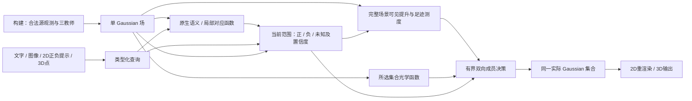

# 从能力迁移到统一集合推理：机制与闭环条件

2026-10-12。本文收敛当前方法方向；实验状态以各结果报告为准。候选课题表述：
**保留原生查询能力的 Gaussian 场：类型化范围组合与实际集合决策。**
核心问题是：如何在构建时吸收多教师的不同能力，使一份场表示在无源查询时，
既识别当前提示的对象，又输出符合任务语义、可投影的完整实际集合？

保留单 Gaussian 载体、SigLIP/DINO/SAM 三教师角色、当前合法类型化输入与同一
2D/3D实际集合。不要求三教师特征混成一个向量，也不要求所有任务argmax同一
标量。允许增大构建表示、改变范围和成员架构，但不把测试查询答案、源检测、
逐查询连续参数拟合藏入部署包。当前大场是功能参考，压缩仍是后续要求。

其中当前范围的正确性仍未闭环；图中箭头是目标职责，不代表整条标准链已验收。
`extent_preparation`已[完整四场验收](../experiments/2026-10-11-extent-preparation-results.md)，
移除了初始化和成本的特权来源。本轮补齐范围组合的无源函数，但固定原生准入
控制四场均退化。函数可运行、数值保持和实际能力恢复必须分别验收。

## 机制一：保留查询函数的证据测度

科学问题：多个原生观测混成均值后，语义竞争、非线性准入与局部双向对应会
失去区分信息。特征误差下降或坐标保持不代表这些查询功能保持。

已有实现是Gaussian支撑上的语义测度和多模态局部对应：先在原生证据上执行
当前类别竞争/前景判定，再按空间支撑整合；局部图像匹配保留双向patch对应，
而不是把所有外观平均后只比较一次cosine。数学上一般有
`sum_r w_ir f_q(z_r) != f_q(sum_r w_ir z_r)`；非交换性本身不是新定理。

可能的贡献是明确哪些原生查询函数必须保留，并以同源、同几何的功能对照
证明其对跨输入能力的作用。不能只把一个码本或更大的特征存储称为创新。
验收需同时包括原生排序/局部对应、真实身份正确率及共同成员读出的最终表现。
当前证据支持部分原生函数迁移，尚不支持全任务身份与完整范围已恢复。

## 机制二：类型化范围的组合与排除许可

科学问题：相关区域、完整实例、类别并集、局部属性/部件并非同一集合。
一个可靠局部正样本不能自动证明整对象范围；没有观测到也不能当背景。

目标表示为绑定Gaussian支撑的查询无关区域关系，运行时保留身份候选及其
层级/可见性，产生三态证据：正、获准的负、未知。类别并集允许多个对象；
reference instance使用当前参考约束身份；part/attribute不自动扩张成整实例；
partition保留完整类别竞争。这些类型共同提供范围证据，最终成员决策共享。

组合顺序必须明确：同一视图先形成当前集合的范围，再判定其内部、边界与
排除许可，最后提升到Gaussian。一般 `erode(union(M)) != union(erode(M))`，
简单合并已有部分正标签不能声称复现完整并集。已有`ScopeConstraints`的
P-any/N-all处理部分标签具有明确语义，但不等于查询条件检测器的完整范围。

其中完整范围组合已新增[ScopeTopology功能参考](../experiments/2026-10-11-scope-topology-results.md)：
query-free候选的成员模式合并为atom，保留其与观察射线邻域的关系。查询先组合
候选，再对邻域生成内部/边界/负许可，最后经已验收的观察算子提升。它保留分割
关系信息，不是通过改名消除源信息；没有源mask文件回读、新源SAM检测或查询
答案存储。在有限候选与固定离散化下，35389440个射线条件独立逐位验证；
四场68查询及独立审计完成。既有标准46.6535%，特权完整参考56.9282%，特权候选匹配55.0409%，
原生完整无源控制35.0014%。后两者同时改变P/N/c，不能把差距全算作身份的
单项因果效应；匹配组Ramen仍退9.2468pp，说明范围精度也没有解决。

关键修订是：**原生相关性只产生身份假设，不能直接授权整个候选为正。**
原生控制P36.0690%、R91.3804%，四场均表现为较标准更多误选；完整并集的
计算正确不等于它包含且仅包含查询所需对象，也不证明并集补集可获准为负。
将全局confidence尺度消除的[完整四场对照](../experiments/2026-10-12-relative-evidence-results.md)
只有34.9523%（−0.0490pp，区间跨零）。这个标量不是主要补救方向；相对视图
可靠性、拒识及负许可仍需单独验证，不据此否定所有confidence建模。

源伪范围诊断中，完整候选贪心并集84.7519%，任意原子并集的精确最优87.8886%，
原生准入并集47.7222%；均为四场等权、376个非空query-view的结果。原子最优
同时放宽组合域并采用精确求解，不把与贪心的差距纯归为表示损失；它不是
Gaussian性能上界。所有贪心均未用满16步，也没有继续增预算的直接依据。

类型化身份准入、可信负证据及完整公共多输入链仍是待验证的主要机制，不能用
whole-instance森林、阈值、硬种子保持或追加损失代替。最小归因顺序是：

1. 在固定训练观测上检查query-free候选是否包含所需范围；匹配诊断使用源
   伪范围，必须标为特权诊断，不能把评测查询及其答案加入训练/场状态。
2. 固定候选和几何，分别替换原生准入与范围组合，区分检索错误和候选缺失。
3. 固定正范围，单独替换负证据/未知与置信度生成，统计有效删除和范围损失。
4. 在同一已验收成员引擎上比较完整集合，确认源范围拟合改善是否转成实际收益。

候选不足时调整构建信息与范围表达；身份错误时改查询函数；完整范围已有而
成员仍错时才改决策。不再把三种缺陷合成“模型未收敛”。

下一实现应允许查询条件下的**三态原子范围**，而不是整实例的统一开关。
建议职责分离为：原生语义/局部对应产生身份假设；类型条件的范围判定产生
可信正原子；独立可见性与排除依据授权负原子；证据不足或冲突时保留未知。
身份拒绝只说明这个候选未被接受，不能直接证明相关Gaussian属于背景。
部件、属性和类别并集需要不同的范围约束，但共享观察提升和实际集合引擎。
上述判定器尚未实现或验收，不能提前声称它能恢复55.0409%或v10完整性能。

最小下一轮验收应固定几何与成员引擎，分开替换P、N/unknown及c；明确原子
target与已知证据的合同，避免把“未被准入”在渲染损失里偷偷当作负标签。
源伪范围仅作特权功能对照；训练/校准不得读取benchmark查询答案或新增3D标签。
先观察误选是否下降、正确范围是否保留，再看真实选集IoU及未参与设计的数据。
若只能依赖特权信息提升，不能提升标准默认或宣布准入机制成立。

## 机制三：分清观测解释与集合决策的场内几何函数

科学问题：完整场景中某高斯如何解释源观测，与删去其他成员后该高斯如何
渲染，是两个不同算子。可见性固定会漏掉重新暴露的成员；只存稀疏局部约束
又会漏掉范围和排除信息。保留源初值中的全部误选则无法恢复精度。

构建得到两类函数：`A_obs`保留完整场景遮挡后的可见提升；`R_set(S)`保留
包含隐藏候选的真实所选集合透射率及提前终止。当前查询先以正负已知证据
经`A_obs`产生可修订初值；未知Gaussian仍用原生先验。足迹用相同投影尺度、
active views和置信度合成，并相对于本次初值归一。随后有限四遍成员增删
通过`R_set`计算完整约束上的改变量；输出同一实际集合供2D/3D使用。

这是源辅助连续求解功能迁移到单场的具体路线。完整光学因子与有限决策在
固定特权范围/初值/成本下56.9282%，接近同输入连续参考57.5700%，较标准
46.6535%四场全升。16×16采样的独立连续对照只有47.6829%。这些支持保留
完整函数的必要性，但既不证明四遍最优，也不证明原始光学公式或坐标下降新颖。
56个新集合的同一二值目标全部更低而真实IoU三场下降，还说明代理目标不是
真实表现的充分排序，不能以更低能量自动选模型。

本轮`extent_preparation`补齐`A_obs`与成本生成的无源执行，按
[固定验收协议](../experiments/2026-10-11-extent-preparation-v2-protocol.md)全部68
最终成员精确保持、四场独立审计通过。该次保持实验的范围输入仍特权。
本轮新无源范围控制已评分但明显退化，没有更优的标准成绩；因此暂不修改已验收的提升与决策函数。

### 可证明的范围：固定证据条件下的函数充分性

设几何、可选成员域、构建射线和数值规则固定，范围输入为
`e_q = (y_v, P_v, N_v, c_v)`，原生先验为`p_q`。若场内保存：

- 完整场景可见提升`A_obs,v`；
- 各视图解析足迹`a_v`；
- 可选域中全部潜在足迹的深度顺序、opacity与visibility；

则这些统计量足以计算当前函数族的初始化、成本和任意二值集合的光学目标，
无需构建源相机/图像再次参与。这是**对给定范围和固定离散化的限定命题**。

理由分三步。已知质量和正质量分别是
`sum_v A_obs,v^T [c_v(P_v+N_v)]`与
`sum_v A_obs,v^T [c_v(P_v+N_v)y_v]`，故提升仅需存储的系数和当前证据。
成本是`sum_active c_v a_v`除以其与初始化的内积。二值成员只能删除潜在命中，
不会使原本低于alpha阈值的足迹变得可见；保留所有可能命中并按原深度/浮点
顺序重算透射即可得到每个集合的相同光学函数。确定的初值、候选次序、预算与
接受规则据此给出相同成员决策（按提案序列归纳）。

系数本身、归约和阈值附近的浮点差异仍需端到端验收，不能用实数公式代替。
本轮允许连续初值/成本的预设数值误差，但最终成员要求逐位相同。此命题不说明
当前范围足以表达真实对象，不保证未见视图、全局最优、紧凑性或真实IoU；也不
等价于复现原240步soft Adam。证明确定函数可编译本身不是独立的新颖性主张，
价值在于明确迁移必须保留的信息及能以实际结果检验的边界。

## 已有工作与应收窄的创新主张

原生论文核查不是穷尽性新颖性审查，不能据此声称“首次”。

| 相关工作 | 已有机制 | 本课题必须额外证明的内容 |
|---|---|---|
| [LERF](https://arxiv.org/abs/2303.09553) | 多尺度语言特征的场内蒸馏与查询 | 原生函数保持，以及实际完整集合能力 |
| [LangSplat](https://arxiv.org/abs/2312.16084) | Gaussian语言特征、场景自编码、SAM层级语义 | 表示压缩之外的查询函数和成员决策保持 |
| [GARField](https://arxiv.org/abs/2401.09419) | SAM多尺度关系与尺度条件affinity | 不确定身份下的类型化完整范围与排除许可 |
| [Gaussian Grouping](https://arxiv.org/abs/2312.00732) | Gaussian identity编码、SAM及空间一致性 | 多类输入的同一实际集合推理及可验证能力迁移 |
| [OpenGaussian](https://arxiv.org/abs/2406.02058) | 实例特征、两阶段码本与实例级2D–3D关联 | 超出实例/码本的原生功能保持、组合范围与双向决策 |
| [OpenGaFF，2026](https://arxiv.org/html/2605.06088v3) | 几何/外观条件特征场、结构码本和attention语言读出 | 不把几何条件场或码本本身当新贡献；验证上述范围与函数迁移 |

因此论文应围绕三个可检验命题组织：原生查询功能需要什么证据；不完整多视图
观测如何产生当前类型所需的正负/未知范围；如何用场内函数形成一致实际集合。
单场、三教师、通用输入覆盖是系统目标，哈希/冻结/测试是证据质量，均不应单列
为方法创新。最终可以是一项主贡献与两项支撑机制，无须强凑三个独立创新点。

## 快速收敛的完成条件

目前完整组合、场内初值/成本、所选集合光学与有限成员增删已通过限定功能验收；
身份与范围的证据准入仍是主缺口。下一步集中修正这一职责，先冻结可证伪的
分项对照，不继续围绕已失败的全局confidence标量搜索。随后通过同一
公共类型化入口跑五benchmark与UQIS全部四输入；单列LERF语义2D、实际选集
投影及真正3D-GT，不混用名称。报告v10历史资源参考、同契约功能参考和标准
无源候选三者；同输入57.57%不能替换历史66.96%的目标或冒充全性能恢复。

当前三个贡献方向的闭环状态如下，不能提前包装为三个已经成立的创新：

| 候选机制 | 已有证据 | 尚缺的决定性证据 |
|---|---|---|
| 原生查询函数的证据测度 | 部分原生语义与局部对应功能保持 | 身份正确率、各输入共同收益与独立泛化 |
| 类型化三态范围与证据准入 | 完整组合数值正确；失败对照定位弱准入与范围精度问题 | 可部署的身份/正范围/负许可判定，分项消融和真实增益 |
| 观测提升与集合光学分离、有限双向决策 | 固定范围下56.9282%；初值/成本迁移全68成员保持 | 与正确无源范围联合、五任务同一实际集合及资源可接受性 |

最终每项机制要有单项去除/替换对照、真实集合指标、错误归因和独立数据验证。
压缩与时延在能力闭环后再做，所有额外索引/系数计入场大小。若类型范围机制
没有增益或共同五任务明显退化，就收窄贡献，而不是靠包装延续通用主张。
