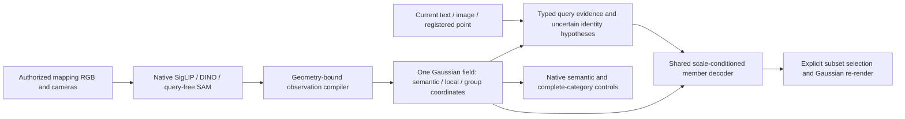

# Query-preserving Gaussian field: implementation and experiment ledger

Research entry: `python -m radio_gs.query_field`.
Decision: [ADR0013](../adr/0013-query-preserving-scene-specific-gaussian-field.md).

This package is the new construction/learning/query path. The v10 executable
recipe remains a frozen comparator. Neither its source-only NVOS solver nor
its label-trained member tree is silently called by the new package.

## Implementation boundary

| Module | Responsibility |
|---|---|
| `contracts` | Current query evidence, signed supports, explicit target type |
| `observations` | Native teacher extraction and geometry-bound source compilation |
| `geometry` | Full-scene contributions, actual selected-subset rendering and its differentiable training surrogate |
| `field` | Protected native subspaces, affine matching, shared scale-conditioned members |
| `adapters` | Native text/image encoding and camera/world-coordinate supports |
| `train` | Source-only partial-mask member fitting with frozen geometry/native features |
| `storage` | Local, hashed standalone payload and actual tensor/file cost |
| `evaluate` | Development diagnostics after fixed fitting; never model selection on final labels |
| `baseline` | Saved v10 metric and resource inventory |
| `smoke`, `cold_check` | Native encoders and four-input replay from a copied export with source-file access denied |
| `diagnose` | Explicitly privileged projection controls, never model predictions |
| `hypotheses`, `hypothesis_study` | Query-only native ranking and separately scored identity/scale capacity controls |
| `native_transfer` | Paired native-coordinate intervention with fixed members and observation support |
| `public_lerf` | Source-free text prediction, then unchanged historical benchmark scoring |
| `readout_study`, `subset_errors` | Exact baseline replay, explicit selection controls, and checked error decomposition |



The first implementation stores full native semantic/local coordinates as the
capacity control. Copying their averages into Gaussian rows is not yet
query-preserving distillation: preserving these coordinates during group fitting
does not prove that the source teacher's query capability survived initial
multi-view fusion. Native query ranking and local matching preservation remain
separate required experiments. Likewise, a shared affinity decoder with a scale
gate is an implementation starting point, not a novelty claim by itself.

## Reproduce the first pilot

Run from `/root/RADIO-GS-query-field`, with the existing cybersim_agent Python
environment and `PYTHONPATH=.`. Select a GPU through `CUDA_VISIBLE_DEVICES`;
the device argument is relative to that selection. The initial bounded run uses
one GPU, four CPU threads, and the same fixed configuration for all stages.

```sh
python -m radio_gs.query_field compile --output output/query_field_20261007/figurines_pilot_v1
python -m radio_gs.query_field fit --output output/query_field_20261007/figurines_pilot_v1
python -m radio_gs.query_field evaluate --output output/query_field_20261007/figurines_pilot_v1
python -m radio_gs.query_field smoke --output output/query_field_20261007/figurines_pilot_v1
python -m radio_gs.query_field diagnose --output output/query_field_20261007/figurines_pilot_v1
```

Construction and model export refuse to overwrite existing directories.
Development results concern source SAM groupings and native feature retention,
not human-labelled complete instances, LERF benchmark masks, or v10 equivalence.
Scale-conditioned diagnostics and automatic default-scale results must be
labelled separately. Projection coverage is reported on the complete raster;
missing elements do not disappear from the evaluation denominator.

These paths now contain the completed run and are immutable. To reproduce,
choose a fresh root. The 2,000-step controls reuse the same compiled observations
under an `observations` symlink in fresh run roots, then call `fit` and `evaluate`
with `--config configs/query_field/figurines_fit_budget.json` or
`--config configs/query_field/figurines_subset_objective.json`. The latter changes
only the objective to query-selected subset alpha; stored geometry/opacity remain
frozen. This is source-only scene fitting of one shared member function, not a
source-cache optimization performed for each evaluation query.

Do not add full-scene visible-membership and subset losses merely to increase
the loss count: historical next68 did not support that combination. The new
matched comparison evaluates the two objectives separately.

Actual results, limitations and next experiments are recorded in the
[2026-10-07 ledger](../experiments/2026-10-07-query-preserving-gaussian-field-bootstrap.md).
The machine-readable [five-task acceptance specification](../../configs/query_field/benchmark_contracts.json)
distinguishes geometry, input, teacher and output changes from compression.

`point_2d` consumes registered camera intrinsics/extrinsics and the camera world's
units-per-metre value; image pixels alone cannot register a 3D ray. `point_3d`'s
registration tolerance is in the supplied world's coordinate units. The local
"LERF3D" benchmark uses a different, historical alpha threshold than this fixed
0.5 development diagnostic; their numbers are not directly comparable.

## Required next evidence

The [two-scene follow-up](../experiments/2026-10-07-query-field-two-scene-and-readout.md)
now completes figurines/ramen 6/18-view fits, real text LERF probes, fixed native
identity/scale controls, readout interventions and a second-scene cold replay.
The shared member path is much weaker than native-only selection on both
18-view scenes. This is a failed quality gate, not evidence against all possible
scene-specific member architectures. It narrows the next implementation work.

- Diagnose and repair the loss from native inferred identity to member extent,
  including the mismatch between reliable training anchors and inferred runtime support.
- Preserve registered-point competence while testing native-conditioned member learning;
  no public benchmark queries or answers enter scene fitting.
- Evaluate actual reference-image target identity beyond teacher-region diagnostics.
- Local DINO query retention before compression; no substitution by pooled-only claims.
- High-capacity B vs compact B using identical geometry, inputs, split and readout.
- Full five-task protocol and resource ledger; newly held-out final rooms.

The current implementation does not implement general compositional language grounding,
multi-turn signed interaction, learned category affinity, codebook compression,
or full source-SAM extensions. They remain explicit work, not hidden fallbacks.

GitHub issue synchronization is pending because `gh` is unavailable in this
execution environment. This repository-local decision and ledger preserve the
authorized implementation scope in the meantime.
