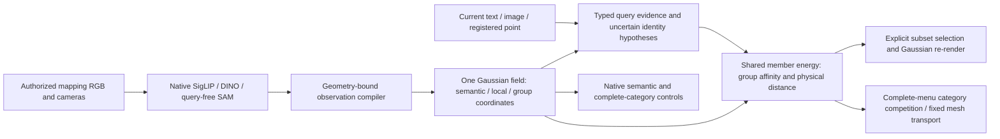

# Query-preserving Gaussian field: implementation and experiment ledger

Research entry: `python -m radio_gs.query_field`.
Decision: [ADR0013](../adr/0013-query-preserving-scene-specific-gaussian-field.md).

Latest design: [v10 capability transfer](v10-capability-transfer.md), governed by
[ADR0014](../adr/0014-v10-capability-transfer-within-one-gaussian-field.md).
It retains the one-field core while allowing the evidence capacity and typed
decisions required to recover performance. `identity_evidence` implements
v10-compatible rank fusion and bidirectional correspondence as research primitives;
the [fixed full-image control](../experiments/2026-10-08-native-identity-transfer-protocol.md)
does not change the default field or claim that fused Gaussian sets equal source patches.
Its [completed results](../experiments/2026-10-08-native-identity-transfer-results.md)
show partial identity recovery, with no default promotion; construction capability
retention and conditional member learning remain the next architectural work.

This package is the new construction/learning/query path. The v10 executable
recipe remains a frozen comparator. Neither its source-only NVOS solver nor
its label-trained member tree is silently called by the new package.

Latest evidence: the [architecture attribution](../experiments/2026-10-08-architecture-attribution-results.md)
is complete on the full baseline. The current member implementation remains
unchanged. Next designs must address functional native-query retention,
identity evidence beyond anchor selection, correct-support extent and semantic
category competition. The report distinguishes measured component effects from
unvalidated joint identity/scope proposals; it supersedes historical local
next-step suggestions below.

## Implementation boundary

| Module | Responsibility |
|---|---|
| `contracts` | Current query evidence, signed supports, explicit target type |
| `observations` | Native teacher extraction and geometry-bound source compilation |
| `geometry` | Full-scene contributions, actual selected-subset rendering and its differentiable training surrogate |
| `field` | Protected native subspaces, affine matching, shared scale-conditioned members |
| `adapters` | Native text/image encoding and camera/world-coordinate supports |
| `train` | Source-only partial-mask member fitting with frozen geometry/native features |
| `storage` | Local, hashed standalone payload and actual tensor/file cost |
| `evaluate` | Development diagnostics after fixed fitting; never model selection on final labels |
| `baseline` | Saved v10 metric and resource inventory |
| `smoke`, `cold_check` | Native encoders and four-input replay from a copied export with source-file access denied |
| `diagnose` | Explicitly privileged projection controls, never model predictions |
| `hypotheses`, `hypothesis_study` | Query-only native ranking and separately scored identity/scale capacity controls |
| `native_transfer` | Paired native-coordinate intervention with fixed members and observation support |
| `public_lerf` | Source-free text prediction, then unchanged historical benchmark scoring |
| `readout_study`, `subset_errors` | Exact baseline replay, explicit selection controls, and checked error decomposition |
| `support_audit`, `support_control` | Train-only inferred-support compilation, matched packaging, and three-scene validation |
| `metric_study` | Fixed physical-scale member-energy controls with frozen native query vectors |
| `exclusion_audit`, `local_metric_bound` | Source-only exclusion coverage and separate post-evaluation locality/scope bounds |
| `source_regions`, `public_nvos` | Query-free native crop construction; registered signed raster inputs, source-denied replay and separate real-prompt scoring |
| `public_scannet` | Common text-union member scores, complete-menu category competition and fixed Gaussian-to-mesh scoring |
| `public_uqis` | Independent public text/image/2D/3D inputs, one instance member core, persisted Gaussian and mesh sets |
| `support_training`, `support_concentration` | Matched source support-form experiments and post-study support-disagreement audit |
| `support_energy`, `support_jensen_audit` | Expected singleton-energy control, separate negative rays, and source-only comparison with response averaging |



The first implementation stores full native semantic/local coordinates as the
capacity control. Copying their averages into Gaussian rows is not yet
query-preserving distillation: preserving these coordinates during group fitting
does not prove that the source teacher's query capability survived initial
multi-view fusion. Native query ranking and local matching preservation remain
separate required experiments. Likewise, a shared affinity decoder with a scale
gate is an implementation starting point, not a novelty claim by itself.

Registered multi-pixel evidence now uses `adapters.raster_support`: normalize
each camera ray, then pool pixel evidence into the same weighted Gaussian Support.
Area resampling retains fractional thin strokes; missing projection mass is
reported instead of relocated. Deterministic CPU float64 reduction avoids CUDA
atomic-order differences in large support sets. Positive and negative rays may
share contributors and remain uncertain, so this does not introduce hard 2D
element constraints. The existing signed member rule is unchanged.

An explicit `raster_extent_scale` experiment uses positive ray-centre dispersion
to supply the existing physical scale input. The source scope convention is
twice spatial standard deviation; its maximum with the default is used. Single
pixels retain the default, and within-ray depth ambiguity is excluded from the
extent statistic. This is an input-scope estimate, not a new mask decoder or an
established recovery of complete object size. Keep both fixed scope controls in
the [real-prompt protocol](../experiments/2026-10-07-native-signed-prompt-protocol.md).
`public_nvos` keeps actual selected-subset alpha and the retained full-scene
normalized member response separate, and scores only after all fixed predictions
and copied-field source-denied replays are finalized.

`CapabilityField.support_membership` and `exclude_membership` now expose the
existing observed-support filtering and signed rule as differentiable common
operations for fitting and deployment. `training.support_policy` defaults to
`single`. The explicit `mixed_unsigned`/`mixed_signed` research policies use
source interiors/exclusions and deterministic gathered rays with independent
sampling RNG. The [completed comparison](../experiments/2026-10-07-support-training-results.md)
fails its common-input/public-subset gate; keep both as controls, not new defaults.
It preserves inference specification and tensor cost while changing training
support distribution (and adding 25% member evaluations in the signed arm).
Representing support disagreement and the difference between uncertain
alternatives and separate signed constraints remains an open method requirement.

The next opt-in `support_aggregation: expected_energy` control computes the
weighted expectation of the existing singleton member logit. Its sufficient
statistics are the mean group vector **without renormalization**, support centre
and spatial variance. For the physical metric,
`E[||x-X||²] = ||x-E[X]||² + E[||X-E[X]||²]`. This identity introduces no
learned parameters or new scene tensors. One-element supports retain the exact
old path, including inferred text/image hypotheses and exact 3D prompts.

An optional transient `Support.components` preserves negative ray identities.
Each ray averages its uncertain association energies; the largest per-ray
sigmoid response supplies the exclusion term. Every supported ray is retained,
with chunks of 32 controlling memory. This maximum makes independent exclusions
monotone and duplicate whole constraints idempotent; it can also amplify noisy
or weak fractional negative observations. Positive observations use their
evidence-mass-weighted mean energy, not independent hard constraints.

`paired_signed` source training averages an original anchor-render loss and an
auxiliary ray-render loss at each of 2000 updates. Auxiliary forms cycle one
ray, four positives and four positives plus four negatives. It doubles rendered
losses to 4000 while retaining 2000 singleton presentations; singleton gradient
weight is halved, so unchanged competence is a measured gate, not an assumption.
The [fixed study](../experiments/2026-10-07-expected-support-protocol.md) includes
both frozen insertion and matched paired training with the old aggregation.
Expected logit, average sigmoid response and a calibrated latent-association
posterior are distinct. The sufficient moments for energy do not establish
that they suffice for nonlinear query capability.
The [completed results](../experiments/2026-10-07-expected-support-results.md)
reject both fitted arms: 2D support losses and severe signed over-exclusion
prevent promotion despite some image/3D or positive-only gains. The protected
native field and accepted physical candidate remain the reference. The source
nonlinearity audit does not validate response averaging as a replacement either.

An optional protected `anchor_eligible` mask now aligns inferred text/image
supports with the source-interior domain used by member training. It does not
restrict decoded members, relocate registered prompts or turn inferred anchors
into certain positives. `observations.training_episode` is the shared rule for
fitting and support compilation. Old exports without the mask retain their old
behavior. New fits may set `training.inferred_anchor_domain` to
`training_eligible`; the default remains `all_observed` for matched controls.
See the [three-scene result](../experiments/2026-10-07-training-supported-identity.md)
and `configs/query_field/supported_anchor_control.json` for policy-only packaging
of existing fields. The added mask belongs to the deployment size, not a hidden
training-cache dependency.

`training.spatial_metric: scale_normalized` is an opt-in physical metric in the
same member kernel. It subtracts squared distance to the weighted support centre
divided by twice squared query scale from the learned group logits. Explicit
`world_units_per_metre` converts physical metres to reconstruction coordinates
and is exported with the model. It has no new trainable parameters or runtime
source dependencies. The original `none` mode preserves old exports' behavior.
Spatial scale now affects geometric extent as well as the group feature gate;
the uncertainty and limitations of a Euclidean support-centre prior remain
separate from the source-supervised group representation. Evaluation follows
the [fixed two-arm protocol](../experiments/2026-10-07-physical-scale-member-protocol.md).
The [completed three-scene comparison](../experiments/2026-10-07-physical-scale-member-results.md)
selects the **refitted** physical metric: the frozen post-fit control fails the
image gate on figurines. Current opt-in fitting recipes are
`configs/query_field/{figurines,ramen,teatime}_spatial_metric.json`, which combine
`training_eligible` inferred supports and `scale_normalized` membership. Legacy
constructor and first-pilot defaults stay unchanged for exact reproduction.

The physical recipe now also covers `waldo_kitchen_spatial_metric.json`, completing
the four declared LERF development scenes. The [full-cohort ledger and next
intervention](../experiments/2026-10-07-native-local-member-results.md) keep those
four physical fields separate from native-local experiments.

`training.local_metric: native_cosine` is a research-only option adding protected
DINO cosine distance to the common group energy, including signed supports.
The coefficient is fixed inside the existing temperature and support directions
are decoded and normalized before averaging. It adds no stored tensors. The
refitted version improves text/image evidence but fails one 3D-point diagnostic
gate; its default remains `none`. Do not insert it only for text, combine the
best per-input outputs, or call it a promoted replacement. Native directional
comparison incurs additional query computation, and heterogeneous object parts
remain a scope problem rather than verified negative evidence.

## Relative signed-evidence controls

`negative_rule: competitive_pooled` and `competitive_rays` are explicit frozen
research controls. Both use `sigmoid(l+ - softplus(l-))`, retaining unsaturated
positive logits from the same member kernel. The ray version aggregates every
negative ray's normalized-prototype score by observed evidence mass; it adds no
field tensors and does not alter positive pooling. No-negative outputs remain
exact. The rule requires normalized-prototype support aggregation and cannot be
stacked with the failed expected-energy option. These scores are not calibrated
probabilities or a complete uncertainty model.

The [completed comparison](../experiments/2026-10-07-competitive-evidence-results.md)
finds small fern signed gains for ray competition but a failed figurines
teacher-subset gate. Keep `product` as the common default. No per-scene selection
or negative-strength tuning follows. Source-only association/extent diagnostics
now show both visible anchor mismatch and incomplete extent control even with
target-supported anchors. The next hypothesis is to retain identity evidence
beyond anchor selection while learning scope through the same member operator;
it has not yet been implemented or validated as a replacement.

## Reproduce the first pilot

Run from `/root/RADIO-GS-query-field`, with the existing cybersim_agent Python
environment and `PYTHONPATH=.`. Select a GPU through `CUDA_VISIBLE_DEVICES`;
the device argument is relative to that selection. The initial bounded run uses
one GPU, four CPU threads, and the same fixed configuration for all stages.

```sh
python -m radio_gs.query_field compile --output output/query_field_20261007/figurines_pilot_v1
python -m radio_gs.query_field fit --output output/query_field_20261007/figurines_pilot_v1
python -m radio_gs.query_field evaluate --output output/query_field_20261007/figurines_pilot_v1
python -m radio_gs.query_field smoke --output output/query_field_20261007/figurines_pilot_v1
python -m radio_gs.query_field diagnose --output output/query_field_20261007/figurines_pilot_v1
```

Construction and model export refuse to overwrite existing directories.
Development results concern source SAM groupings and native feature retention,
not human-labelled complete instances, LERF benchmark masks, or v10 equivalence.
Scale-conditioned diagnostics and automatic default-scale results must be
labelled separately. Projection coverage is reported on the complete raster;
missing elements do not disappear from the evaluation denominator.

These paths now contain the completed run and are immutable. To reproduce,
choose a fresh root. The 2,000-step controls reuse the same compiled observations
under an `observations` symlink in fresh run roots, then call `fit` and `evaluate`
with `--config configs/query_field/figurines_fit_budget.json` or
`--config configs/query_field/figurines_subset_objective.json`. The latter changes
only the objective to query-selected subset alpha; stored geometry/opacity remain
frozen. This is source-only scene fitting of one shared member function, not a
source-cache optimization performed for each evaluation query.

Do not add full-scene visible-membership and subset losses merely to increase
the loss count: historical next68 did not support that combination. The new
matched comparison evaluates the two objectives separately.

Actual results, limitations and next experiments are recorded in the
[2026-10-07 ledger](../experiments/2026-10-07-query-preserving-gaussian-field-bootstrap.md).
The machine-readable [five-task acceptance specification](../../configs/query_field/benchmark_contracts.json)
distinguishes geometry, input, teacher and output changes from compression.

`point_2d` consumes registered camera intrinsics/extrinsics and the camera world's
units-per-metre value; image pixels alone cannot register a 3D ray. `point_3d`'s
registration tolerance is in the supplied world's coordinate units. The local
"LERF3D" benchmark uses a different, historical alpha threshold than this fixed
0.5 development diagnostic; their numbers are not directly comparable.

## Required next evidence

The 2026-10-08 work order is to complete the same architecture on all five
development cohorts before further local method changes, compression or speed
work. Historical local gates below do not delay that full-cohort baseline.
Use the [fixed protocol](../experiments/2026-10-08-five-benchmark-architecture-protocol.md)
and `configs/query_field/five_benchmark_v1/cohort.json`. New scenes share the
18-training/2-development-view source budget and 2,000-step physical member fit;
the accepted LERF fields and 12-training-view fern field are retained.

The compiler accepts explicitly registered metric cameras as well as the saved
MoGe calibration route. ScanNet and UQIS use declared unlabelled-mesh surface
Gaussians. ScanNet runs the same text-union query for every category and compares
member scores within each full 19/15/10 menu. UQIS uses instance scope for all
four independent public inputs, with no target pairing or source access during
prediction. Their fixed nearest-centre mesh correspondence transports both
scores and actual sets; unobserved points and unsupported queries remain scored.
These input/carrier/readout differences and the smaller observation budget must
remain visible in comparisons with v10.

The [completed five-task table](../experiments/2026-10-08-five-benchmark-results.md)
now provides that baseline. Its full configuration, construction receipts,
prediction barrier and scoring evidence are saved under
`output/query_field_20261007/five_benchmark_v1`. No per-scene or per-input winner
is selected. Next measure the stages below against those fixed outputs before
implementing another method variant:

| Stage | Diagnostic question |
|---|---|
| Geometry and source coverage | Which target elements and prompt supports have no trained observation? |
| Native observation fusion | Which native text/local distinctions are lost when authorized views become Gaussian features? |
| Query identity | Does the inferred or registered support refer to the requested target? |
| Member extent and scale | Given target-associated support, which target elements are missed and which others are added? |
| Typed readout | How much is lost in category competition, thresholded response, actual subset rendering or mesh transport? |

Privileged target-based diagnoses must stay in evaluation and never become
undeclared training/query inputs. Fixing one stage should retain complete-cohort
reporting rather than substituting a locally improved score.

The [two-scene follow-up](../experiments/2026-10-07-query-field-two-scene-and-readout.md)
now completes figurines/ramen 6/18-view fits, real text LERF probes, fixed native
identity/scale controls, readout interventions and a second-scene cold replay.
The shared member path is much weaker than native-only selection on both
18-view scenes. This is a failed quality gate, not evidence against all possible
scene-specific member architectures. It narrows the next implementation work.

- Diagnose and repair the loss from native inferred identity to member extent,
  after the completed training-supported input correction; actual subset extent
  remains weak despite better semantic response maps.
- Preserve registered-point competence while testing native-conditioned member learning;
  no public benchmark queries or answers enter scene fitting.
- Evaluate actual reference-image target identity beyond teacher-region diagnostics.
- Local DINO query retention before compression; no substitution by pooled-only claims.
- High-capacity B vs compact B using identical geometry, inputs, split and readout.
- Full five-task protocol and resource ledger; newly held-out final rooms.

The current implementation does not implement general compositional language grounding,
multi-turn signed interaction, learned category affinity, codebook compression,
or full source-SAM extensions. They remain explicit work, not hidden fallbacks.

GitHub issue synchronization is pending because `gh` is unavailable in this
execution environment. This repository-local decision and ledger preserve the
authorized implementation scope in the meantime.
