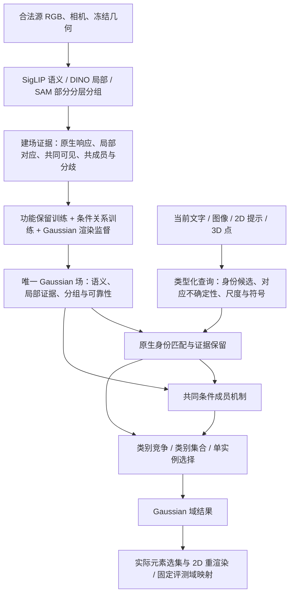

# v10 能力迁移与理想架构的融合方案

2026-10-08。决策见 [ADR0014](../adr/0014-v10-capability-transfer-within-one-gaussian-field.md)。
这是当前研究设计与验收账本，不是已经实现完整性能的声明。

## 独立联合函数：已定位排序与入选混淆

2026-10-09全4场、756合法来源的LERF功能研究已完成，见
[固定对照和失败归因](../experiments/2026-10-09-text-union-functions-results.md)。
无训练、无新增实例标签，在单场SemanticMeasure上独立比较当前文本与通用
背景，取消语义分支的八候选／最佳相对入选。共同成员仍保留旧候选限制。

预定主方案响应IoU49.6752→56.0037%，实际选集投影30.0056→29.9632%；
**未通过实际范围改善**。相同状态measure_prior实际42.9498%，加入共同成员
正向排序加分后四场均退化，精确率46.2069→30.3358%，召回84.1598→94.8561%。
这已定位为读出语义错误，而非理想架构已证明不可行或训练时间不够。

新增显式的入选保持型支持只在正语义margin上调整排序，不允许低于阈值的
语义证据靠成员加分直接变成前景。该限制还不具有完整范围推断能力；不得把
其等于prior的实际选集描述为共同成员完成了范围恢复。探索协议见
[修复完整结果](../experiments/2026-10-09-union-admission-results.md)。四场响应55.3608%、
实际选集42.9498%，较父版本提高5.6855／12.9442pp；实际集合四场均升。
与语义prior选集完全一致，排序另增响应1.2719pp；不能把集合提升归于成员
已经学会范围。20测试和21文本复制场回放数值通过，严格逐值仍失败。
探索性修复未提升统一默认，相比v10仍差15.0399／24.0135pp。

能力账本的后续顺序：保留语义函数与拒绝能力；共同成员显式接收可信正负证据，
先测正确身份下的实际范围，再与身份误差共同测；最后才整合统一五项模型。
NVOS123份缺失合法原生缓存已补齐，243个合法来源全部验证绑定；
其中108份旧缓存是原图最长边1008的确定缩放，12份旧fern使用schema2，
其余schema3。来源覆盖恢复但分辨率／生成版本未统一，尚非同预算功能参照。
原图字节假设的失败与确定缩放逐像素验证均保留，见
[来源完成及差异](../experiments/2026-10-09-nvos-source-completion.md)。
不能将“缓存齐全”直接记作NVOS能力恢复。

## 完整类别菜单的函数迁移

2026-10-09 后续全10场ScanNet研究已完成。新增场内SemanticMeasure保留原生语义
原子及Gaussian支持测度，在完整菜单上先竞争，再积分，并保留熵信息可靠性。
共同成员仍由同一场提供，其有界支持规则未变。架构见
[ADR0017](../adr/0017-menu-conditioned-semantic-measures.md)，完整对照见
[类别函数结果](../experiments/2026-10-09-semantic-measure-results.md)。

预定主方案19/15/10类mIoU为51.0166／52.8039／62.9232%，父场重新预测为
37.8310／38.6493／45.4900%；全部十场均改善。v10参考61.0115／62.5276／72.4861%，
仍有约9.56–9.99pp差距。相同状态上的平均后竞争→竞争后积分单独带来19/10类
2.5169／2.3998pp，再加可靠性1.1030／1.2750pp；并非每场均受益。
可靠性原生证据与共同成员结合在19类四场退化，不能把结构支持强解释成正确。

1138个合法来源、72,380个原子、60次来源函数比较，最大误差4.77e-7、类别
选择无差异。新增状态约1.81GB，未压缩。没有新训练、新实例标签或旧查询答案；
旧成员仍是此前全五项的confidence mixture，尚未替换为UQIS后续监督森林。
父场比较同时增加来源及改变原生构造，不能把总增量只归为非线性操作顺序。

18项测试通过。一场19类完整菜单独立复制回放类别选择完全一致，分数误差
1.79e-7；严格逐值检查失败，数值容差通过。来源拦截探针有效，无实际禁止
路径打开，但不是OS隔离或原始编码器的全场验证。失败及完整对照均保留。

这一阶段再次支持“先保留查询函数所需分布，再执行非线性读出”的方法原则，
不支持用平均特征保真代替能力迁移。v10运行时文本条件检测和额外局部通道
仍未迁移；类别文本消歧、LERF union、NVOS正负输入及同一配方全五项验证继续
欠缺。不能把不同轮次各任务最优结果拼接为已完成的统一系统，也不晋升默认。

## 原生身份函数与当前输入函数迁移

后续三条件研究已完成，构建冻结于 `ae80fc4`，18份场导出、804个公共查询及
全部评分和归因均已完成；未据分数调整冻结方案。协议见
[原生模式函数](../experiments/2026-10-09-native-mode-functions-protocol.md)，
架构扩展见[ADR0016](../adr/0016-gaussian-supported-native-appearance-measures.md)。

本轮将每个外观模式绑定到已有 Gaussian 支持列，保存语义方向和局部外观加权
分布；保留所有受支持模式作为身份候选。图像在完整模式上计算语义／局部秩融合，
确定估计锚点后仍调用相同成员函数。该模式不是完整实例标签，也不会强制为正。
源图像、掩码、相机和每视图 patch 栅格不进入导出；外观原子本身是新增的未压缩
场状态，必须计入容量，不能借“场内张量”这一命名隐去来源信息或宣称创新。

固定三个条件：相同候选／原尺寸输入上的均值与完整加权分布，以及同一完整分布
上的448宽重采样／单位质量与原裁剪尺寸／有效面积质量。后者补回此前丢失的
查询输入函数；三个条件都整合已验证的几何表面2D输入。共同成员判定、几何及
Gaussian原生通道不变，继承22房间监督与3房间校准，不新增训练或教师。

全部9场37,679个模式、1,670,173个外观原子上的72次源查询回放最大误差1.79e-7，
没有发生源区域中位数锚点变化。44项相关测试通过。均值／分布导出的张量哈希
相同，读出配置不同；九场一套导出27,667,535,242字节，较前一轮完整成员场
增加约5.56GB。均值条件为控制变量仍保存相同原子，不能据此讨论均值的最小存储。

本轮对上一轮的差异还包括完整来源的身份描述覆盖、候选域和语义绑定；上一轮
完整成员证据并不等于完整身份功能。来源／表示／当前输入／最后成员判定需要
分别归因。UQIS完整机制研究也不能替代后续相同配方的全五项验收。

完整分布＋原尺寸的文本／图像／二维点／三维点 IoU 为
20.1561／39.8749／49.5025／48.4807%，图像从26.8655%提高13.0094 pp，
九场全部提高，距v10为0.0230 pp。均值＋原尺寸图像34.0541%，完整分布＋448宽
为38.3179%；两个局部对照的场级95%区间均跨零，不声称每场稳定受益。
文本总体提高但scene0700明显退化；详见[完整结果及限制](../experiments/2026-10-09-native-mode-functions-results.md)。

文本／图像候选含目标均67/67，最终正确身份24/67、44/67，说明候选覆盖已恢复，
排序仍有错误；两个点输入67/67正确仍不等于完整成员范围正确。同实例内模式
改变也能显著改变最终范围。旧语义响应及点输出对声明参照逐值相同，一场四输入
复制导出回放逐值通过且无来源打开，但只是Python拦截／预编码查询的有限验证。
当前不晋升默认，也不是全五项完成；下一阶段先验证相同方法的其它任务类型化
读出、补齐NVOS合法来源，再做身份／锚点／范围的独立对照。

## 共同观测与成员决策的实际功能迁移

2026-10-09 后续四条件研究已完成36份场构建、1,072次预测及全部评分，协议见
[共同观测功能迁移](../experiments/2026-10-09-joint-observation-transfer-protocol.md)。
这次将 v10 的15项成员输入函数和实际判别器分别编译进同一 Gaussian 场，明确
替换当前“成员先验 + 固定 P/N 更新”这一中间实现。原生查询通道、几何和候选程序
不变；每种输入调用相同的成员函数，不转接旧任务求解器。

四条件是同一查询无关 SAM／RGB-D 可见性生成方式下的原18帧与完整合法来源，
分别使用 source-only 可见条件共成员读出与已有独立房间监督的成员判定。UQIS
九场共162／1,089个来源视图，均排除原18个开发视图和 benchmark 保留帧。
额外监督条件继承既有22房间实例标签和3房间阈值校准，不重训，也不访问当前
benchmark 标签；其收益不能归给 source-only 三教师能力。此轮覆盖全部9场、
四种输入，但不是完整五项的新版本验收，更不是其它任务各取旧获胜模型的组合。

Gaussian 行保留二值共同观测坐标与可见性，使“任一掩码支持／全部掩码支持／
粒度分歧／共同可见”实际进入成员判定。原生成员响应可以按其线性函数折叠为
每 Gaussian 的 native moment，但必须保留幅值；归一化每行会改变该函数。
这只保留指定的原生锚点响应，不能证明单均值保留了非线性的局部 patch 匹配。
成员森林节点、双精度阈值和叶值成为场内张量，运行时不加载 joblib 或来源地图。
当前是未压缩的功能参照，不能把张量包装本身称为论文创新。

原生特征训练覆盖与完整成员域也已分开。注册点和判别器输出可覆盖完整冻结载体，
原生身份候选仍限于原来有特征的域；不把“缺少原生观测”硬译成“不可能是目标
成员”。同一判别器对不确定射线采用明确的混合条件，对推断身份不强制正成员。
这部分与 v10 使用单几何锚点的输入条件不同，需要单独验收。

288个固定源域查询的输入函数最大误差8.34e-7；相同输入上的森林算子通过1e-7
比较，固定样本选集一致。重新结合浮点运算后，完整函数链的成员分数最大差异
.0012075，不能冒称端到端逐值相同。

完整来源与迁移判定条件的 UQIS 文本／图像／二维点／三维点 IoU 为
17.2524／26.8655／46.4446／48.4807%，三维点距 v10 只差约0.5663 pp。
source-only 完整来源三维点为40.5871%，原18帧加迁移判定为41.1677%，
表明来源与判定都有独立作用，收益存在交互、不能直接相加。固定原59个正确点的
成员精确率／完整目标召回率／IoU 从58.3361／53.3664／33.0997%变为
70.1553／66.7753／48.4314%；所有67个3D输入现均能正确注册。
详见[完整结果与归因](../experiments/2026-10-09-joint-observation-transfer-results.md)。

此外在任何新评分前登记了[二维点输入函数对照](../experiments/2026-10-09-surface-input-function-protocol.md)：
由 Gaussian 中心恢复 v10 的第一局部表面交点规则，并将结果交给同一成员场。
它与整条射线的贡献混合是不同的条件分布；两者不能未经验证就视为等价输入。
该对照使用完整监督条件场的全部67个2D点，不把估计的三维点强制为正成员，
不据分数选择某些查询采用哪种适配器。两项几何函数测试通过，全部67个2D输入
IoU从46.4446%升至49.5025%，距v10约0.2332 pp，九场八场改善。原混合输入
的主分量其实全部正确；19个输入混入其它实例分量，收益主要集中于这19个输入。
因此条件混合的传播是实质问题，不能只看主点定位正确率；本对照尚未分离表面
位置变化和非线性效应，也不是新的全五项／全输入候选验收。

图像身份仍未恢复：完整迁移条件正确选中29/67（前一轮33/67），候选含目标
37/67；文本正确20/67、候选含目标27/67。本轮提高了范围判定，不能据此宣称
原生身份能力已经迁完。下一阶段要验证真实局部patch函数及候选覆盖。

53项不同场／查询回归及2项表面测试通过。四条件各134个原生语义响应与前一轮
精确相同。冷回放20组选集完全一致、无源路径打开、数值容差全部通过；严格逐值
门仍失败：full_source二维点348个分数差异、最大1.788e-7；其余19组逐值相同。
保留失败，不晋升默认模型。当前大容量函数参照是研究工具，不能当成已完成的
紧凑论文方法；接下来仍须完成原生局部功能和同一配方的完整五项验证。

其它21场的来源复用也完成只读核查：几何回执均与 v10 相同；保留现有开发划分后，
LERF756／756、ScanNet1,138／1,138个候选视图均有标记查询无关的原生描述缓存，
且引用的 SAM 文件存在。NVOS 为120／243，还有123个候选视图需准备原生缓存。
这只是缓存头与文件存在性，不是全部掩码重新验真或已完成函数迁移；不能继承旧
查询相关校准器。证据位于本轮输出的 `diagnostics/remaining_family_sources.json`。

## 支持函数修复与信息预算核查

2026-10-09 后续实现 `confidence_mixture_partial_view_evidence_v1`，固定协议见
[支持函数对照](../experiments/2026-10-09-confidence-mixture-function-protocol.md)。它改变真实查询
调用关系证据的方式，所有场张量保持上一组 Soft 导出的 SHA256，不再加损失或训练。
对已观测支持分量 i，区域 r 的正／排除坐标为 p、n；未知为两者均无质量。先在每个
分量内部依据 p>n 和原物理尺度约束进行条件关联，以保留区域已知质量的 p 表示偏好，按视图归一化，
再乘该分量在视图中已接纳区域的最大已知质量。最后按合法输入权重合并各分量。
每个视图的总关联质量不超过1，未知支持保留弃权质量，弱证据不会被归一化为完整一票。
这明确改变了“先平均全部支持，再对绝对正质量做多数门限”的旧函数。

第一版曾用 p/(p+n) 作为视图内偏好；来源反例 p=[1,1e-6]、n=0 得到 [.5,.5]，
使微弱区域借用了强区域的可信度。该批次完成30份构建后，在任何评分前停止，保留
部分预测与停止记录。修正版使用 p=(p+n)·p/(p+n)，同时检验弱区域趋零和孤立弱视图
仍为弱票。这一修正依据源函数反例，未依据 benchmark 分数挑选。

现有 observed 过滤、成员先验、目标正负坐标、有限证据更新、符号乘积和类型读出保持
不变。因此本对照只能回答关联函数这一组合干预的实际效果，不能声称解决未观测载体、
独立负射线约束或完整实例判定。新六项观测统计已在二值、互补可见排除、单点条件下
对齐 v10 原函数；真实软部分观测是另一条件，六项统计也尚未用于替换最后的成员判定。
源函数数值保持、真实输入激活与任务性能分别验收，不能合并成一个“迁移完成”标签。

逐场来源清单核查同时发现当前高容量参照仍沿用最初的小来源预算：

| 去重场景族 | 新路线训练视图 | 特征开发视图 | v10 清单来源视图 |
|---|---:|---:|---:|
| LERF（4场） | 72 | 8 | 764 |
| NVOS（7场、8组提示） | 120 | 14 | 257 |
| ScanNet（10场） | 180 | 20 | 1,158 |
| UQIS（9场） | 162 | 18 | 1,107 |
| 合计 | 534 | 60 | 3,286 |

证据为 `mixture_functions_v1/diagnostics/reference_budgets.json`，包含31组任务到30份场
的映射和双方清单哈希。当前534个训练视图全部进入关系编译；fern 原配方12个、其余
29场各18个。此前“六个 fern 视图无有效 episode 被过滤”的解释已更正，实验分数不变。

上述计数并不证明补帧就能补齐精度，也不是净信息量比值：来源查询依赖、辅助教师、
分辨率、完整实例监督和查询扩展仍有差别。但它明确说明当前18视图中间实现不是
与 v10 同信息预算的完整能力参照。后续完整 B 必须先固定可用的查询无关来源、保留
开发划分并消除任意20帧上限，再分别测原生响应／局部对应、条件证据和最终集合。
不能反复在同一个小预算参照上增加损失，然后把长期差距归于理想架构。

架构要保留的是一份 Gaussian 物理载体、三教师职责、场内条件函数和统一空间结果。
18个训练视图、单均值描述符、32维分组和一个固定证据组合都只是可替换的中间选择。
扩充来源或声明额外监督时必须单列条件；现有 source-only 结果不变成同预算结果。

完整来源迁移的几何可行性也已逐行核对：UQIS九场中七场新 Gaussian 中心与 v10
载体坐标完全同序；scene0435_00、scene0246_00 各少三个顶点，但通过导出时保存的
`source_vertex_ids`，九场全部能精确对应且索引唯一。证据位于修正版批次的
`diagnostics/uqis_carrier_correspondence.json`。这允许下一步按显式来源顶点索引
在相同载体上编译完整关系，避免把近邻重采样误差混入来源预算对照；它尚未实际迁移
源证据，也不证明 teacher／划分相同或性能已恢复。

该修正版现已完成全部五项，详见[结果与归因](../experiments/2026-10-09-confidence-mixture-results.md)。
它没有使用额外训练：全部8组 NVOS 的正负支持从不激活变为激活，正确 UQIS 点
支持接通数量40→55／59；这是实际输入功能的修复。NVOS 响应57.9518→61.8552%，
UQIS 图像20.4545→21.0120%，但 NVOS 实际选集69.9469→69.7200%、LERF2D
50.8613→49.6752%，UQIS 点几乎持平。所有数字均为相对上一完整 Soft 参照，
同一新配方覆盖全部任务，不晋升默认模型。

这轮进一步把“支持接通”与“成员判定正确”分开。正确点的目标证据激活从55.5853%
升至72.4393%，有效视图质量却仅1.339→1.371；目标排除占优从10.0394%升到
16.5521%，漏选但正证据占优从5.2008%升到8.1664%。当前决策仍是
`2*prior-1+P-N>0`，53个正确查询累计17,588个目标顶点虽 P>N 仍未越过先验。
因此既有证据错误极性，也有证据强度／先验标定缺口；仅增加关联或统一放大权重
不能证明恢复完整成员能力。六项共同观测统计仍只做诊断，下一版本必须检验它们
参与共同成员判定的功能，而非继续只报告统计测试或特征不变。

下一步的足量 B 要先固定合法查询无关来源与监督条件，保留开发划分，再同时保存
原生局部功能、共同可见和粒度分歧。534对3,286的计数不能成为直接搬入全部 v10
资产的许可或效果保证。一个场、共同条件机制和类型读出保留；18帧、单均值、
32维分组以及固定有限证据更新都允许为可验证的能力迁移而调整。

独立源重放1,068次全部非空且最大误差4.77e-6，268个原生输出精确不变。
严格冷回放的图像分数哈希失败也明确保留：原操作顺序的两次新进程中1,339个
分数最大差1.79e-7，全部选集和另外四类分数精确相同、无源路径打开。补充数值
检查通过不豁免原严格标准；这是一组完成执行但未通过全部验证、未恢复性能的研究。

## 2026-10-09：从参数保护改为功能验收

用户进一步明确：不能让精度长期迁就中间表示，也不能把特征保留、增加监督和训练
收敛当作 v10 功能迁移。这个要求改变方法验收的顺序：先声明要保留的查询函数及其
输入条件，再验证足够容量参照，最后讨论如何将该能力写入学习表示。

当前实现的是[成对部分关系功能参照](../experiments/2026-10-09-paired-function-protocol.md)，
并非又一轮原成员头训练。一份 Gaussian 场暂时保留未压缩的稀疏正／排除关系坐标，
同时记录物理尺度和从属视图组；共同成员函数直接消费这些场内关系。建场时将
“源像素中组合部分掩码，再向 Gaussian 传递”的函数，与“仅在导出关系码上求值”的
函数逐元素比较。这个参照允许容量增加，明确报告字节，不把保存稀疏观察因子包装成
紧凑化或已成立的论文创新。首组完整五项结果已封存于
[结果 JSON](../experiments/2026-10-09-paired-function-results.json)，可复核快照为 f13f0ec。
30 份场、534 个有效源视图上的 1,068 次函数重放通过，但真实任务未恢复：LERF
实际选集投影四场均下降，NVOS 不变，UQIS 点输入仅小幅改善。保存函数和有效迁移
已经能分别检验，不能把前者作为后者的替代指标。

第二组[连续可信度对照](../experiments/2026-10-09-soft-paired-function-protocol.md)在首组
任何 benchmark 推理之前，依据源观测覆盖检查确定。它固定同一父场、所有源视图／
区域、支持关联、原生查询和接受规则，仅令目标行的弱投影按 `min(1,peak/.1)` 提供
分数证据。单独保留硬关联坐标，避免改变目标覆盖时同时更换查询关联。增加容量属于
已申报的研究参照；其成本必须与所有五项质量一起报告。

两组现在均已完整结束，见[全部结果与归因](../experiments/2026-10-09-paired-function-results.md)。
全场关系可用覆盖从 23.6653% 增到 85.4164%，但 Soft 相对 Hard 的 UQIS 3D 点
IoU 仅增加 .0420 个百分点，配对区间跨零；LERF 实际选集仍在四场都低于固定父场。
因此优先级不能停留在增加目标覆盖。八组 NVOS 正负支持在尺度过滤前就全部未通过
.5 关联门槛，关系输出为零，四类保存输出与父场逐值相同。59 个正确 UQIS 点支持中
也有 19 个完全不关联视图。源伪查询重放成功，没有保证实际支持输入接通了该功能。

实际查询审计还显示：正确支持的目标潜在覆盖已到 94.98%，实际激活只有 55.59%；
29.53% 的已观测目标顶点同时处于漏选和无激活证据状态。Soft 相对 Hard 累计补入
405 个目标顶点，但也新增 931 个非目标顶点，另丢失 72／排除 61 个。计数按查询累加，
不能当作场景宏平均或唯一因果解释。修复支持关联时必须保留 unknown、可靠反对及
多射线不确定性，并重新验收所有输入；不能靠降低门槛强迫非空，也不能继续把扩大
坐标覆盖当作完整实例能力。当前两组只是部分功能参照，完整同口径基线 B 仍未完成。

下一阶段的方法验收要显式区分三层：支持是否能关联到合法证据；证据是否覆盖正确
目标并保留分歧；共同成员判定是否把证据变成正确集合。未知支持和反对支持不能混为
一谈，多视图中的“部分 mask 支持／全部 mask 支持／共同可见”也不能只靠一个曝光
标量代替。当前坐标虽保留正负部分关系，其固定质量加权读出仍未等价实现 v10 的
六维共同观测函数；此缺口与原生局部 patch 功能、完整实例监督缺口分别记账。

| 能力契约 | 必须检验的函数行为 | 当前已经具备 | 仍不能声称 |
|---|---|---|---|
| 文字身份 | 相同合法文字对候选的排序、混淆与接受范围 | 原生查询代数、完整场评测 | 原生分数不变即已恢复源区域的文字功能 |
| 图像身份 | 当前裁剪与目标局部证据的双向对应、正确身份率 | v10 匹配原语数值一致、Gaussian 集合匹配 | 融合均值向量等价于原始 patch 分布 |
| 条件关系 | 支持与候选的可靠正证据、排除、共同可见和分歧 | 本轮显式保留部分正／排除函数并独立重放 | 已复制 v10 六项共同观测特征及其标注成员判别器 |
| 完整成员 | 正确支持下的实际精确率、召回与集合 IoU | 59 个正确支持的固定归因队列 | 源部分关系拟合或梯度覆盖等价于完整对象监督 |
| 任务语义 | 实例、并集、类别竞争使用各自正确的证据含义 | 一份场与共同成员核心、类型化读出 | 相同 scalar／相同阈值必然具有相同语义 |
| 输出落地 | 实际 Gaussian 选择与移除其它元素后的重渲染 | 真实选集、响应与 AP 分开评分 | 软渲染或二维响应改善即完整三维成员改善 |

可调整的是表示容量、关系坐标、查询条件与小读出；不要求冻结目前32维分组、单均值
原生描述或一个曝光标量。保持的是三教师职责、同一物理载体与场景状态、共同条件关系、
运行时无需源资产，以及由同一 Gaussian 结果产生空间输出。比较增加容量带来的收益时，
必须把“函数已保存”与“证据正确、决策有效”分开。即使这次功能参照失败，也需区分
合法源关系本身不足和后续接受规则不足，不能再次据此否定整个理想架构。

完整 v10 对齐仍须明示源帧、额外3D监督、辅助教师和 NVOS 输入的差别。这一轮只改变
同源条件下关系函数的保存与消费方式，不借用上述不同条件的能力来宣称等价迁移。

## 保持初心，调整不足

核心仍是：**在建场阶段吸收多视图教师能力，形成一份场景特定的 Gaussian
能力场；查询时由当前输入与这个场共同推断目标及其成员，2D/3D 消费同一结果。**
不把 v10 的多个任务求解器重新接回来，也不把“统一”简化成所有任务只能使用一个
失去语义含义的标量。允许受保护的结构化子空间、必要的多模态局部表示、场景特定
小解码器，以及明确的类别／集合／实例读出。每项容量必须解释保留什么证据。



原生功能训练已补上首个可执行实现，见下文第三轮；多模态局部表示尚未完成，
不能把整张图当作已验证的方法或足够容量上限。
双向匹配与排名融合的纯算子已经落地，且完成全部67图像的固定场对照：
[首轮迁移结果](../experiments/2026-10-08-native-identity-transfer-results.md)。
部分身份能力恢复，但 IoU 提升的区间跨零，尚未晋升或实现完整性能。

## 第二轮已实现的共同版本

`radio_gs.query_field.runtime.QueryFieldRuntime` 是独立运行入口。它加载原有的
`field.pt + manifest.json`，接收 `QueryPacket`，并提供 `category_partition`。
四种输入继续使用 `NativeQueryEncoder` 和注册点适配器；运行入口没有源数据加载器。
同一套程序、同一跨视图训练配方用于所有场景，未按任务或场景选择获胜模型。

**建场训练从单视图成员拟合扩展到部分跨视图关系。** 对一个源区域选取可靠内部
Gaussian 锚点，利用其在其它训练视图的几何贡献查找共同支持。只接受内部投影质量
至少一半、物理尺度比在 `[0.5, 2]` 内的区域；先在视图内归一化，再均匀采样有支持的
其它视图。部分正证据和可信排除各自保留权重；未观测处不参与损失，冲突不硬化成负例。
主视图和辅助视图都由**同一个原始锚点**条件化共同成员机制，分别经过实际 subset-alpha
渲染监督，各占一半损失。每个合法训练区域完整遍历两次，不更新语义、局部、几何或
候选域缓冲区。没有第二视图支持时重复原视图，并明确计数。

配对控制看到完全相同的区域、视图、目标、尺度和步数，仅让辅助视图使用自己的内部
锚点。这使“增加训练量和改变区域曝光”与“保留同一锚点的跨视图条件”可以分别比较。
这还不是完整对象监督：关联来自粗投影和部分 SAM 区域，可能漏掉可见关系或错误关联。

**图像实例保留原生身份证据直至范围选择。** 先在全部合法候选域对 SigLIP 与 DINO
匹配分数分别排名融合，按既定规则保留八个空间候选；每个候选都使用共同成员机制生成
Gaussian 集合，再计算集合与当前图像 patch 的双向匹配。原生语义排名与该匹配共同
选择一个成员假设。候选不是硬正提示；无有效集合时返回空集。当前集合里的局部描述
仍然是已融合的 Gaussian 向量，不能冒称恢复了 v10 的完整源 patch 信息。

**类别分区恢复原生语义竞争。** 完整类别菜单的原生 cosine 经固定温度100得到 `p`，
共同成员支持 `m` 形成 `p + p(1-p)m`。结构只能提供有界支持，强语义证据不被独立实例
亲和直接替代。此温度来自 v10 的既有 ScanNet 配方；这个组合是新适配，不是 v10
求解器，也不是已校准后验。15/10类报告从完整菜单结果取列，未知 Gaussian 保持 void。

本轮在30个场景上完成两组训练和全部五项及 UQIS 四输入验证，保留父模型、
配对控制、跨视图单项、类型化读出和固定组合的结果。完整结果见
[关系训练与共同程序](../experiments/2026-10-08-cross-view-relation-results.md)：
图像与类别能力恢复较明显，但成员范围进展有限，LERF实际选集出现退化，尚不晋升默认模型。
后验参数块互换进一步发现：figurines只换新分组编码实际IoU43.85%，只换新共享解码参数21.59%，
父模型41.79%。这支持优先检验分组学习与共享尺度／亲和接受范围的训练职责分离，
而非丢弃已学表示。后续五项验证已经完成：回退恢复了该场景，但其它场景并不一致，
训练时冻结也未优于事后回退，见[保护与功能建场结果](../experiments/2026-10-08-protected-native-results.md)。
协议分别见
[关系训练](../experiments/2026-10-08-cross-view-relation-protocol.md)、
[类别读出](../experiments/2026-10-08-typed-category-evidence-protocol.md) 与
[共同程序](../experiments/2026-10-08-common-query-program-protocol.md)。

调用示例（查询编码器是共享依赖，场景文件不包含源图像）：

```python
from radio_gs.query_field.runtime import QueryFieldRuntime
from radio_gs.query_field.adapters import NativeQueryEncoder, point_3d

runtime = QueryFieldRuntime.load(scene_export, "cuda")
encoder = NativeQueryEncoder(siglip_checkpoint, "cuda")
text_result = runtime.query(encoder.text("a red chair"))
image_result = runtime.query(encoder.image(current_reference_image))
point_result = runtime.query(point_3d(runtime, current_world_point))
```

## 成功经验与迁移验收

第三轮把建场优化拆成两个受保护的职责：源区域关系更新 Gaussian 分组编码，
原生查询功能更新语义／局部坐标。共享尺度门控、温度和亲和接受偏置作为独立参数块，
分别用回退原参数、训练时冻结两个控制检验，不能因一个场景的失败就断言全局应永久冻结。

`functional_training.py` 用合法源区域生成语义、局部伪查询，拟合教师在可靠像素对上的
软偏好。Gaussian 原生 cosine 必须先计算再投影，避免训练一个与部署不同的归一化函数。
局部教师提供实际相似度差；SAM 只界定可靠比较区域，不把同一对象所有纹理强制当作相似。
全维仿射残差以恒等映射初始化，并用方向保持项约束改变，随后写回原场的原生坐标。
几何、分组、共享成员参数及支持域保持不变，部署没有额外源库或第二套场景状态。

这个实现补上了“平均特征之后从未优化查询功能”的缺口，但全局仿射残差无法逆转任意
局部多模态混合，因此不能冒充高容量 B，也不能把源伪查询拟合改善等同于真实查询恢复。
三组均用既定共同查询程序跑全部五项；参数、训练／留出规则及归因对照见
[保护与功能建场协议](../experiments/2026-10-08-protected-native-protocol.md)。

三组完整结果已经给出负面约束：源留出偏好误差下降不等于真实查询恢复，原生更新也
不会改变当前注册点成员路径。[逐 Gaussian 原生坐标对照](../experiments/2026-10-08-native-coordinate-results.md)
也已跑完全部30场、五项与268个UQIS输入。它保留同一场、源功能目标和推理程序，
直接优化原生坐标，不引入源查询库。相对保护组，LERF实际选集32.8763→34.8311%、
ScanNet10 45.4731→46.3277%，但LERF2D 52.2864→50.5530%、UQIS图像20.4974→19.4973%。
语义源偏好在29/30场改善，仍未获得一致迁移；逐元素自由度并未单独解决功能保留。
优化器与参数化不同、平均仅86.32%已观测元素参与更新，因此不是充分优化的纯容量对照。
这四组均不晋升默认模型，不能按任务挑不同赢家形成虚假的共同版本。

后续成员工作须检查观测不均衡、元素关系监督与渲染监督的差别，以及原生／几何证据
在条件成员机制中的作用。具体优先级是：先固定正确注册支持，检验共同成员函数能否
利用场内原生局部证据、相对几何和可靠共同观测纠正漏选／多选；再让推断身份以其
不确定性条件化同一函数。源关系监督只使用已证实的部分正证据和可信排除，嵌套、
遮挡及冲突保留未知。原生／几何条件与部分元素关系已完成下述全量检验；真正的成对共同可见统计仍未完成。
功能建场同时需要检验真实文字／裁剪patch对应的查询行为，不能只用源区域／单像素
伪查询的偏好KL作为验收。继续保护一份场与共同成员核心，不接回标注v10头或源库求解器。

本轮已完成成员部分的首个全量实现与检验，固定设计见[元素关系协议](../experiments/2026-10-08-element-relation-protocol.md)。
`element_relation_training.py` 将同一配对区域的可靠投影转换成部分 Gaussian 关系，
分别保留正质量、负质量和未知，以逐元素软监督检查渲染目标之外的学习缺口。
`conditional_relation.py` 在原成员logit上加入零初始化的小残差，读取场内分组、
原生语义／局部匹配、相对几何和一个观测可信度标量；所有输入仍调用同一成员函数。
旧原生坐标、几何和共享接受参数不变。单改监督与加入条件解码两个对照均从原父场
开始，核对上一保护组的完整源配对trace。
[完整结果](../experiments/2026-10-08-element-relation-results.md)显示：条件成员将 NVOS
响应 57.9518→74.6098%，但 LERF2D 52.2864→16.9454%、实际选集 32.8763→9.4783%。
正确点支持下的召回提升被精确率下降抵消；源 BCE 下降不能替代范围校准。两组均不晋升，
不按任务拼接。相同原父场、源配对与采样下的元素／实际选集渲染联合训练也已完成
全部 30 场与五项验收，见[联合结果](../experiments/2026-10-08-joint-relation-results.md)。
相对条件单监督，NVOS 实际选集 71.9338→76.3384%，UQIS 点输入约恢复 2pp；
LERF2D 16.9454→33.2817%、实际选集 9.4783→13.0840%，仍远低于保护渲染对照。
正确支持的点精确率 44.4343→50.6241%，仍低于保护组 58.3788%。联合组也不晋升。

真实渲染 logit 梯度覆盖平均 94.5246% 已观测元素，两类源误差分别在 29/30、28/30
场改善；有梯度与较低源误差仍不是完整成员能力。默认尺度全部落在源尺度 10%–90%
分位内，不能用简单全局尺度外推解释失败。剩余工作应分开检验：已知支持下的接受
校准、源单锚点训练到不确定支持／并集读出的条件匹配、原生文字与局部 patch 功能。
并集累积假阳性目前是代码支持的机制假设，尚无独立消融；不能解释全部点输入误差。
仍缺同一条件解码器的纯渲染完整对照，不能宣称联合监督协同已被单独验证。

这个改动也改变了后续优化的依赖关系：注册点的成员函数现在读取原生语义／局部特征。
此前“原生更新不会改变点输出”的实验证据只适用于旧成员核，不能沿用到新的条件场。
后续功能保留或多模态表示更新，必须重新验证点输入、负提示及全部五项；保护原生参数
的训练职责，不等于声称解码后的各项能力彼此独立。

| 能力 | 历史证据与边界 | 当前缺口 | 新架构中的承接方式与检验 |
|---|---|---|---|
| 原生查询代数 | bias 与 decoded norm 必须配套；代数精确不保证语义能力 | 代数已继承，均值建场丢失功能 | 保护式写入继续保留；建场检验响应排序、查询干预、跨视图留出检索，特征 cosine 只作诊断 |
| 图像局部身份 | 同源／同教师双向 patch 比区域均值约 +4.14pp IoU；v10 使用双路排名 | 单元素均值、单向 patch 最大值和原始分数平均 | 先精确移植匹配与排名原语，再检验 Gaussian 集合是否保留足够局部证据；不足时修建场与表示 |
| 条件完整成员 | 真实部署观测训练比合成观测约 +9.62pp 点查询 IoU；含22房间3D标签 | 当前部分 SAM 单视图目标不能代表完整对象；仅相似度和距离 | 从合法源观测学习共同可见、分组一致／分歧、几何关系；正确输入支持与推断支持分开验收，不偷用标注模型 |
| 图像身份到范围 | 固定原生身份，已有成员头让图像 IoU34.8762→39.8980 | 两个阶段均弱，且身份选择后证据丢失 | 先修已知身份范围，再让身份条件持续参与候选／尺度选择；不把估计点硬标为正 |
| 类别分区与集合 | v10 保留任务含义；当前同场 native19=36.95%而成员竞争22.29% | 独立实例亲和被当作类别后验 | 原生类别证据参与完整菜单竞争，共同结构辅助归属；同时报告类别分区和实例集合，不用平均成绩遮蔽退化 |
| 正参考与有符号输入 | v10 NVOS 使用正提示派生参考 SAM 与源 tracks | 当前原始正负 scribble 信息条件不同 | 标准轨先保住提示及完整成员；源辅助扩展经同一核心单列输入与成本，不混入标准轨 |
| 实际选集可渲染性 | 归一化响应不等于移除其它 Gaussian 后的 alpha | 已沿用实际 subset-alpha 训练与评分，但响应/选集仍分化 | 两种输出均验收，保持几何和 opacity 冻结；禁止只优化好看的二维响应 |
| 可见性与观测平衡 | v10 不把未共同可见当负例，嵌套 mask 不等于独立视图票数 | 场中只有粗 observed 与有限分组编码 | 关系监督记录有效共同观测及不确定性，按视图平衡；重复区域/视图不能无故增加确信 |

历史失败也要迁移：高重构 cosine 不保证高查询精度；区域响应先算后融合的试验
有局部收益但未进入 v10；粗统计查询头未稳定胜出；能量均值、负提示最大排除和
单纯聚合改动也已有失败。不能把这些失败方案写成 v10 的成功组件。

## 训练对象需要改变

1. **功能保留**：用合法源区域、源图像局部块及跨视图伪查询监督“该查询如何排序和
   对应”，不只拟合平均向量。查询构造与验证视图隔离；教师自身生成的伪查询高分
   不能当独立真值。建场容量足够后再讨论压缩。
2. **条件关系**：已知正支持下学习尺度相关的成员与边界；利用多视图部分正证据、
   可信排除、嵌套分歧和共同可见。跨视图关联有冲突和未知状态，不能硬凑完整伪实例。
3. **查询与身份**：以受控的正确支持保留为前提，再加入图像、文字、注册 ray 条件。
   学习范围的过程不能覆盖或擅自替换原生身份；也不能期待局部成员头自动纠正所有错身份。
4. **任务读出**：类别分区、并集和单实例共享表示及关系，但优化其实际输出语义；
   类别 logits、身份 ranks、member scores 分别记录并单独校准。

保护式写入的含义也要准确：原生通道可以在独立建场阶段接受合法的功能监督；
“保护”约束后续分组训练不能任意改坏已成立的语义与局部匹配，不是永远冻结首次
均值融合的错误结果。每次更新原生表示，必须重验相关查询与 codec 配对。

## 性能恢复顺序与不混淆的比较

- A：保存的 v10 及其真实资源、监督和输入。维持最终体验目标。
- B：同一三教师、合法源、监督和几何条件下的足够容量能力参照，尚未完整建立。
  当前“全维但已平均”的场不能直接冒充 B 的能力上限。
- C：单 Gaussian 场及共同条件成员机制。先对 B 查表征／学习损失，再对 A 报告总差距。
- D：后续紧凑版本；当前不开展。

先完成固定场图像证据对照，随后补 B 和建场功能保留；条件成员与类型化类别读出是
另外两个明确工作包，不等待图像分数完全追平才处理。源帧预算、MaskAdapter 移除、
额外3D监督移除、NVOS 输入差异各自保留独立控制，不能把交互效应相加冒充归因。
正式恢复结论要求完整五项与 UQIS 四模态共同复测，不能只提升图像或只报告 AP。

固定父模型完整基线与最终能力目标如下，单位均为百分数；第二轮共同版本见上面的完整结果。
A 与父模型存在已披露契约
差异；这些目标不能当成已证明可达的保证，也不能用 B→C 保留率掩盖 A→C 的总差距。

| 本地保留协议 | 固定父模型 | v10 能力目标 A |
|---|---:|---:|
| LERF2D IoU | 49.4130 | 70.4007 |
| LERF3D 实际选集投影 IoU（不是独立3D真值） | 32.3130 | 66.9633 |
| ScanNet19 /15 /10 mIoU | 22.2853 /23.3694 /26.5462 | 61.0115 /62.5276 /72.4861 |
| NVOS 响应 IoU（正负原始提示 vs v10正参考扩展） | 57.6865 | 86.5134 |
| UQIS 文字 /图像实际集合 IoU | 12.0755 /15.9861 | 16.3865 /39.8980 |
| UQIS 2D点 /3D点实际集合 IoU | 28.3732 /27.6913 | 49.7357 /49.0470 |

实施按三个可独立定位、最终共同整合的工作包推进：

| 工作包 | 先固定的条件 | 首要判据 | 失败后的合理动作 |
|---|---|---|---|
| 建场证据保留 | 教师、训练源帧、几何、查询与对应范围 | 保留原生排序及局部对应；留出源视图与真实查询分别报告 | 区分投影混合、跨视图平均和表示容量；只为已确认的信息缺失增加容量 |
| 条件成员学习 | 正确支持、源监督、输出域及评测尺度条件 | 正确支持下的完整范围、精确率／召回、实际选集；同时测LERF多选与NVOS漏选 | 修正多视图关系与范围监督；不能靠更换身份头绕过已知身份仍失败的问题 |
| 身份条件与类型化读出 | 固定前两者，不改变输入许可 | UQIS四输入与ScanNet类别竞争同时保留；估计点不强制正 | 检验身份候选遗漏、语义证据丢失、类别分数含义；不用每任务旧求解器救分 |

每个工作包先有单因素或清晰标注耦合因素的对照；共同版本再跑完整五项。若发生
有理由的架构调整，更新同一 ADR 与能力账本，避免堆积只有名称、没有验证责任的分支。

论文候选问题是：**如何把异构多视图证据编译成可保留查询功能、可条件解码的
单 Gaussian 场，而非存储逐任务答案或在查询时重新解题。** 这仍需方法消融和
独立评测支持；“三教师＋一个场”本身不是新颖性证明。

## 依据

- [附件实施计划](/root/.codex/attachments/2fcb3d6d-9def-4b0f-b7cd-d8d583be658d/RADIO_GS_研究收敛与实施计划_20261006.docx)：设计参考，文内旧执行限制不覆盖用户后续推进授权。
- [局部对应](../experiments/2026-10-05-uqis-local-correspondence.md)
- [真实成员训练](../experiments/2026-10-06-scene-binding-and-real-membership.md)
- [v10实际收敛与失败查询头](../experiments/2026-10-06-query-conditioned-membership-and-system-convergence.md)
- [五项完整结果](../experiments/2026-10-08-five-benchmark-results.md)
- [全量架构归因](../experiments/2026-10-08-architecture-attribution-results.md)
