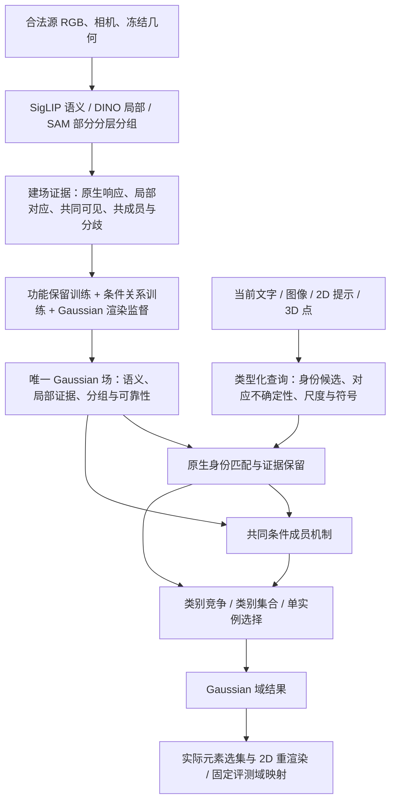

# v10 能力迁移与理想架构的融合方案

2026-10-08。决策见 [ADR0014](../adr/0014-v10-capability-transfer-within-one-gaussian-field.md)。
这是当前研究设计与验收账本，不是已经实现完整性能的声明。

## 保持初心，调整不足

核心仍是：**在建场阶段吸收多视图教师能力，形成一份场景特定的 Gaussian
能力场；查询时由当前输入与这个场共同推断目标及其成员，2D/3D 消费同一结果。**
不把 v10 的多个任务求解器重新接回来，也不把“统一”简化成所有任务只能使用一个
失去语义含义的标量。允许受保护的结构化子空间、必要的多模态局部表示、场景特定
小解码器，以及明确的类别／集合／实例读出。每项容量必须解释保留什么证据。



原生功能训练已补上首个可执行实现，见下文第三轮；多模态局部表示尚未完成，
不能把整张图当作已验证的方法或足够容量上限。
双向匹配与排名融合的纯算子已经落地，且完成全部67图像的固定场对照：
[首轮迁移结果](../experiments/2026-10-08-native-identity-transfer-results.md)。
部分身份能力恢复，但 IoU 提升的区间跨零，尚未晋升或实现完整性能。

## 第二轮已实现的共同版本

`radio_gs.query_field.runtime.QueryFieldRuntime` 是独立运行入口。它加载原有的
`field.pt + manifest.json`，接收 `QueryPacket`，并提供 `category_partition`。
四种输入继续使用 `NativeQueryEncoder` 和注册点适配器；运行入口没有源数据加载器。
同一套程序、同一跨视图训练配方用于所有场景，未按任务或场景选择获胜模型。

**建场训练从单视图成员拟合扩展到部分跨视图关系。** 对一个源区域选取可靠内部
Gaussian 锚点，利用其在其它训练视图的几何贡献查找共同支持。只接受内部投影质量
至少一半、物理尺度比在 `[0.5, 2]` 内的区域；先在视图内归一化，再均匀采样有支持的
其它视图。部分正证据和可信排除各自保留权重；未观测处不参与损失，冲突不硬化成负例。
主视图和辅助视图都由**同一个原始锚点**条件化共同成员机制，分别经过实际 subset-alpha
渲染监督，各占一半损失。每个合法训练区域完整遍历两次，不更新语义、局部、几何或
候选域缓冲区。没有第二视图支持时重复原视图，并明确计数。

配对控制看到完全相同的区域、视图、目标、尺度和步数，仅让辅助视图使用自己的内部
锚点。这使“增加训练量和改变区域曝光”与“保留同一锚点的跨视图条件”可以分别比较。
这还不是完整对象监督：关联来自粗投影和部分 SAM 区域，可能漏掉可见关系或错误关联。

**图像实例保留原生身份证据直至范围选择。** 先在全部合法候选域对 SigLIP 与 DINO
匹配分数分别排名融合，按既定规则保留八个空间候选；每个候选都使用共同成员机制生成
Gaussian 集合，再计算集合与当前图像 patch 的双向匹配。原生语义排名与该匹配共同
选择一个成员假设。候选不是硬正提示；无有效集合时返回空集。当前集合里的局部描述
仍然是已融合的 Gaussian 向量，不能冒称恢复了 v10 的完整源 patch 信息。

**类别分区恢复原生语义竞争。** 完整类别菜单的原生 cosine 经固定温度100得到 `p`，
共同成员支持 `m` 形成 `p + p(1-p)m`。结构只能提供有界支持，强语义证据不被独立实例
亲和直接替代。此温度来自 v10 的既有 ScanNet 配方；这个组合是新适配，不是 v10
求解器，也不是已校准后验。15/10类报告从完整菜单结果取列，未知 Gaussian 保持 void。

本轮在30个场景上完成两组训练和全部五项及 UQIS 四输入验证，保留父模型、
配对控制、跨视图单项、类型化读出和固定组合的结果。完整结果见
[关系训练与共同程序](../experiments/2026-10-08-cross-view-relation-results.md)：
图像与类别能力恢复较明显，但成员范围进展有限，LERF实际选集出现退化，尚不晋升默认模型。
后验参数块互换进一步发现：figurines只换新分组编码实际IoU43.85%，只换新共享解码参数21.59%，
父模型41.79%。这支持优先检验分组学习与共享尺度／亲和接受范围的训练职责分离，
而非丢弃已学表示。后续五项验证已经完成：回退恢复了该场景，但其它场景并不一致，
训练时冻结也未优于事后回退，见[保护与功能建场结果](../experiments/2026-10-08-protected-native-results.md)。
协议分别见
[关系训练](../experiments/2026-10-08-cross-view-relation-protocol.md)、
[类别读出](../experiments/2026-10-08-typed-category-evidence-protocol.md) 与
[共同程序](../experiments/2026-10-08-common-query-program-protocol.md)。

调用示例（查询编码器是共享依赖，场景文件不包含源图像）：

```python
from radio_gs.query_field.runtime import QueryFieldRuntime
from radio_gs.query_field.adapters import NativeQueryEncoder, point_3d

runtime = QueryFieldRuntime.load(scene_export, "cuda")
encoder = NativeQueryEncoder(siglip_checkpoint, "cuda")
text_result = runtime.query(encoder.text("a red chair"))
image_result = runtime.query(encoder.image(current_reference_image))
point_result = runtime.query(point_3d(runtime, current_world_point))
```

## 成功经验与迁移验收

第三轮把建场优化拆成两个受保护的职责：源区域关系更新 Gaussian 分组编码，
原生查询功能更新语义／局部坐标。共享尺度门控、温度和亲和接受偏置作为独立参数块，
分别用回退原参数、训练时冻结两个控制检验，不能因一个场景的失败就断言全局应永久冻结。

`functional_training.py` 用合法源区域生成语义、局部伪查询，拟合教师在可靠像素对上的
软偏好。Gaussian 原生 cosine 必须先计算再投影，避免训练一个与部署不同的归一化函数。
局部教师提供实际相似度差；SAM 只界定可靠比较区域，不把同一对象所有纹理强制当作相似。
全维仿射残差以恒等映射初始化，并用方向保持项约束改变，随后写回原场的原生坐标。
几何、分组、共享成员参数及支持域保持不变，部署没有额外源库或第二套场景状态。

这个实现补上了“平均特征之后从未优化查询功能”的缺口，但全局仿射残差无法逆转任意
局部多模态混合，因此不能冒充高容量 B，也不能把源伪查询拟合改善等同于真实查询恢复。
三组均用既定共同查询程序跑全部五项；参数、训练／留出规则及归因对照见
[保护与功能建场协议](../experiments/2026-10-08-protected-native-protocol.md)。

三组完整结果已经给出负面约束：源留出偏好误差下降不等于真实查询恢复，原生更新也
不会改变当前注册点成员路径。[逐 Gaussian 原生坐标对照](../experiments/2026-10-08-native-coordinate-results.md)
也已跑完全部30场、五项与268个UQIS输入。它保留同一场、源功能目标和推理程序，
直接优化原生坐标，不引入源查询库。相对保护组，LERF实际选集32.8763→34.8311%、
ScanNet10 45.4731→46.3277%，但LERF2D 52.2864→50.5530%、UQIS图像20.4974→19.4973%。
语义源偏好在29/30场改善，仍未获得一致迁移；逐元素自由度并未单独解决功能保留。
优化器与参数化不同、平均仅86.32%已观测元素参与更新，因此不是充分优化的纯容量对照。
这四组均不晋升默认模型，不能按任务挑不同赢家形成虚假的共同版本。

后续成员工作须检查观测不均衡、元素关系监督与渲染监督的差别，以及原生／几何证据
在条件成员机制中的作用。具体优先级是：先固定正确注册支持，检验共同成员函数能否
利用场内原生局部证据、相对几何和可靠共同观测纠正漏选／多选；再让推断身份以其
不确定性条件化同一函数。源关系监督只使用已证实的部分正证据和可信排除，嵌套、
遮挡及冲突保留未知。原生／几何条件与部分元素关系已完成下述全量检验；真正的成对共同可见统计仍未完成。
功能建场同时需要检验真实文字／裁剪patch对应的查询行为，不能只用源区域／单像素
伪查询的偏好KL作为验收。继续保护一份场与共同成员核心，不接回标注v10头或源库求解器。

本轮已完成成员部分的首个全量实现与检验，固定设计见[元素关系协议](../experiments/2026-10-08-element-relation-protocol.md)。
`element_relation_training.py` 将同一配对区域的可靠投影转换成部分 Gaussian 关系，
分别保留正质量、负质量和未知，以逐元素软监督检查渲染目标之外的学习缺口。
`conditional_relation.py` 在原成员logit上加入零初始化的小残差，读取场内分组、
原生语义／局部匹配、相对几何和一个观测可信度标量；所有输入仍调用同一成员函数。
旧原生坐标、几何和共享接受参数不变。单改监督与加入条件解码两个对照均从原父场
开始，核对上一保护组的完整源配对trace。
[完整结果](../experiments/2026-10-08-element-relation-results.md)显示：条件成员将 NVOS
响应 57.9518→74.6098%，但 LERF2D 52.2864→16.9454%、实际选集 32.8763→9.4783%。
正确点支持下的召回提升被精确率下降抵消；源 BCE 下降不能替代范围校准。两组均不晋升，
不按任务拼接。下一项是相同原父场、源配对与采样下的元素／实际选集渲染联合训练；
原生和几何信息保留，新增渲染约束的价值按[联合训练协议](../experiments/2026-10-08-joint-relation-protocol.md)完整检验。
共同训练实现已加入实际渲染 logit 梯度覆盖和两类源开发误差审计，结果尚待全量验收。

这个改动也改变了后续优化的依赖关系：注册点的成员函数现在读取原生语义／局部特征。
此前“原生更新不会改变点输出”的实验证据只适用于旧成员核，不能沿用到新的条件场。
后续功能保留或多模态表示更新，必须重新验证点输入、负提示及全部五项；保护原生参数
的训练职责，不等于声称解码后的各项能力彼此独立。

| 能力 | 历史证据与边界 | 当前缺口 | 新架构中的承接方式与检验 |
|---|---|---|---|
| 原生查询代数 | bias 与 decoded norm 必须配套；代数精确不保证语义能力 | 代数已继承，均值建场丢失功能 | 保护式写入继续保留；建场检验响应排序、查询干预、跨视图留出检索，特征 cosine 只作诊断 |
| 图像局部身份 | 同源／同教师双向 patch 比区域均值约 +4.14pp IoU；v10 使用双路排名 | 单元素均值、单向 patch 最大值和原始分数平均 | 先精确移植匹配与排名原语，再检验 Gaussian 集合是否保留足够局部证据；不足时修建场与表示 |
| 条件完整成员 | 真实部署观测训练比合成观测约 +9.62pp 点查询 IoU；含22房间3D标签 | 当前部分 SAM 单视图目标不能代表完整对象；仅相似度和距离 | 从合法源观测学习共同可见、分组一致／分歧、几何关系；正确输入支持与推断支持分开验收，不偷用标注模型 |
| 图像身份到范围 | 固定原生身份，已有成员头让图像 IoU34.8762→39.8980 | 两个阶段均弱，且身份选择后证据丢失 | 先修已知身份范围，再让身份条件持续参与候选／尺度选择；不把估计点硬标为正 |
| 类别分区与集合 | v10 保留任务含义；当前同场 native19=36.95%而成员竞争22.29% | 独立实例亲和被当作类别后验 | 原生类别证据参与完整菜单竞争，共同结构辅助归属；同时报告类别分区和实例集合，不用平均成绩遮蔽退化 |
| 正参考与有符号输入 | v10 NVOS 使用正提示派生参考 SAM 与源 tracks | 当前原始正负 scribble 信息条件不同 | 标准轨先保住提示及完整成员；源辅助扩展经同一核心单列输入与成本，不混入标准轨 |
| 实际选集可渲染性 | 归一化响应不等于移除其它 Gaussian 后的 alpha | 已沿用实际 subset-alpha 训练与评分，但响应/选集仍分化 | 两种输出均验收，保持几何和 opacity 冻结；禁止只优化好看的二维响应 |
| 可见性与观测平衡 | v10 不把未共同可见当负例，嵌套 mask 不等于独立视图票数 | 场中只有粗 observed 与有限分组编码 | 关系监督记录有效共同观测及不确定性，按视图平衡；重复区域/视图不能无故增加确信 |

历史失败也要迁移：高重构 cosine 不保证高查询精度；区域响应先算后融合的试验
有局部收益但未进入 v10；粗统计查询头未稳定胜出；能量均值、负提示最大排除和
单纯聚合改动也已有失败。不能把这些失败方案写成 v10 的成功组件。

## 训练对象需要改变

1. **功能保留**：用合法源区域、源图像局部块及跨视图伪查询监督“该查询如何排序和
   对应”，不只拟合平均向量。查询构造与验证视图隔离；教师自身生成的伪查询高分
   不能当独立真值。建场容量足够后再讨论压缩。
2. **条件关系**：已知正支持下学习尺度相关的成员与边界；利用多视图部分正证据、
   可信排除、嵌套分歧和共同可见。跨视图关联有冲突和未知状态，不能硬凑完整伪实例。
3. **查询与身份**：以受控的正确支持保留为前提，再加入图像、文字、注册 ray 条件。
   学习范围的过程不能覆盖或擅自替换原生身份；也不能期待局部成员头自动纠正所有错身份。
4. **任务读出**：类别分区、并集和单实例共享表示及关系，但优化其实际输出语义；
   类别 logits、身份 ranks、member scores 分别记录并单独校准。

保护式写入的含义也要准确：原生通道可以在独立建场阶段接受合法的功能监督；
“保护”约束后续分组训练不能任意改坏已成立的语义与局部匹配，不是永远冻结首次
均值融合的错误结果。每次更新原生表示，必须重验相关查询与 codec 配对。

## 性能恢复顺序与不混淆的比较

- A：保存的 v10 及其真实资源、监督和输入。维持最终体验目标。
- B：同一三教师、合法源、监督和几何条件下的足够容量能力参照，尚未完整建立。
  当前“全维但已平均”的场不能直接冒充 B 的能力上限。
- C：单 Gaussian 场及共同条件成员机制。先对 B 查表征／学习损失，再对 A 报告总差距。
- D：后续紧凑版本；当前不开展。

先完成固定场图像证据对照，随后补 B 和建场功能保留；条件成员与类型化类别读出是
另外两个明确工作包，不等待图像分数完全追平才处理。源帧预算、MaskAdapter 移除、
额外3D监督移除、NVOS 输入差异各自保留独立控制，不能把交互效应相加冒充归因。
正式恢复结论要求完整五项与 UQIS 四模态共同复测，不能只提升图像或只报告 AP。

固定父模型完整基线与最终能力目标如下，单位均为百分数；第二轮共同版本见上面的完整结果。
A 与父模型存在已披露契约
差异；这些目标不能当成已证明可达的保证，也不能用 B→C 保留率掩盖 A→C 的总差距。

| 本地保留协议 | 固定父模型 | v10 能力目标 A |
|---|---:|---:|
| LERF2D IoU | 49.4130 | 70.4007 |
| LERF3D 实际选集投影 IoU（不是独立3D真值） | 32.3130 | 66.9633 |
| ScanNet19 /15 /10 mIoU | 22.2853 /23.3694 /26.5462 | 61.0115 /62.5276 /72.4861 |
| NVOS 响应 IoU（正负原始提示 vs v10正参考扩展） | 57.6865 | 86.5134 |
| UQIS 文字 /图像实际集合 IoU | 12.0755 /15.9861 | 16.3865 /39.8980 |
| UQIS 2D点 /3D点实际集合 IoU | 28.3732 /27.6913 | 49.7357 /49.0470 |

实施按三个可独立定位、最终共同整合的工作包推进：

| 工作包 | 先固定的条件 | 首要判据 | 失败后的合理动作 |
|---|---|---|---|
| 建场证据保留 | 教师、训练源帧、几何、查询与对应范围 | 保留原生排序及局部对应；留出源视图与真实查询分别报告 | 区分投影混合、跨视图平均和表示容量；只为已确认的信息缺失增加容量 |
| 条件成员学习 | 正确支持、源监督、输出域及评测尺度条件 | 正确支持下的完整范围、精确率／召回、实际选集；同时测LERF多选与NVOS漏选 | 修正多视图关系与范围监督；不能靠更换身份头绕过已知身份仍失败的问题 |
| 身份条件与类型化读出 | 固定前两者，不改变输入许可 | UQIS四输入与ScanNet类别竞争同时保留；估计点不强制正 | 检验身份候选遗漏、语义证据丢失、类别分数含义；不用每任务旧求解器救分 |

每个工作包先有单因素或清晰标注耦合因素的对照；共同版本再跑完整五项。若发生
有理由的架构调整，更新同一 ADR 与能力账本，避免堆积只有名称、没有验证责任的分支。

论文候选问题是：**如何把异构多视图证据编译成可保留查询功能、可条件解码的
单 Gaussian 场，而非存储逐任务答案或在查询时重新解题。** 这仍需方法消融和
独立评测支持；“三教师＋一个场”本身不是新颖性证明。

## 依据

- [附件实施计划](/root/.codex/attachments/2fcb3d6d-9def-4b0f-b7cd-d8d583be658d/RADIO_GS_研究收敛与实施计划_20261006.docx)：设计参考，文内旧执行限制不覆盖用户后续推进授权。
- [局部对应](../experiments/2026-10-05-uqis-local-correspondence.md)
- [真实成员训练](../experiments/2026-10-06-scene-binding-and-real-membership.md)
- [v10实际收敛与失败查询头](../experiments/2026-10-06-query-conditioned-membership-and-system-convergence.md)
- [五项完整结果](../experiments/2026-10-08-five-benchmark-results.md)
- [全量架构归因](../experiments/2026-10-08-architecture-attribution-results.md)
