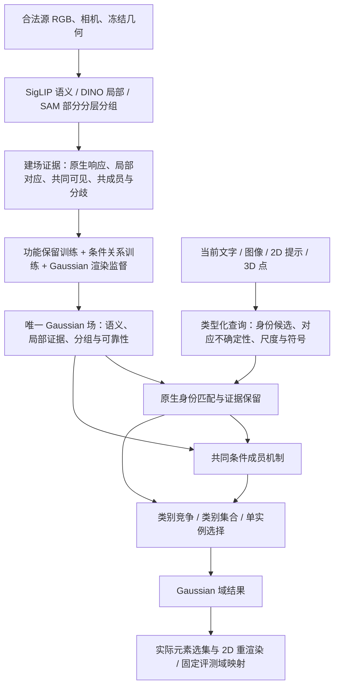

# v10 能力迁移与理想架构的融合方案

2026-10-08。决策见 [ADR0014](../adr/0014-v10-capability-transfer-within-one-gaussian-field.md)。
这是当前研究设计与验收账本，不是已经实现完整性能的声明。

## 保持初心，调整不足

核心仍是：**在建场阶段吸收多视图教师能力，形成一份场景特定的 Gaussian
能力场；查询时由当前输入与这个场共同推断目标及其成员，2D/3D 消费同一结果。**
不把 v10 的多个任务求解器重新接回来，也不把“统一”简化成所有任务只能使用一个
失去语义含义的标量。允许受保护的结构化子空间、必要的多模态局部表示、场景特定
小解码器，以及明确的类别／集合／实例读出。每项容量必须解释保留什么证据。

其中功能训练、丰富关系训练及新的类型化读出尚未完成；现有实现是其薄弱原型。
双向匹配与排名融合的纯算子已经落地，且完成全部67图像的固定场对照：
[首轮迁移结果](../experiments/2026-10-08-native-identity-transfer-results.md)。
部分身份能力恢复，但 IoU 提升的区间跨零，尚未晋升或实现完整性能。

## 成功经验与迁移验收

| 能力 | 历史证据与边界 | 当前缺口 | 新架构中的承接方式与检验 |
|---|---|---|---|
| 原生查询代数 | bias 与 decoded norm 必须配套；代数精确不保证语义能力 | 代数已继承，均值建场丢失功能 | 保护式写入继续保留；建场检验响应排序、查询干预、跨视图留出检索，特征 cosine 只作诊断 |
| 图像局部身份 | 同源／同教师双向 patch 比区域均值约 +4.14pp IoU；v10 使用双路排名 | 单元素均值、单向 patch 最大值和原始分数平均 | 先精确移植匹配与排名原语，再检验 Gaussian 集合是否保留足够局部证据；不足时修建场与表示 |
| 条件完整成员 | 真实部署观测训练比合成观测约 +9.62pp 点查询 IoU；含22房间3D标签 | 当前部分 SAM 单视图目标不能代表完整对象；仅相似度和距离 | 从合法源观测学习共同可见、分组一致／分歧、几何关系；正确输入支持与推断支持分开验收，不偷用标注模型 |
| 图像身份到范围 | 固定原生身份，已有成员头让图像 IoU34.8762→39.8980 | 两个阶段均弱，且身份选择后证据丢失 | 先修已知身份范围，再让身份条件持续参与候选／尺度选择；不把估计点硬标为正 |
| 类别分区与集合 | v10 保留任务含义；当前同场 native19=36.95%而成员竞争22.29% | 独立实例亲和被当作类别后验 | 原生类别证据参与完整菜单竞争，共同结构辅助归属；同时报告类别分区和实例集合，不用平均成绩遮蔽退化 |
| 正参考与有符号输入 | v10 NVOS 使用正提示派生参考 SAM 与源 tracks | 当前原始正负 scribble 信息条件不同 | 标准轨先保住提示及完整成员；源辅助扩展经同一核心单列输入与成本，不混入标准轨 |
| 实际选集可渲染性 | 归一化响应不等于移除其它 Gaussian 后的 alpha | 已沿用实际 subset-alpha 训练与评分，但响应/选集仍分化 | 两种输出均验收，保持几何和 opacity 冻结；禁止只优化好看的二维响应 |
| 可见性与观测平衡 | v10 不把未共同可见当负例，嵌套 mask 不等于独立视图票数 | 场中只有粗 observed 与有限分组编码 | 关系监督记录有效共同观测及不确定性，按视图平衡；重复区域/视图不能无故增加确信 |

历史失败也要迁移：高重构 cosine 不保证高查询精度；区域响应先算后融合的试验
有局部收益但未进入 v10；粗统计查询头未稳定胜出；能量均值、负提示最大排除和
单纯聚合改动也已有失败。不能把这些失败方案写成 v10 的成功组件。

## 训练对象需要改变

1. **功能保留**：用合法源区域、源图像局部块及跨视图伪查询监督“该查询如何排序和
   对应”，不只拟合平均向量。查询构造与验证视图隔离；教师自身生成的伪查询高分
   不能当独立真值。建场容量足够后再讨论压缩。
2. **条件关系**：已知正支持下学习尺度相关的成员与边界；利用多视图部分正证据、
   可信排除、嵌套分歧和共同可见。跨视图关联有冲突和未知状态，不能硬凑完整伪实例。
3. **查询与身份**：以受控的正确支持保留为前提，再加入图像、文字、注册 ray 条件。
   学习范围的过程不能覆盖或擅自替换原生身份；也不能期待局部成员头自动纠正所有错身份。
4. **任务读出**：类别分区、并集和单实例共享表示及关系，但优化其实际输出语义；
   类别 logits、身份 ranks、member scores 分别记录并单独校准。

保护式写入的含义也要准确：原生通道可以在独立建场阶段接受合法的功能监督；
“保护”约束后续分组训练不能任意改坏已成立的语义与局部匹配，不是永远冻结首次
均值融合的错误结果。每次更新原生表示，必须重验相关查询与 codec 配对。

## 性能恢复顺序与不混淆的比较

- A：保存的 v10 及其真实资源、监督和输入。维持最终体验目标。
- B：同一三教师、合法源、监督和几何条件下的足够容量能力参照，尚未完整建立。
  当前“全维但已平均”的场不能直接冒充 B 的能力上限。
- C：单 Gaussian 场及共同条件成员机制。先对 B 查表征／学习损失，再对 A 报告总差距。
- D：后续紧凑版本；当前不开展。

先完成固定场图像证据对照，随后补 B 和建场功能保留；条件成员与类型化类别读出是
另外两个明确工作包，不等待图像分数完全追平才处理。源帧预算、MaskAdapter 移除、
额外3D监督移除、NVOS 输入差异各自保留独立控制，不能把交互效应相加冒充归因。
正式恢复结论要求完整五项与 UQIS 四模态共同复测，不能只提升图像或只报告 AP。

当前完整基线与最终能力目标如下，单位均为百分数。A 与当前场存在已披露契约
差异；这些目标不能当成已证明可达的保证，也不能用 B→C 保留率掩盖 A→C 的总差距。

| 本地保留协议 | 当前场 | v10 能力目标 A |
|---|---:|---:|
| LERF2D IoU | 49.4130 | 70.4007 |
| LERF3D 实际选集投影 IoU（不是独立3D真值） | 32.3130 | 66.9633 |
| ScanNet19 /15 /10 mIoU | 22.2853 /23.3694 /26.5462 | 61.0115 /62.5276 /72.4861 |
| NVOS 响应 IoU（正负原始提示 vs v10正参考扩展） | 57.6865 | 86.5134 |
| UQIS 文字 /图像实际集合 IoU | 12.0755 /15.9861 | 16.3865 /39.8980 |
| UQIS 2D点 /3D点实际集合 IoU | 28.3732 /27.6913 | 49.7357 /49.0470 |

实施按三个可独立定位、最终共同整合的工作包推进：

| 工作包 | 先固定的条件 | 首要判据 | 失败后的合理动作 |
|---|---|---|---|
| 建场证据保留 | 教师、训练源帧、几何、查询与对应范围 | 保留原生排序及局部对应；留出源视图与真实查询分别报告 | 区分投影混合、跨视图平均和表示容量；只为已确认的信息缺失增加容量 |
| 条件成员学习 | 正确支持、源监督、输出域及评测尺度条件 | 正确支持下的完整范围、精确率／召回、实际选集；同时测LERF多选与NVOS漏选 | 修正多视图关系与范围监督；不能靠更换身份头绕过已知身份仍失败的问题 |
| 身份条件与类型化读出 | 固定前两者，不改变输入许可 | UQIS四输入与ScanNet类别竞争同时保留；估计点不强制正 | 检验身份候选遗漏、语义证据丢失、类别分数含义；不用每任务旧求解器救分 |

每个工作包先有单因素或清晰标注耦合因素的对照；共同版本再跑完整五项。若发生
有理由的架构调整，更新同一 ADR 与能力账本，避免堆积只有名称、没有验证责任的分支。

论文候选问题是：**如何把异构多视图证据编译成可保留查询功能、可条件解码的
单 Gaussian 场，而非存储逐任务答案或在查询时重新解题。** 这仍需方法消融和
独立评测支持；“三教师＋一个场”本身不是新颖性证明。

## 依据

- [附件实施计划](/root/.codex/attachments/2fcb3d6d-9def-4b0f-b7cd-d8d583be658d/RADIO_GS_研究收敛与实施计划_20261006.docx)：设计参考，文内旧执行限制不覆盖用户后续推进授权。
- [局部对应](../experiments/2026-10-05-uqis-local-correspondence.md)
- [真实成员训练](../experiments/2026-10-06-scene-binding-and-real-membership.md)
- [v10实际收敛与失败查询头](../experiments/2026-10-06-query-conditioned-membership-and-system-convergence.md)
- [五项完整结果](../experiments/2026-10-08-five-benchmark-results.md)
- [全量架构归因](../experiments/2026-10-08-architecture-attribution-results.md)
